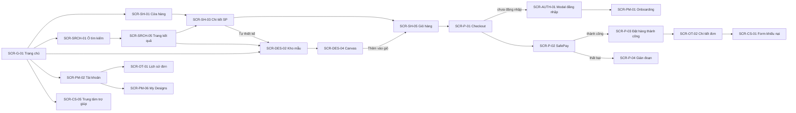
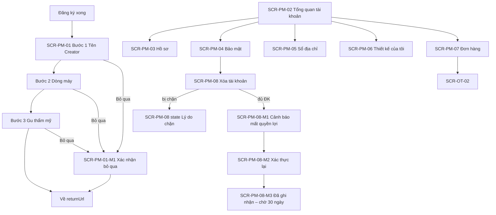
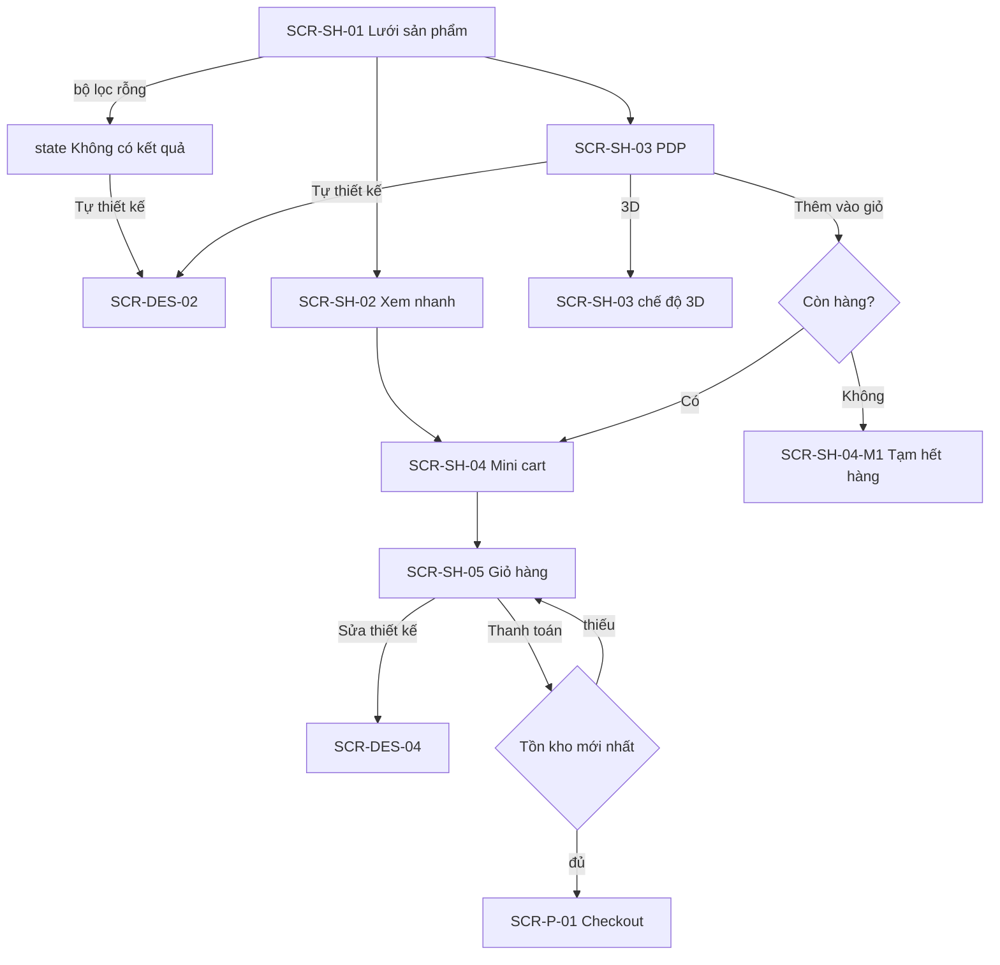
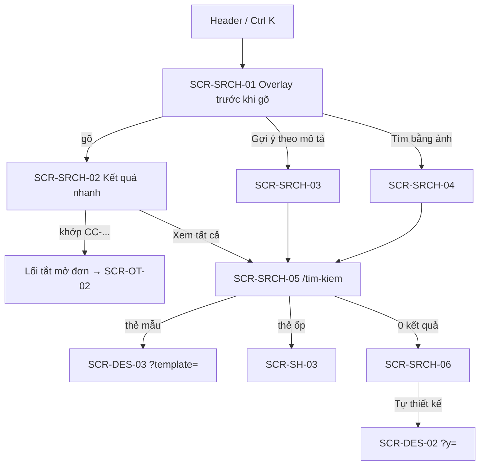
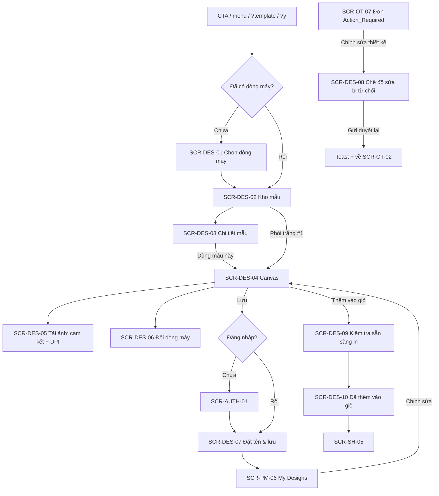
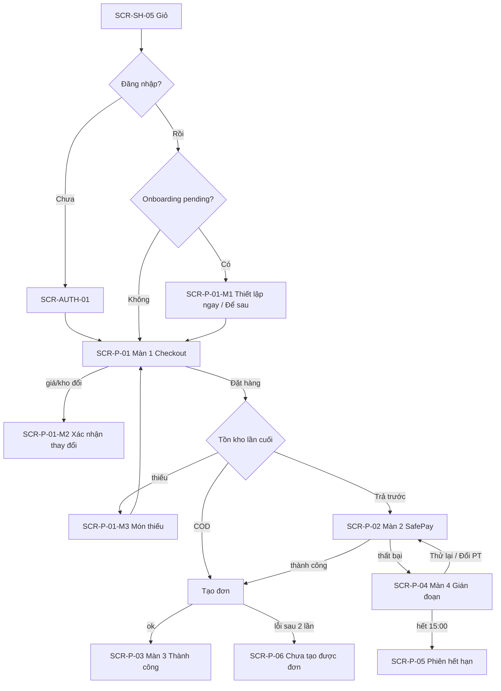
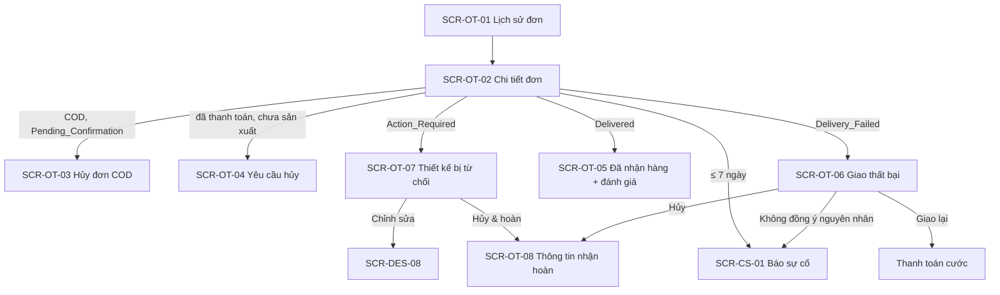
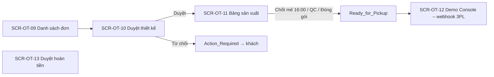
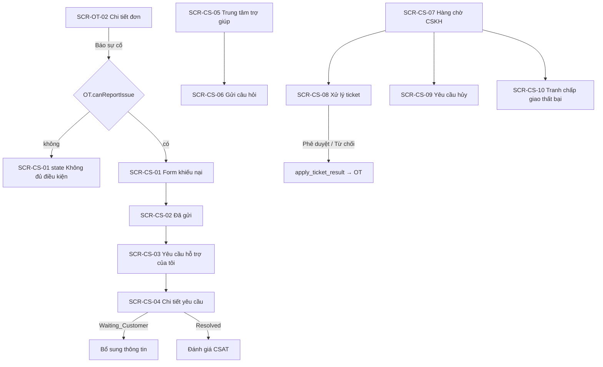

# SCREENFLOW CHI TIẾT – casEYES (đặc tả cho AI prototype & thiết kế Figma)

> **Nguồn:** Chương 3 – Phân tích nghiệp vụ (BRD/SRD, UC, User story, BPMN, Class diagram) của casEYES.
> **Mục đích:** Mô tả đầy đủ các màn hình (screen), trạng thái (state) và luồng chuyển màn (flow) của 8 chức năng để AI (Figma AI / Make / v0 / Claude) dựng prototype có thể click được.
> **Cách dùng với AI:** Mỗi khối `SCR-…` là một frame độc lập. Dán **Phần 0 (bối cảnh & design system)** + **khối màn hình cần dựng** vào prompt. Mỗi khối đã có: mục đích, route, layout từ trên xuống, thành phần, dữ liệu mẫu, các trạng thái, hành động → màn đích, microcopy tiếng Việt.

---

## 0. Bối cảnh chung cho AI

### 0.1. Sản phẩm

- **casEYES** – website thương mại điện tử bán **ốp lưng điện thoại**: (1) **hàng có sẵn** (IN_STOCK – ốp in sẵn, phụ kiện) và (2) **ốp in theo thiết kế riêng** (CUSTOM – Print on Demand, thiết kế trên Canvas, giá **250.000₫**).
- Đối tượng: Gen Z – millennials Việt Nam, thích cá nhân hóa. Giọng văn: thân thiện, ngắn gọn, xưng "bạn", tiếng Việt có dấu.
- Hai khu vực giao diện:
  - **Storefront (khách hàng)** – responsive, ưu tiên **mobile 390×844** và **desktop 1440×900**.
  - **Khu quản trị `/admin/*` (Operator / CSKH / Admin)** – mức mock-up, **chỉ desktop 1440×900**, giao diện bảng/danh sách tối giản.
- Actor: Khách vãng lai, Khách thành viên, Operator, Nhân viên CSKH, Admin. Hệ thống ngoài (chỉ mô phỏng): Cổng thanh toán SafePay, Inventory, 3PL, Ngân hàng, Loyalty "Cosmic Club", Email/SMS/OTP, Google OAuth, AI CSKH.

### 0.2. Design system đề xuất (để AI dựng nhất quán)

| Token | Giá trị gợi ý | Ghi chú |
|---|---|---|
| Font | Be Vietnam Pro (UI), 14/16/20/24/32 | Hỗ trợ tiếng Việt tốt |
| Màu chính (Primary) | #5B3DF5 (tím vũ trụ) | Nút chính, link, tiến trình |
| Màu nhấn (Accent) | #FF6FB1 (hồng) | Nhãn NEW DROP, CTA "Tự thiết kế" |
| Nền | #FFFFFF / #F6F5FB | Thẻ, section |
| Chữ | #1B1A22 / #6B6A75 | Chính / phụ |
| Trạng thái | Success #1F9D55 · Warning #F59E0B · Error #E5484D · Info #3B82F6 | Toast, badge, viền lỗi |
| Bo góc | 12px (thẻ), 999px (chip, nút tròn) | |
| Lưới | Desktop 12 cột, gutter 24, max 1200; Mobile 4 cột, margin 16 | |
| Khoảng cách | 4/8/12/16/24/32/48 | |

**Thư viện component dùng lại (tạo trước trong Figma):** Header, Footer, Button (primary/secondary/ghost/danger, có trạng thái loading/disabled), Input/Select/Textarea (có lỗi + helper), Chip lọc, Badge trạng thái, Product card, Template card, Modal, Drawer, Toast, Stepper, Progress timeline 5 mốc, Empty state, Skeleton, Countdown, Table admin, Tabs, Breadcrumb.

**Quy tắc chung cho mọi màn:**
1. Mỗi màn có tối thiểu các trạng thái: **Default · Loading (skeleton) · Empty · Error (có nút Thử lại)**.
2. Nút thao tác quan trọng (Đặt hàng, Hủy, Đã nhận hàng, Gửi khiếu nại, Duyệt/Từ chối) **tự vô hiệu hóa ngay khi bấm** và hiện spinner (chống thao tác trùng).
3. Lỗi biểu mẫu hiển thị **ngay dưới trường**, giữ nguyên dữ liệu đã nhập.
4. Thao tác cần đăng nhập → mở **Modal đăng nhập theo ngữ cảnh** (SCR-AUTH-01), xong quay lại đúng chỗ.
5. Tiền tệ: `250.000₫`; ngày: `19/11/2026`; mã đơn: `CC-261119-0001`.

### 0.3. Quy ước mã màn hình

`SCR-<CHỨC NĂNG>-NN` – ví dụ `SCR-DES-04`. Modal/dialog gắn hậu tố `-M`, ví dụ `SCR-P-01-M2`. Mỗi màn ghi **BPMN / UC liên quan** để truy vết với Chương 3.

### 0.4. Sơ đồ điều hướng tổng thể (sitemap)



**Route chính (storefront):** `/` · `/shop` · `/shop/:id` · `/cart` · `/tim-kiem` · `/design-studio/templates` · `/design-studio` · `/checkout` · `/checkout/success` · `/checkout/failed` · `/auth/login` · `/auth/register` · `/auth/forgot-password` · `/auth/reset-password` · `/account` · `/account/onboarding` · `/order-tracking` · `/order-tracking/:code` · `/ho-tro` (Trung tâm trợ giúp) · `/ho-tro/yeu-cau`.

**Route quản trị:** `/admin/dang-nhap` · `/admin/don-hang` · `/admin/duyet-thiet-ke` · `/admin/san-xuat` · `/admin/mo-phong` · `/admin/hoan-tien` · `/admin/khach-rui-ro` · `/admin/cskh` · `/admin/cskh/:ticket` · `/admin/qc`.

---

## G. Thành phần toàn cục

### SCR-G-01 · Trang chủ (Landing)
- **Route:** `/` · **Actor:** mọi khách · **Liên quan:** BPMN-L0 (điểm bắt đầu "Có nhu cầu ốp lưng")
- **Layout:**
  1. Header (SCR-G-02).
  2. Hero: tiêu đề "Ốp lưng mang dấu ấn của riêng bạn", 2 CTA: **[Tự thiết kế ngay]** (accent) → SCR-DES-02, **[Mua ốp có sẵn]** → SCR-SH-01. Hình mockup ốp 3D.
  3. Dải "Chọn dòng máy của bạn" (chip iPhone 15 Pro Max, iPhone 15, Galaxy S24…) → SCR-SH-01 `?model=`.
  4. Section "BEST SELLER" (4–8 product card) → SCR-SH-03.
  5. Section "Mẫu đang được yêu thích" (template card) → SCR-DES-03.
  6. Section 3 bước "Chọn mẫu → Thiết kế → Nhận hàng" + cam kết (duyệt thiết kế trước khi in, giao đúng hạn).
  7. Footer (SCR-G-03).
- **Trạng thái:** Default · Loading (skeleton card).

### SCR-G-02 · Header
- Logo casEYES (→ `/`) · Menu: Cửa hàng · Thiết kế · Trợ giúp · **Ô tìm kiếm** (placeholder "Tìm ốp, mẫu, mã đơn… (Ctrl K)") → mở SCR-SRCH-01 · Icon Giỏ hàng có badge số lượng → SCR-SH-05 · Icon Thông báo (chuông, badge) → SCR-G-04 · Avatar/“Đăng nhập”.
- **Biến thể:** Khách vãng lai (nút "Đăng nhập") · Thành viên (avatar + dropdown: Tài khoản, Đơn hàng, Thiết kế của tôi, Yêu cầu hỗ trợ, Đăng xuất).
- Mobile: logo + icon tìm kiếm + giỏ + hamburger (drawer menu).

### SCR-G-03 · Footer
- Cột: Về casEYES · Chính sách đơn hàng (→ SCR-CS-05 bài chính sách) · Hỗ trợ · Mạng xã hội. Dòng bản quyền.

### SCR-G-04 · Trung tâm thông báo (dropdown/drawer)
- Danh sách thông báo trong ứng dụng (loại: đơn hàng, thiết kế, thanh toán, hỗ trợ), chấm xanh = chưa đọc, thời gian tương đối. Bấm → màn liên quan (SCR-OT-02, SCR-CS-04…). Empty: "Bạn chưa có thông báo nào".

### SCR-G-05 · Toast & banner hệ thống
- Toast 4 loại (success/info/warning/error), tự ẩn 4s, có nút hoàn tác khi xóa (6s).
- Banner cảnh báo: "Trình duyệt đang chặn lưu tạm – dữ liệu có thể mất. Đăng nhập để lưu an toàn." (FR-AUTH-EX-10).

---

## 1. AUTH – Xác thực tài khoản

**Luồng (theo BPMN-AUTH-01/02/03):**

```mermaid
flowchart TD
  A[Thao tác cần đăng nhập] --> M1[SCR-AUTH-01 Modal theo ngữ cảnh]
  M1 -->|Email| M1L[Tab Đăng nhập]
  M1 -->|Chưa có TK| M1R[Tab Đăng ký]
  M1 -->|Google| G[SCR-AUTH-04 Chuyển hướng Google]
  M1L -->|sai ≥5 lần| LK[SCR-AUTH-01 state Tạm khóa]
  M1L -->|đúng| SY[SCR-AUTH-09 Toast đồng bộ] --> BACK[Quay về returnUrl]
  M1R -->|thành công| SY2[Đồng bộ] --> ONB[SCR-PM-01 Onboarding]
  G -->|hủy| M1
  G -->|ok, TK mới| ONB
  G -->|ok, TK cũ| SY
  M1L -->|Quên mật khẩu?| F[SCR-AUTH-05] --> S[SCR-AUTH-06 Đã gửi] --> R[SCR-AUTH-07 Đặt lại MK] --> L[SCR-AUTH-02 Đăng nhập]
  R -->|link hết hạn| X[SCR-AUTH-08]
  AD[SCR-AUTH-10 Đăng nhập nhân viên] -->|admin| V[SCR-AUTH-11 Chọn góc nhìn] --> ADM[/admin/*]
  AD -->|customer| AD
```

### SCR-AUTH-01 · Modal Đăng nhập / Đăng ký theo ngữ cảnh
- **Loại:** Modal 480px (mobile: bottom sheet full) · **UC:** UC-AUTH-01, UC-AUTH-02 · **BPMN:** BPMN-AUTH-01 "Mở modal đăng nhập theo ngữ cảnh"
- **Tiêu đề động theo ý định** (CX touchpoint): "Đăng nhập để lưu thiết kế *Mèo mây*" / "Đăng nhập để thanh toán 3 sản phẩm" / "Đăng nhập để gửi khiếu nại" / mặc định "Chào mừng đến casEYES".
- **Layout:** Tiêu đề + dòng phụ lợi ích ("Bản nháp và giỏ hàng của bạn sẽ được giữ nguyên") → Tabs **Đăng nhập | Đăng ký** → nút **[Tiếp tục với Google]** → dải "hoặc" → form → nút chính → link phụ.
- **Tab Đăng nhập:** Email · Mật khẩu (icon hiện/ẩn) · link "Quên mật khẩu?" (→ SCR-AUTH-05) · **[Đăng nhập]**.
- **Tab Đăng ký:** Email · Mật khẩu (helper "Tối thiểu 8 ký tự, gồm chữ và số") · Xác nhận mật khẩu · **[Tạo tài khoản]**.
- **Trạng thái:**
  - Lỗi trường: "Email không đúng định dạng", "Mật khẩu xác nhận không khớp".
  - Lỗi đăng nhập chung: "Email hoặc mật khẩu không chính xác" (không lộ email tồn tại).
  - Email đã tồn tại (đăng ký): "Email này đã được đăng ký. Vui lòng đăng nhập hoặc khôi phục mật khẩu" + 2 link.
  - Tài khoản Google nhập mật khẩu: "Tài khoản này được đăng ký thông qua Google…" + nút Google + "Quên mật khẩu".
  - Tài khoản chờ xóa: "Tài khoản đang chờ xóa – đăng nhập để khôi phục" + [Khôi phục tài khoản].
  - **Tạm khóa:** sau 5 lần sai – khối cảnh báo + đồng hồ "Thử lại sau 14:59", nút đăng nhập disabled.
  - Loading: nút có spinner, form khóa.
  - Phiên hết hạn giữa chừng: dùng cùng modal, tiêu đề "Phiên đăng nhập đã hết hạn", dữ liệu biểu mẫu nền giữ nguyên.
- **Hành động:** Đóng (X) → giữ nguyên trang · Thành công → SCR-AUTH-09 rồi về returnUrl (đăng nhập) / SCR-PM-01 (đăng ký).

### SCR-AUTH-02 · Trang Đăng nhập (`/auth/login`)
- Cùng nội dung tab Đăng nhập của SCR-AUTH-01 nhưng dạng trang 2 cột (desktop: trái ảnh thương hiệu, phải form). Nhận tham số `returnUrl` (chỉ đường dẫn nội bộ).

### SCR-AUTH-03 · Trang Đăng ký (`/auth/register`)
- Dạng trang của tab Đăng ký. Thêm dòng nhỏ: "Bằng việc đăng ký, bạn đồng ý Điều khoản & Chính sách".
- State "Chờ xác nhận email" (nếu bật xác nhận): "Kiểm tra hộp thư để xác nhận tài khoản" + [Gửi lại email xác nhận] (đếm ngược 60s); quá 15 phút: "Không thể hoàn tất đăng ký" + [Gửi lại email xác nhận].

### SCR-AUTH-04 · Đang xác thực Google (overlay)
- Overlay mờ + spinner "Đang kết nối với Google…". Kết quả: thành công → đồng bộ; hủy/từ chối → quay lại modal + toast "Đăng nhập qua Google không thành công. Vui lòng thử lại."

### SCR-AUTH-05 · Quên mật khẩu (`/auth/forgot-password`)
- Tiêu đề "Quên mật khẩu?" · Email · **[Gửi liên kết khôi phục]** · link "Quay lại đăng nhập".
- Lỗi tần suất: "Bạn đã yêu cầu quá nhiều lần. Vui lòng thử lại sau ít phút."

### SCR-AUTH-06 · Đã gửi liên kết (thông báo trung lập)
- Icon thư · "Nếu email tồn tại trong hệ thống, bạn sẽ nhận được liên kết đặt lại mật khẩu trong vài phút." · [Mở ứng dụng email] · [Gửi lại] (đếm ngược).

### SCR-AUTH-07 · Đặt lại mật khẩu (`/auth/reset-password`)
- Mật khẩu mới + xác nhận + thanh đo độ mạnh · **[Lưu mật khẩu mới]** → toast "Đổi mật khẩu thành công, vui lòng đăng nhập lại" → SCR-AUTH-02.
- Chỉ mở bằng phiên khôi phục; người đang đăng nhập bình thường mở link này → chuyển SCR-PM-04 (tab Bảo mật).

### SCR-AUTH-08 · Liên kết hết hạn
- Icon cảnh báo · "Đường dẫn khôi phục đã hết hạn hoặc không hợp lệ" · [Gửi lại liên kết] → SCR-AUTH-05.

### SCR-AUTH-09 · Toast tóm tắt đồng bộ dữ liệu vãng lai
- Toast success lớn (6s): "Đã chuyển **2 bản thiết kế** và **3 sản phẩm** vào tài khoản". Biến thể có cảnh báo: "Ốp A chỉ còn 4 sản phẩm – số lượng đã được điều chỉnh".

### SCR-AUTH-10 · Đăng nhập nhân viên (`/admin/dang-nhap`)
- Desktop, nền tối giản, logo + nhãn "Khu quản trị". Email · Mật khẩu · **[Đăng nhập]**. Ghi chú: "Phiên nhân viên tách biệt với phiên mua sắm".
- Lỗi vai trò: "Tài khoản này không có quyền nhân viên." Lỗi chung: "Thông tin đăng nhập không đúng".
- Thành công: Operator → `/admin/don-hang`; CSKH → `/admin/cskh`; Admin → SCR-AUTH-11.

### SCR-AUTH-11 · Chọn góc nhìn (Admin)
- 3 thẻ lớn: **Operator** (duyệt thiết kế, sản xuất, mô phỏng giao vận) · **CSKH** (hàng chờ hỗ trợ) · **Admin** (hoàn tiền, khách rủi ro, thống kê). Trên header admin luôn có dropdown "Góc nhìn: …" để đổi nhanh.

---

## 2. PM – Quản lý hồ sơ

**Luồng (BPMN-PM-01, BPMN-PM-02):**



### SCR-PM-01 · Onboarding wizard (`/account/onboarding?flow=signup&returnUrl=`)
- **UC:** UC-PM-01 · **BPMN:** BPMN-PM-01 "Hiển thị wizard 3 bước"
- **Layout:** Stepper 3 bước trên cùng · thẻ nội dung giữa màn · thanh dưới: [Bỏ qua] (ghost, trái) · [Quay lại] · **[Tiếp tục]** / **[Hoàn tất]**.
- **Bước 1 – Tên Creator:** input điền sẵn tên hiển thị (2–40 ký tự, bắt buộc), xem trước "Xin chào, *Mây*!".
- **Bước 2 – Dòng máy (tùy chọn):** chọn Hãng (tabs Apple/Samsung/…) → lưới thẻ dòng máy có ảnh.
- **Bước 3 – Gu thẩm mỹ (tùy chọn):** chip chọn nhiều: #Cute, #Tối_giản, #Hoa_lá, #Abstract, #Anime-free style… (bộ từ vựng chung).
- **Trạng thái:** lỗi tên (<2 ký tự) · đang lưu · **lưu lỗi**: toast "Chưa lưu được, bạn có thể hoàn tất sau trong Tài khoản" rồi về returnUrl.
- **SCR-PM-01-M1 Xác nhận bỏ qua:** "Bỏ qua thiết lập? Bạn có thể hoàn tất bất cứ lúc nào trong Tài khoản." [Tiếp tục thiết lập] · [Bỏ qua].

### SCR-PM-02 · Tổng quan tài khoản (`/account`)
- **Layout desktop:** Sidebar trái (Tổng quan · Hồ sơ · Bảo mật · Sổ địa chỉ · Thiết kế của tôi · Đơn hàng · Yêu cầu hỗ trợ) · nội dung phải. Mobile: tab cuộn ngang.
- **Nội dung:** Thẻ chào "Xin chào, Mây" + avatar · **Thanh đo hoàn thiện hồ sơ** (vd 80%) + banner CTA "Hoàn thiện hồ sơ để nhận voucher" (ẩn khi đã nhận) · Thẻ "Đơn hàng gần nhất" (mã, trạng thái badge, EDD) → SCR-OT-02 · "Thiết kế đã lưu" (3 thumbnail) → SCR-PM-06 · Banner "Hoàn tất thiết lập" nếu onboarding = skipped → SCR-PM-01.

### SCR-PM-03 · Hồ sơ cá nhân
- **UC:** UC-PM-02. Ảnh đại diện (đổi ảnh) · Tên hiển thị · Ngày sinh (date picker, chặn tương lai, đủ 13 tuổi; **khóa** + tooltip "Liên hệ CSKH để sửa" sau khi đã nhận voucher) · Giới tính (Nam/Nữ/Khác) · Sở thích (chip) · Email & SĐT dạng chỉ đọc + nút [Đổi] · **[Lưu thay đổi]**.
- **Modal/state:**
  - **SCR-PM-03-M1 Đổi email/SĐT + OTP:** nhập giá trị mới → [Gửi mã] → 6 ô OTP + đếm ngược → thành công: toast + "Đã gửi cảnh báo bảo mật tới email/SĐT cũ".
  - **SCR-PM-03-M2 Rời trang khi chưa lưu:** "Bạn có thay đổi chưa lưu" [Lưu] · [Tiếp tục sửa] · [Hủy thay đổi].
  - **Xung đột phiên bản:** banner vàng "Hồ sơ vừa được cập nhật ở nơi khác. Đã tải dữ liệu mới nhất."
  - **Mất mạng:** form đóng băng, banner "Mất kết nối – dữ liệu của bạn vẫn được giữ" + [Thử lại].
  - **Đạt 100% lần đầu:** modal chúc mừng + mã voucher PROFILE_COMPLETE + [Sao chép mã].

### SCR-PM-04 · Bảo mật
- Đổi mật khẩu: Mật khẩu hiện tại · Mật khẩu mới · Xác nhận · [Cập nhật] (lỗi: "Mật khẩu hiện tại không đúng", "Mật khẩu mới phải khác mật khẩu cũ"). Tài khoản Google: hiển thị "Đăng nhập bằng Google" + [Tạo mật khẩu riêng].
- Vùng nguy hiểm (viền đỏ): "Xóa tài khoản" + [Xóa tài khoản] → SCR-PM-08. Ẩn với tài khoản nhân viên (hiện "Liên hệ Admin").

### SCR-PM-05 · Sổ địa chỉ
- **UC:** UC-PM-04. Danh sách thẻ địa chỉ (tên người nhận, SĐT, địa chỉ đầy đủ, badge "Mặc định") · mỗi thẻ: [Sửa] [Đặt mặc định] [Xóa] · nút **[+ Thêm địa chỉ]**.
- **SCR-PM-05-M1 Form địa chỉ (modal):** Họ tên người nhận · SĐT · Tỉnh/Thành → Quận/Huyện → Phường/Xã (select phụ thuộc) · Số nhà, tên đường · ☐ Đặt làm mặc định · [Lưu].
- **SCR-PM-05-M2 Xác nhận xóa:** "Xóa địa chỉ này? Đơn đã đặt không bị ảnh hưởng."
- Empty: minh họa + "Chưa có địa chỉ nào" + [Thêm địa chỉ đầu tiên].

### SCR-PM-06 · Thiết kế của tôi (My Designs)
- Lưới thẻ bản vẽ: thumbnail, tên, dòng máy, "Sửa lần cuối 2 giờ trước" · menu ⋯: Chỉnh sửa (→ SCR-DES-04), Nhân bản, Đổi tên, Xóa · nút [+ Thiết kế mới] → SCR-DES-02. Bộ lọc dòng máy, sắp xếp.
- Empty: "Bạn chưa có bản thiết kế nào" + [Bắt đầu thiết kế]. Error: [Thử lại].

### SCR-PM-07 · Đơn hàng (rút gọn)
- 5 đơn gần nhất dạng danh sách (mã, ngày, tổng, badge trạng thái) + link [Xem tất cả] → SCR-OT-01.

### SCR-PM-08 · Xóa tài khoản
- **UC:** UC-PM-03 · **BPMN:** BPMN-PM-02.
- **Bước kiểm tra (loading):** "Đang kiểm tra điều kiện xóa tài khoản…".
- **State Bị chặn:** tiêu đề "Chưa thể xóa tài khoản" + danh sách lý do, mỗi lý do có link xử lý: "Còn 1 đơn chưa hoàn tất – CC-261119-0001 →", "Có 1 yêu cầu hoàn tiền đang xử lý →", "Có 1 yêu cầu hỗ trợ đang mở →".
- **SCR-PM-08-M1 Cảnh báo mất quyền lợi:** "Điểm Cosmic Club (1.250 điểm) và 2 voucher chưa dùng sẽ bị hủy vĩnh viễn." ☐ Tôi hiểu · [Tiếp tục].
- **SCR-PM-08-M2 Xác thực lại:** Mật khẩu (hoặc OTP email với tài khoản Google). Sai 5 lần: "Chức năng xóa tạm khóa 15 phút".
- **SCR-PM-08-M3 Đã ghi nhận:** "Tài khoản sẽ bị xóa sau 30 ngày (19/12/2026). Đăng nhập lại trước thời hạn để khôi phục." → đăng xuất về trang chủ.
- Banner khi đăng nhập lại trong 30 ngày: "Tài khoản đã được khôi phục" (toast success).

---

## 3. SH – Cửa hàng & giỏ hàng

**Luồng (BPMN-SH):**



### SCR-SH-01 · Cửa hàng – lưới sản phẩm (`/shop?model=&color=&style=&price=&tag=&sort=&page=`)
- **UC:** UC-SH-01 · **BPMN:** "Duyệt & lọc sản phẩm"
- **Layout desktop:** Breadcrumb · Tiêu đề "Cửa hàng" + số kết quả ("48 sản phẩm") · Thanh chọn **dòng máy đang dùng** (dropdown nổi bật) · Cột trái **bộ lọc**: Dòng máy, Màu phôi (swatch), Phong cách (checkbox), Khoảng giá (slider 2 đầu + 2 ô số), Tags (BEST SELLER/NEW DROP/LIMITED) · Vùng phải: hàng chip bộ lọc đang áp dụng (x để gỡ, "Xóa tất cả") · Sắp xếp (Nổi bật / Giá tăng / Giá giảm / Tên) · 3 kiểu xem (lưới lớn / lưới nhỏ / danh sách) · Lưới 12 thẻ · Phân trang.
- **Mobile:** nút [Bộ lọc] mở drawer từ dưới, [Sắp xếp] bottom sheet.
- **Product card:** ảnh (hover đổi ảnh 2), nhãn góc trái (BEST SELLER/NEW DROP/LIMITED), icon ♡ yêu thích, tên, giá theo dòng máy đang chọn ("từ 189.000₫"), nhãn xám "Tạm hết" (thẻ mờ, xếp cuối), nút [Xem nhanh] khi hover. CTA nhỏ trong lưới: thẻ đặc biệt "Không thấy mẫu ưng ý? **Tự thiết kế phiên bản của bạn**" → SCR-DES-02.
- **Trạng thái:** Loading (12 skeleton) · **Empty:** minh họa + "Chưa có mẫu phù hợp" + gợi ý "Thử bỏ bớt bộ lọc" + [Xóa bộ lọc] + [Tự thiết kế] · **Tham số URL sai:** toast nhỏ "Đã bỏ bộ lọc không hợp lệ" · **Error:** "Không tải được sản phẩm" + [Thử lại] (giữ bộ lọc).

### SCR-SH-02 · Xem nhanh (Quick view – modal)
- Ảnh trái (carousel) · phải: tên, giá, chọn dòng máy, màu phôi, số lượng, [Thêm vào giỏ], link "Xem chi tiết" → SCR-SH-03. Phụ kiện không có PDP đầy đủ → modal này là trang chi tiết.

### SCR-SH-03 · Chi tiết sản phẩm – PDP (`/shop/:id?model=&sku=`)
- **UC:** UC-SH-03, UC-SH-04 · **BPMN:** "Render PDP: thông tin, nhãn, 3D"
- **Layout desktop 2 cột:**
  - Trái: khung xem **toggle 2D | 3D 360°** (3D: model-viewer, kéo để xoay, nút phóng to, gợi ý "Kéo để xoay"); thumbnail ảnh.
  - Phải: nhãn · tên · giá (đổi theo biến thể) · trạng thái kho ("Còn hàng" xanh / "Chỉ còn 3" cam / "Tạm hết" xám) · chọn **Hãng → Dòng máy** (select) · **Màu phôi** (swatch) · Số lượng (− 1 +, tối đa theo tồn kho, trần 99) · **[Thêm vào giỏ]** (primary) · **[Tự thiết kế phiên bản của bạn]** (accent outline) · ♡ · cam kết ngắn (giao 2–4 ngày, đổi trả lỗi in).
  - Dưới: Tabs **Thông số** (vật liệu, độ bền, chống sốc, kích thước in, hoàn thiện, SKU) · Mô tả · "Sản phẩm liên quan" (carousel card).
- **Trạng thái:** Dòng máy chưa có 3D: ảnh 2D + nhãn "3D cho iPhone 13 sắp có" · 3D lỗi/>8s: ảnh dự phòng + toast "Không tải được mô hình 3D" · Dòng máy không tương thích: cảnh báo + gợi ý dòng gần nhất · Không tải được giá: ẩn giá, nút Thêm vào giỏ disabled · **Không tìm thấy SP:** "Không tìm thấy sản phẩm" + lưới "Mẫu tương tự".

### SCR-SH-04 · Đã thêm vào giỏ (mini cart drawer)
- Drawer phải 400px (mobile: bottom sheet): ✓ "Đã thêm vào giỏ" · thumbnail + tên + dòng máy + số lượng · tạm tính giỏ · [Xem giỏ hàng] → SCR-SH-05 · [Tiếp tục mua sắm].
- **SCR-SH-04-M1 Tạm hết hàng:** "iPhone 15 – Ốp Mây Hồng đang tạm hết" · [Báo khi có hàng] (nhập email nếu là khách vãng lai) · [Chọn dòng máy khác].
- Vượt tồn kho: toast "Chỉ còn 2 sản phẩm – đã điều chỉnh số lượng".

### SCR-SH-05 · Giỏ hàng (`/cart`)
- **UC:** UC-SH-06, UC-SH-07, UC-SH-08 · khách vãng lai dùng được.
- **Layout desktop:** trái danh sách dòng giỏ · phải thẻ **Tóm tắt** dính (sticky).
- **Dòng giỏ:** ảnh/preview · tên (hàng CUSTOM: tên bản thiết kế, link mở Studio) · dòng máy · badge loại (Có sẵn / Thiết kế riêng) · đơn giá · số lượng (− +) · thành tiền · trạng thái kho · hành động: [Lưu để mua sau] · [Xóa] · (CUSTOM) **[Sửa thiết kế]** → SCR-DES-04.
- **Cảnh báo kho trên dòng:** viền cam + "Chỉ còn 1 – vui lòng giảm số lượng" / viền đỏ + "Đã hết hàng – không thể thanh toán mặt hàng này" / "Ngừng bán". Kho không phản hồi: "Chưa xác nhận tồn kho" + [Kiểm tra lại].
- **Thẻ Tóm tắt:** Tạm tính · ghi chú "Phí giao và mã giảm giá được tính ở bước thanh toán" · **[Thanh toán]** (disabled khi không còn dòng hợp lệ).
- **Section "Lưu để mua sau":** thẻ nhỏ + [Chuyển vào giỏ] · [Xóa].
- **Hoàn tác:** xóa dòng → toast "Đã xóa Ốp Mây Hồng" + [Hoàn tác] (6s).
- **Đồng bộ nhiều tab:** banner "Giỏ hàng vừa được cập nhật ở tab khác".
- **Empty:** "Giỏ hàng đang trống" + [Mua ốp có sẵn] + [Tự thiết kế].
- Bấm Thanh toán: loading "Đang kiểm tra tồn kho…" → đủ → SCR-P-01; khách vãng lai → SCR-AUTH-01 (tiêu đề "Đăng nhập để thanh toán 3 sản phẩm").

### SCR-SH-06 · [Admin] Khách hàng rủi ro cao (`/admin/khach-rui-ro`)
- **UC:** UC-SH-10. Bảng: Khách, Số lần hủy do lỗi khách/90 ngày, Ngày gắn cờ, Trạng thái cờ (High Risk/Đã gỡ), Ghi chú · Hành động: [Xác nhận cờ] [Gỡ cờ] → modal bắt buộc ghi chú. Bộ lọc trạng thái. Badge "Tự hết hiệu lực sau 5 đơn hoàn tất".

---

## 4. SRCH – Tìm kiếm & gợi ý

**Luồng (BPMN-SRCH):**



### SCR-SRCH-01 · Overlay tìm kiếm – trước khi gõ
- **Loại:** overlay toàn trang (desktop: panel 720px dưới header; mobile: full screen). Mở bằng ô tìm kiếm, **Ctrl/⌘ K**, hoặc nút "Gợi ý theo mô tả" trong Kho mẫu.
- **Layout:** ô input lớn (autofocus, icon camera "Tìm bằng ảnh", nút "Gợi ý theo mô tả", Esc để đóng) · **Tìm kiếm gần đây** (tối đa 8, mỗi mục có x, link "Xóa lịch sử") · **Từ khóa phổ biến** (chip) · **Dòng máy đang bán** (chip có icon hãng).
- Empty lịch sử: ẩn section.

### SCR-SRCH-02 · Kết quả nhanh khi gõ
- Hiện sau 150 ms ngừng gõ; spinner nhỏ trong ô input khi đang tìm.
- **Chip nhận diện dòng máy** dưới ô: "Dòng máy: iPhone 15 Pro Max ✕" (từ "ip15 pro max").
- **Lối tắt mã đơn** (dòng đầu, nổi bật): "📦 Mở đơn hàng CC-261119-0001".
- 3 nhóm: **Mẫu thiết kế** (3 mục, thumbnail + hashtag) · **Ốp có sẵn** (3 mục, ảnh + giá + nhãn "Tạm hết" xếp sau) · **Thông tin hỗ trợ** (≤ 2 mục, icon ?) · cuối: **"Xem tất cả kết quả cho 'op meo'"** → SCR-SRCH-05.
- Phím ↑↓ di chuyển, Enter mở. Dòng máy không bán: "Chưa hỗ trợ iPhone 8 – thử iPhone SE 2022?". Một nguồn lỗi: nhóm đó hiện "Tạm thời không tải được" (các nhóm khác vẫn hiển thị).

### SCR-SRCH-03 · Gợi ý theo mô tả
- Panel trong overlay: tiêu đề "Mô tả ý tưởng chiếc ốp bạn muốn" · textarea đa dòng (placeholder "VD: ốp tối giản màu be, có hoa nhỏ, cho iPhone 15") · chip câu mẫu bấm để điền · **[Gợi ý cho tôi]** (disabled khi < 3 ký tự + nhắc "Vui lòng nhập mô tả ý tưởng thiết kế trước khi yêu cầu gợi ý").
- **Kết quả:** danh sách thẻ, mỗi thẻ có dòng **lý do** ("Vì: phong cách Tối giản · tông be · họa tiết hoa") · nút cuối "Tự thiết kế với ý tưởng này" → SCR-DES-02 `?y=`.
- **Không nhận diện được:** "Hệ thống chưa nhận diện được yêu cầu cụ thể" + 3 câu mẫu + [Tự thiết kế với ý tưởng này].

### SCR-SRCH-04 · Tìm bằng ảnh
- Vùng kéo-thả "Thả ảnh vào đây hoặc chọn tệp (JPG, PNG, WebP ≤ 5 MB)" · ghi chú quyền riêng tư "Ảnh được xử lý ngay trên trình duyệt, không tải lên máy chủ".
- Đang xử lý: preview ảnh + "Đang phân tích màu…".
- **Kết quả:** dải **bảng màu trích xuất** (4–6 ô màu + %) · lưới mẫu cùng tông · nút "Tự thiết kế theo tông màu này".
- **Lỗi:** sai định dạng/> 5 MB: "Ảnh vượt 5 MB hoặc không đúng định dạng" + [Chọn ảnh khác] · ảnh hỏng: "Không đọc được ảnh này…" · không có mẫu cùng tông: "Chưa có mẫu trùng khớp tông màu – đây là 6 mẫu gần nhất" · ảnh quá nhiều màu: "Ảnh có quá nhiều màu để so khớp – thử 'Gợi ý theo mô tả'".

### SCR-SRCH-05 · Trang kết quả (`/tim-kiem?q=`)
- **UC:** UC-SRCH-04. Ô tìm kiếm lớn ở đầu (giữ từ khóa) · chip dòng máy · **Tabs:** Tất cả (32) · Mẫu thiết kế (20) · Ốp có sẵn (12) · Bộ lọc phong cách (tối đa 6 chip) · Sắp xếp (Phù hợp nhất / Giá / Mới nhất) · lưới thẻ trộn (thẻ mẫu có badge "Mẫu thiết kế", thẻ ốp có giá) · hàng "Tạm hết" luôn ở cuối có nhãn · khối "Thông tin hỗ trợ" (≤ 2) ở cuối trang.
- Bấm thẻ mẫu → SCR-DES-03 (mở hộp thoại chi tiết mẫu); thẻ ốp → SCR-SH-03; phụ kiện → SCR-SH-02.

### SCR-SRCH-06 · Không có kết quả
- Minh họa · "Không tìm thấy kết quả cho 'ốp khủng long tím vũ trụ'" · 2 nút lớn: **[Gợi ý theo mô tả]** → SCR-SRCH-03 · **[Tự thiết kế với ý tưởng này]** → SCR-DES-02 `?y=` · gợi ý từ khóa phổ biến.

---

## 5. DES – Design Studio

**Luồng (BPMN-DES):**



### SCR-DES-01 · Chọn dòng máy (modal bắt buộc)
- **UC:** UC-DES-01 bước 1. Tiêu đề "Bạn đang dùng điện thoại nào?" · bước 1 chọn Hãng (logo) · bước 2 lưới Dòng máy (ảnh mặt lưng + tên, ô tìm nhanh) · **[Tiếp tục]**. Ghi nhớ lựa chọn (khôi phục sau F5).
- Vào bằng `?template=` khi chưa có dòng máy: hiện modal này trước rồi mở SCR-DES-03.

### SCR-DES-02 · Kho mẫu (`/design-studio/templates`)
- **Layout:** Thanh trên: "Đang thiết kế cho **iPhone 15** · [Đổi]" · ô "Gợi ý mẫu theo mô tả" (mở SCR-SRCH-03 dạng nhúng) · chip hashtag phong cách (#Cute #Tối_giản #Hoa_lá #Abstract…) · Lưới mẫu: **vị trí #1 luôn là thẻ "Phôi trắng – Bắt đầu từ đầu"** (viền nét đứt, icon +) · thẻ mẫu (ảnh mockup đúng dòng máy, tên, hashtag, badge Trending) · section tách biệt **"Mẫu đang được yêu thích"**.
- `?y=`: banner "Mẫu gợi ý cho ý tưởng: *mèo ngủ trên mây*" + cuộn tới mẫu phù hợp. Không có mẫu phù hợp: thông báo + [Tự thiết kế với ý tưởng này] (mở phôi trắng).
- Loading: skeleton; nguồn mẫu lỗi: [Thử lại].

### SCR-DES-03 · Chi tiết mẫu (modal)
- Ảnh mockup lớn (2D, xoay 3D nếu dòng có 3D) · tên mẫu · hashtag · mô tả ngắn · giá "250.000₫ khi đặt in" · **[Dùng mẫu này & Vào Studio]** · [Đóng]. Mẫu bị vô hiệu: không mở được, toast "Mẫu không còn khả dụng".

### SCR-DES-04 · Canvas – không gian thiết kế (`/design-studio`)
- **UC:** UC-DES-02, 03, 04 · **BPMN:** tiểu quy trình "Biên tập Canvas & tác vụ an toàn".
- **Layout desktop (3 vùng + thanh trên):**
  - **Thanh trên:** ← Kho mẫu · tên bản vẽ (bấm để đổi) · trạng thái lưu ("Đã lưu nháp lúc 10:32" / "Đang lưu…") · Undo/Redo · dòng máy [Đổi] · **[Lưu thiết kế]** · **[Thêm vào giỏ – 250.000₫]** (primary).
  - **Thanh công cụ trái (icon + nhãn):** Ảnh (tải lên) · Chữ · Sticker · Nền (màu đơn / gradient 2 màu + góc / ảnh) · Mẫu.
  - **Sân khấu giữa:** khuôn ốp đúng dòng máy, **vùng cụm camera bị khóa** (sọc xám, tooltip "Vùng camera – không in"), viền vùng an toàn nét đứt, phần tràn viền hiển thị mờ 50%. Phần tử chọn có handle xoay/co giãn, cắt 4 phía, nhấp đúp để sửa chữ.
  - **Panel phải (tabs):** **Thuộc tính** (vị trí, kích thước, xoay, độ mờ, font/cỡ/màu chữ) · **Layers** (danh sách kéo thả thứ tự, icon mắt/khóa, **biểu tượng ⚠ DPI thấp** trên layer ảnh) · **Xem trước** (toggle 2D thời gian thực | 3D 360°; dòng không có 3D: chỉ 2D chuẩn phôi in).
- **Mobile:** sân khấu chiếm màn, thanh công cụ dưới dạng tab bar, panel thuộc tính là bottom sheet.
- **Trạng thái/feedback:** Canvas trống (gợi ý "Thêm ảnh hoặc chữ để bắt đầu") · chữ chứa từ cấm: viền đỏ + "Nội dung chứa từ ngữ vi phạm quy chuẩn cộng đồng. Vui lòng chỉnh sửa" · kéo phần tử ra xa sân khấu: dialog "Xóa phần tử này?" hoặc toast có Undo · mở cùng bản vẽ ở tab khác: dialog "Bản này đã thay đổi ở nơi khác – giữ bản nào?" · bản vẽ đã nằm trong giỏ/đơn: banner "Thay đổi không áp dụng cho sản phẩm đã thêm giỏ/đặt hàng" · dòng máy ngừng hỗ trợ: dialog yêu cầu chọn dòng khác · không lưu tạm được: banner G-05.

### SCR-DES-05 · Luồng tải ảnh (chuỗi modal)
- Thứ tự cố định: **kiểm tra định dạng → nén → cam kết bản quyền → kiểm tra DPI → tải lên**.
- **M1 Sai định dạng (toast lỗi):** "Định dạng tệp không được hỗ trợ. Vui lòng chỉ tải lên PNG, JPG hoặc WebP".
- **M2 Đang tối ưu ảnh:** progress "Ảnh 12 MB đang được tối ưu (giữ nền trong suốt)…". Vẫn > 10 MB/ > 6000 px: "Ảnh quá lớn, vui lòng chọn ảnh khác".
- **M3 Cam kết bản quyền:** "Tôi xác nhận có quyền sử dụng hình ảnh này và chịu trách nhiệm về nội dung" ☐ · ☐ Ghi nhớ lựa chọn · [Đồng ý & tải lên].
- **M4 Cảnh báo DPI thấp (< 150 DPI):** preview phóng to cho thấy vỡ hạt · "Ảnh có thể bị mờ khi in" · [Thay ảnh khác] · [Vẫn sử dụng].
- **M5 Mất mạng khi tải:** "Tải ảnh bị gián đoạn" + [Thử lại] (Canvas giữ nguyên).

### SCR-DES-06 · Đổi dòng máy (dialog cảnh báo)
- "Đổi sang iPhone 15 Pro? Các phần tử sẽ được co giãn theo khuôn mới, vị trí có thể thay đổi." · preview trước/sau · [Hủy] (giữ nguyên 100%) · [Đổi dòng máy].

### SCR-DES-07 · Đặt tên & lưu
- Modal: "Đặt tên cho thiết kế" (input, gợi ý "Thiết kế 19/11") · [Lưu] → toast "Đã lưu vào Thiết kế của tôi" + link [Xem]. Khách vãng lai: trước đó mở SCR-AUTH-01 (tiêu đề "Đăng nhập để lưu thiết kế *…*"); sau đăng nhập, bản nháp tự đồng bộ và hiện lại modal này.

### SCR-DES-08 · Chế độ sửa thiết kế bị từ chối (`/design-studio?order=CC-…&action=edit-design`)
- **UC:** UC-DES-05 · Canvas như SCR-DES-04 nhưng:
  - **Banner đỏ trên cùng:** "Đơn CC-261119-0001 cần chỉnh sửa – Lý do: *Ảnh nhân vật có logo thương hiệu*" · "Còn **2/2** lần gửi lại · Hạn xử lý: 26/11/2026".
  - Layer bị nêu trong lý do được **đánh dấu viền đỏ** trong Layers và trên sân khấu.
  - Nút chính đổi thành **[Gửi duyệt lại]** (disabled đến khi có thay đổi, tooltip "Hãy chỉnh sửa trước khi gửi lại"); ẩn [Thêm vào giỏ].
  - Link phụ "Tôi muốn hủy đơn & hoàn tiền" → SCR-OT-07.
- **Kết quả:** gửi thành công → toast "Đã gửi duyệt lại – đơn quay về Chờ duyệt" → SCR-OT-02 · hết lượt: dialog "Bạn đã dùng hết 2 lần gửi lại" + [Hủy đơn & hoàn tiền].

### SCR-DES-09 · Kiểm tra sẵn sàng in (modal checklist)
- Checklist tự động: ✓ Canvas có nội dung · ✓ Không có phần tử đè vùng camera · ⚠ 1 ảnh độ phân giải thấp (đã xác nhận) · ✓ Phôi iPhone 15 còn hàng · Ghi chú "Mọi thiết kế được duyệt trước khi in (tối đa 24 giờ)".
- Lỗi chặn: Canvas trống → "Bản thiết kế đang trống…"; phôi hết hàng → "Phôi cho iPhone 15 tạm hết"; phiên bản đang gắn đơn bị từ chối → "Thiết kế này đang chờ chỉnh sửa trong đơn CC-…".
- [Quay lại chỉnh sửa] · **[Xác nhận & thêm vào giỏ]**.

### SCR-DES-10 · Đã thêm vào giỏ
- Drawer giống SCR-SH-04 với preview thiết kế + badge "Thiết kế riêng · Cần duyệt trước khi in" + 250.000₫. Khách vãng lai sau đăng nhập: tự thêm giỏ rồi chuyển thẳng SCR-SH-05.

---

## 6. P – Thanh toán (Checkout)

**Luồng (BPMN-P):**



### SCR-P-01 · Màn 1 – Checkout (`/checkout`)
- **UC:** UC-P-01, 02, 03, 04 · **BPMN:** "Chọn địa chỉ, gói giao, gói quà…", "Chọn PT thanh toán…"
- **Layout desktop 2 cột:** trái các section đánh số, phải thẻ **Tóm tắt đơn** dính. Mobile: một cột, thanh tổng tiền + nút Đặt hàng dính đáy.
- **① Thông tin giao hàng:** địa chỉ mặc định điền sẵn dạng thẻ + [Thay đổi] (mở danh sách sổ địa chỉ) hoặc form 6 trường bắt buộc (Họ tên, SĐT, Tỉnh/TP, Quận/Huyện, Phường/Xã, Số nhà – đường) · ☐ Lưu vào sổ địa chỉ · Ghi chú cho shipper (tùy chọn).
- **② Gói giao hàng:** radio card **Giao tiêu chuẩn – 25.000₫** ("Dự kiến 21/11 – 23/11") · **Giao Hỏa tốc 24H – 45.000₫** (khóa kèm lý do khi có hàng CUSTOM hoặc ngoài vùng). EDD lấy từ Order Tracking.
- **③ Dịch vụ thêm:** ☐ **Gói quà Hologram & Thiệp viết tay (+25.000₫)** → mở textarea lời nhắn (tối đa 150 ký tự, bộ đếm realtime).
- **④ Phương thức thanh toán:** 4 card: Chuyển khoản **VietQR** · **Ví điện tử** (chọn MoMo / ZaloPay / ShopeePay) · **Thẻ** · **COD**. COD khóa (xám, icon 🔒) kèm giải thích: "Đơn có sản phẩm thiết kế riêng cần thanh toán trước 100%" hoặc "Tài khoản tạm không hỗ trợ COD". Đơn hỗn hợp: gợi ý "Tách đơn hàng có sẵn để dùng COD".
- **⑤ Xác nhận chính sách:** ☐ "Tôi đã kiểm tra thiết kế, đồng ý Chính sách đơn hàng (duyệt thiết kế, hủy & hoàn tiền)" + link mở chính sách. Chưa tích mà bấm đặt hàng → khung viền đỏ + "Vui lòng tích chọn xác nhận thiết kế in để tiếp tục".
- **Thẻ Tóm tắt đơn:** danh sách hàng (preview thiết kế, badge "DPI thấp" nếu có, dòng máy, SL, giá) · ô **Mã giảm giá** + [Áp dụng] (1 mã/đơn; lỗi "Mã voucher không hợp lệ hoặc đã hết lượt dùng!"; đã áp: chip mã + [Gỡ]) · Tạm tính · Phí giao · Phí gói quà · Giảm giá (−) · **Tổng thanh toán** (lớn) · **[Đặt hàng]**.
- **Modal:**
  - **SCR-P-01-M1 Onboarding pending:** "Thiết lập hồ sơ để nhận gợi ý phù hợp?" [Thiết lập ngay] (→ SCR-PM-01, returnUrl=/checkout) · [Để sau, tiếp tục thanh toán].
  - **SCR-P-01-M2 Giá/tồn kho thay đổi:** bảng so sánh "Giá lúc thêm giỏ → Giá hiện tại", "Số lượng còn" · [Quay lại giỏ] · [Đồng ý & tiếp tục].
  - **SCR-P-01-M3 Thiếu hàng khi đặt:** "Ốp A chỉ còn 1 – vui lòng điều chỉnh" · [Về giỏ hàng].
  - Đổi địa chỉ ngoài vùng Hỏa tốc: toast "Đã chuyển sang Giao tiêu chuẩn (−20.000₫)".
- Giỏ trống khi vào → chuyển SCR-SH-05. Khách vãng lai mở trực tiếp → SCR-AUTH-01.

### SCR-P-02 · Màn 2 – Cổng đối soát SafePay (mô phỏng)
- **BPMN:** "Chuyển sang SafePay, gửi yêu cầu thanh toán" → "Nhận kết quả".
- Trang tối giản thương hiệu SafePay (linh vật mascot) · số tiền + mã tham chiếu phiên · theo phương thức: **mã VietQR** (nội dung chuyển khoản = mã tham chiếu) / logo ví con / form thẻ mô phỏng (ghi chú "casEYES không lưu số thẻ, CVV").
- **Thanh tiến trình 10% → 100%** qua 3 giai đoạn: "Khởi tạo giao dịch → Khớp sao kê đối soát → Duyệt file & In UV" · mã giao dịch `TXN-CEY48213` · nút [← Quay lại chỉnh sửa đơn] (hủy bộ đếm, về Màn 1 giữ dữ liệu).
- Dev dock (chỉ môi trường demo, góc dưới): chế độ Ngẫu nhiên 80/20 · Luôn thành công · Luôn gián đoạn.
- Sau thành công: "Đang tạo đơn hàng…" (không cho bấm lại, chống F5 tạo trùng).

### SCR-P-03 · Màn 3 – Đặt hàng thành công (`/checkout/success`)
- **UC:** UC-P-06. Icon ✓ + "Đặt hàng thành công!" · **mã đơn thật CC-261119-0001** (nút sao chép) · Dự kiến giao 21/11 – 23/11 · **tiến trình theo loại đơn** (đơn có CUSTOM: Chờ duyệt thiết kế → Đang in → Đóng gói → Đang giao → Hoàn thành; đơn chỉ hàng có sẵn: 4 mốc, không có "Đang in") · tóm tắt đơn · khối Cosmic Club "+250 điểm (dự kiến)" · ghi chú "Email xác nhận đã được gửi" · [Theo dõi đơn hàng] → SCR-OT-02 · [Tiếp tục mua sắm].
- F5: hiển thị lại đơn đã tạo, không tạo đơn mới.

### SCR-P-04 · Màn 4 – Thanh toán gián đoạn (`/checkout/failed`)
- **UC:** UC-P-05. Thông điệp trấn an "Thanh toán chưa hoàn tất – đơn của bạn vẫn được giữ" · **đồng hồ đếm ngược 15:00** ("Giữ giỏ hàng, thiết kế và voucher trong 14:32") · checklist 3 bước kiểm tra nhanh (số dư, kết nối, hạn mức) · **[Thử thanh toán lại ngay]** (tạo mã giao dịch mới trên cùng phiên) · [Đổi phương thức thanh toán] (về Màn 1, mục ④) · [Liên hệ hỗ trợ].
- Voucher hết hạn khi thử lại: banner "Mã CASEFIRST đã hết hạn – tổng tiền đã cập nhật".

### SCR-P-05 · Phiên thanh toán hết hạn
- Icon đồng hồ · "Phiên thanh toán đã hết hạn sau 15 phút. Voucher đã được hoàn lại." · **[Tạo lại đơn hàng mới]** → SCR-SH-05. Kết quả thanh toán đến muộn: "Giao dịch đã được hủy, tiền sẽ không bị trừ".

### SCR-P-06 · Chưa tạo được đơn (thanh toán thành công nhưng tạo đơn lỗi)
- Icon cảnh báo · "Chưa tạo được đơn hàng – giao dịch TXN-… đã được hủy, bạn không bị trừ tiền" · giỏ hàng được giữ · [Thử đặt hàng lại] · [Liên hệ hỗ trợ] (kèm mã tham chiếu).

---

## 7. OT – Quản lý đơn hàng & giao vận

**Luồng khách hàng (BPMN-OT SP1–SP10):**



### SCR-OT-01 · Lịch sử đơn hàng (`/order-tracking`)
- **UC:** UC-OT-01. Tabs trạng thái: Tất cả · Chờ xử lý · Đang sản xuất · Đang giao · Hoàn thành · Đã hủy/Hoàn tiền · ô tìm theo mã đơn.
- **Thẻ đơn (mới nhất trước):** mã đơn · ngày đặt · badge trạng thái màu · 1–3 thumbnail + "+2" · tổng tiền · EDD hoặc nhãn ngoại lệ ("Cần chỉnh sửa thiết kế", "Giao thất bại – lưu kho đến 03/12") · [Xem chi tiết].
- Empty: "Chưa có đơn hàng phù hợp" + [Tiếp tục mua sắm]. Error: [Tải lại]. Khách chưa đăng nhập → SCR-AUTH-01.

### SCR-OT-02 · Chi tiết đơn (`/order-tracking/:code`)
- **UC:** UC-OT-01 → 05, 12.
- **Layout:** Header đơn (mã, ngày đặt, phương thức thanh toán, trạng thái thanh toán) → **Thanh tiến trình** → **Hộp ngoại lệ** (nếu có) → **Thanh hành động** → Sản phẩm → Giao hàng → Thanh toán → Nhật ký trạng thái.
- **Thanh tiến trình 5 mốc** (Xác nhận → Đang in → Đóng gói → Đang giao → Hoàn thành), mốc hiện tại tô primary + chú thích ("Thiết kế của bạn đang được in, dự kiến đóng gói 20/11"), **đơn chỉ hàng có sẵn: 4 mốc** (ẩn "Đang in"). Khoảng EDD "Dự kiến 21/11 – 23/11"; nếu EDD đổi: ghi chú lý do ("+1 ngày do in lại").
- **Hộp ngoại lệ (thay thế/đè lên tiến trình):** Action_Required (đỏ) · Delivery_Failed (cam, đồng hồ lưu kho 14 ngày) · Return_Requested (tím, "Đang xử lý khiếu nại #TK-…" + link SCR-CS-04) · Cancelled / Refunded (xám, lý do + tiến độ hoàn tiền: Chờ duyệt → Đang chuyển khoản → Đã hoàn) · Yêu cầu hủy đang chờ (tiến trình làm mờ + "CSKH sẽ phản hồi trước 20/11 17:00").
- **Thanh hành động theo trạng thái:**
  | Trạng thái | Nút hiển thị |
  |---|---|
  | Pending_Confirmation (COD) | [Hủy đơn] → SCR-OT-03 |
  | Pending_Review / Pending_Confirmation (đã thanh toán) | [Yêu cầu hủy đơn] → SCR-OT-04 |
  | Action_Required | [Chỉnh sửa thiết kế] → SCR-DES-08 · [Hủy đơn & hoàn tiền] |
  | Delivered | **[Đã nhận được hàng]** → SCR-OT-05 · [Báo sự cố] → SCR-CS-01 |
  | Completed (≤ 7 ngày từ khi giao) | [Báo sự cố] · [Đánh giá] |
  | Delivery_Failed | [Giao lại] · [Hủy đơn] → SCR-OT-06 · [Không đồng ý nguyên nhân] |
- **Sản phẩm:** ảnh preview đúng phiên bản thiết kế đã đặt, dòng máy, SL, giá, badge loại · ghi chú shipper, lời nhắn quà.
- **Giao hàng:** địa chỉ snapshot · đơn vị vận chuyển, mã vận đơn · [Đổi địa chỉ] (chỉ trước Ready_for_Pickup).
- **Thanh toán:** tạm tính, phí, giảm giá, tổng, voucher bồi thường (nếu có, vd voucher giao trễ).
- Mã đơn không thuộc tài khoản/không tồn tại: "Không tìm thấy đơn hàng" (mở sai quá 10 lần/10 phút → yêu cầu đăng nhập lại).

### SCR-OT-03 · Hủy đơn COD (dialog)
- Chọn lý do (radio: Đổi ý · Đặt nhầm · Tìm được giá tốt hơn · Khác + textarea) · cảnh báo "Voucher đã dùng sẽ được hoàn lượt" · [Giữ đơn] · [Xác nhận hủy] (danger). Xung đột (đơn vừa chuyển trạng thái): "Đơn đã được xác nhận, không thể tự hủy – bạn có thể gửi yêu cầu hủy".

### SCR-OT-04 · Yêu cầu hủy đơn đã thanh toán (dialog)
- Lý do bắt buộc · ghi chú "CSKH sẽ phản hồi trong 24 giờ; nếu chấp nhận, bạn được hoàn 100% qua chuyển khoản" · [Gửi yêu cầu]. Sau gửi: hộp "Yêu cầu hủy đang chờ" + [Rút yêu cầu].

### SCR-OT-05 · Xác nhận đã nhận hàng + đánh giá
- Dialog: "Xác nhận bạn đã nhận đủ hàng? Sau khi xác nhận, đơn sẽ hoàn tất." · [Xác nhận]. Nếu không bấm, hệ thống tự hoàn thành sau 72 giờ (hiển thị đếm ngược trên chi tiết đơn).
- Sau xác nhận: modal **Đánh giá** (1–5 sao, nhận xét, ảnh tùy chọn) · toast "+250 điểm Cosmic Club".

### SCR-OT-06 · Giao thất bại & lưu kho
- Hộp cam: nguyên nhân ("Không liên lạc được người nhận – lỗi do khách") · hạn lưu kho **"Lưu kho đến 03/12/2026 (còn 12 ngày)"** · lựa chọn:
  - **[Giao lại]** → dialog cước giao lại (lỗi do khách: thu 25.000₫ qua cổng thanh toán; lỗi vận chuyển/shop: miễn phí) · chỉ 1 lượt giao lại. Thanh toán lỗi: "Chưa thu được cước – thử lại; đồng hồ lưu kho vẫn chạy".
  - **[Hủy đơn]** → hoàn theo chính sách (SCR-OT-08).
  - **[Không đồng ý nguyên nhân]** → SCR-CS-01 với loại "Tranh chấp nguyên nhân giao thất bại" (đồng hồ lưu kho tạm dừng).
- Quá hạn: "Đơn đã hủy do quá hạn lưu kho".

### SCR-OT-07 · Thiết kế bị từ chối (hộp Action_Required)
- Hộp đỏ: nhóm vi phạm + lý do Operator + ảnh phiên bản bị từ chối (đánh dấu vùng) · "Còn 2/2 lần gửi lại · Nhắc lần 1 vào ngày 3 · Tự hủy & hoàn 100% sau 7 ngày (26/11)" · **[Chỉnh sửa thiết kế]** → SCR-DES-08 · [Hủy đơn & hoàn tiền 100%] → dialog xác nhận → SCR-OT-08.

### SCR-OT-08 · Thông tin nhận hoàn tiền
- Form: Ngân hàng (select) · Số tài khoản · Tên chủ tài khoản · [Gửi]. Trạng thái yêu cầu hoàn: Chờ cung cấp tài khoản → Chờ Admin duyệt → Đang chuyển khoản → **Đã hoàn** (mã giao dịch ngân hàng) · lỗi chuyển khoản: "Thông tin tài khoản không hợp lệ – vui lòng cập nhật".

### Khu quản trị OT (desktop)

**Luồng Operator/Admin:**



### SCR-OT-09 · [Operator] Danh sách đơn (`/admin/don-hang`)
- Layout admin chung: sidebar trái (Đơn hàng · Duyệt thiết kế · Sản xuất · Mô phỏng · Hoàn tiền · Khách rủi ro · CSKH · QC) + dropdown góc nhìn.
- Bảng: Mã đơn · Khách · Loại (Có sẵn / CUSTOM / Hỗn hợp) · Thanh toán · Trạng thái · EDD · Mẻ in (batch_id) · Cập nhật lúc. Bộ lọc loại, trạng thái, ngày; tab hàng chờ **"Trễ hẹn"** (đỏ). Bấm dòng → drawer chi tiết + nhật ký trạng thái + nút chuyển trạng thái hợp lệ (chỉ hiện bước kế tiếp đúng trình tự).

### SCR-OT-10 · [Operator] Duyệt bản thiết kế (`/admin/duyet-thiet-ke`)
- **UC:** UC-OT-11. Trái: hàng chờ Pending_Review (mã đơn, thời gian chờ, badge "Quá 24h" đỏ, lần duyệt 1/2/3). Phải: **viewer thiết kế** (phiên bản final, file in độ phân giải cao, phóng to), cờ **DPI thấp**, bằng chứng cam kết bản quyền (design_consents), dòng máy, ghi chú khách.
- Hành động: **[Duyệt]** (đơn → In_Production, tính lại EDD) · **[Từ chối]** → modal chọn nhóm vi phạm (Bản quyền / Nội dung cấm / Chất lượng ảnh / Khác) + lý do bắt buộc + chọn layer liên quan → gửi khách thông báo kèm link sửa trên Design Studio.
- Hai Operator cùng duyệt: "Đơn đã được xử lý bởi Operator khác".

### SCR-OT-11 · [Operator] Bảng sản xuất & đóng gói (`/admin/san-xuat`)
- Kanban 3 cột: **Chờ in (mẻ kế tiếp)** · **Đang in / QC** · **Đóng gói**. Nút **[Chốt mẻ 16:00]** (gắn batch_id, bỏ qua ngày lễ). Trên thẻ: [Đạt QC] · [In lại] (EDD +1 ngày) · [Đóng gói xong] → Ready_for_Pickup; đơn hỗn hợp có hàng in lại trễ > 2 ngày: gợi ý [Tách kiện].

### SCR-OT-12 · [Admin] Demo Console – mô phỏng (`/admin/mo-phong`)
- Chọn đơn → nút phát sự kiện 3PL: Picked_Up · In_Transit · Delivered · Delivery_Failed (chọn nguyên nhân) · Warehouse_Received · [Tua giờ +24h/+72h] · [Chạy tác vụ định kỳ] (tự hoàn thành, tự hủy quá hạn, nhắc nhở). Log sự kiện bên dưới (mã sự kiện, kết quả: đã áp dụng / trùng / sai thứ tự).

### SCR-OT-13 · [Admin] Duyệt hoàn tiền (`/admin/hoan-tien`)
- Bảng RefundRequest: Mã · Đơn · Tình huống (S1/S2/S3a/S3b/S3c/S4) · Số tiền · Tài khoản nhận · Trạng thái. Hành động: [Duyệt] → [Đánh dấu đã chuyển khoản] (nhập mã giao dịch ngân hàng) · [Từ chối] (lý do) · lỗi chuyển khoản → "Chờ xử lý lại / thủ công".

---

## 8. CS – Chăm sóc khách hàng & khiếu nại

**Luồng (BPMN-CS):**



### SCR-CS-01 · Form báo sự cố / khiếu nại (nhúng trong chi tiết đơn – drawer phải hoặc trang con)
- **UC:** UC-CS-01. **Khối ngữ cảnh tự đính kèm (chỉ đọc):** mã đơn, ngày giao, dòng máy, preview phiên bản thiết kế, tóm tắt nhật ký giao hàng.
- **Trường:** Loại sự cố (radio card có icon): **Lỗi in** · **Sai thiết kế / sai dòng máy** · **Hư hỏng do vận chuyển** · **Chưa nhận được hàng** · (chỉ đơn Delivery_Failed) **Không đồng ý nguyên nhân giao thất bại** → Chọn sản phẩm bị ảnh hưởng (checkbox từng dòng) → Mô tả (≥ 10 ký tự, bộ đếm) → **Tải ảnh/video** (tối đa 5 tệp; ảnh ≤ 10 MB, video ≤ 50 MB; bắt buộc với Lỗi in và Hư hỏng vận chuyển; thumbnail + tiến trình + x) → Phương án mong muốn (In lại / Voucher / Hoàn tiền) → **[Gửi yêu cầu]**.
- **Trạng thái:** **Không đủ điều kiện** (không mở form): "Đơn đã quá 7 ngày kể từ khi giao" / "Đơn chưa được giao" / "Đơn đã có yêu cầu đang xử lý – xem #TK-…" · lỗi trường (giữ dữ liệu) · tải tệp lỗi: "Chưa gửi được – nội dung của bạn vẫn được giữ" + [Thử lại] · mất kết nối: không tải lại trang · phiên hết hạn: lưu nháp mô tả, đăng nhập lại rồi khôi phục (tệp cần chọn lại) · gửi trùng: chuyển tới ticket đã có · OT không phản hồi: "Chưa kiểm tra được điều kiện" + [Thử lại].

### SCR-CS-02 · Đã gửi yêu cầu
- ✓ "Đã nhận yêu cầu #TK-2611-0042" · "Thời gian phản hồi dự kiến: trong 24 giờ" · trạng thái đơn đổi thành "Đang xử lý khiếu nại" · [Xem tiến độ] → SCR-CS-04 · [Về chi tiết đơn].

### SCR-CS-03 · Yêu cầu hỗ trợ của tôi (`/ho-tro/yeu-cau`)
- **UC:** UC-CS-02. Danh sách gồm **khiếu nại** và **yêu cầu hủy**: mã, loại, đơn liên quan, trạng thái badge (Mới · Đang xử lý · Chờ bạn bổ sung (cam, có hạn) · Đã duyệt · Từ chối · Đã giải quyết), cập nhật lúc. Bộ lọc trạng thái. Empty: "Bạn chưa có yêu cầu hỗ trợ nào".

### SCR-CS-04 · Chi tiết yêu cầu (ticket)
- Header: mã, loại sự cố, đơn liên quan (link), trạng thái.
- **Timeline dọc:** Mới (19/11 10:02) → Đang xử lý → Chờ bạn bổ sung → … kèm nội dung mỗi bước (câu hỏi CSKH, kết quả, phương án).
- **Khối bổ sung (khi Waiting_Customer):** câu hỏi CSKH + hạn "Còn 2 ngày" · textarea + tải tệp · [Gửi bổ sung]. Quá hạn: "Đã quá hạn bổ sung". Trạng thái đổi khi đang nhập: "Yêu cầu vừa được cập nhật – nội dung của bạn được giữ".
- **Kết quả:** phương án (In lại – mã đơn in lại / Voucher – mã + hạn / Hoàn tiền – tiến độ) hoặc lý do từ chối.
- **CSAT (khi đã giải quyết):** 1–5 sao + nhận xét · [Gửi đánh giá].
- Realtime mất kết nối: chip "Đang cập nhật định kỳ" + [Làm mới]. Ticket không thuộc khách: 403 "Bạn không có quyền xem yêu cầu này".

### SCR-CS-05 · Trung tâm trợ giúp (`/ho-tro`)
- **UC:** UC-CS-13 · khách vãng lai xem được. Ô tìm kiếm trợ giúp · lưới chủ đề (Đặt hàng & thanh toán · Thiết kế & duyệt in · Giao hàng · Hủy & hoàn tiền · Tài khoản) · **Câu hỏi thường gặp** (accordion) · trang bài viết (tiêu đề, nội dung, "Bài viết có hữu ích?" 👍👎, bài liên quan) · khối "Chưa tìm thấy câu trả lời?" + [Gửi câu hỏi] → SCR-CS-06 · kênh liên hệ.

### SCR-CS-06 · Gửi câu hỏi (Hỏi đáp)
- Yêu cầu đăng nhập (vãng lai → SCR-AUTH-01 "Đăng nhập để gửi câu hỏi"). Chủ đề · Đơn liên quan (tùy chọn) · Nội dung · [Gửi] → tạo yêu cầu loại Hỏi đáp, hiện trong SCR-CS-03.

### Khu quản trị CSKH (desktop)

### SCR-CS-07 · [CSKH] Hàng chờ hợp nhất (`/admin/cskh`)
- **UC:** UC-CS-04. Thanh tổng quan: số việc mới, đang xử lý, **trễ hẹn**. Tabs/lọc loại việc: **Khiếu nại** · **Yêu cầu hủy đơn** · **Tranh chấp giao thất bại** · **Hỏi đáp**. Bảng: Mã · Loại · Đơn · Khách · Mức ưu tiên (AI) · Cảm xúc (badge) · Hạn SLA (đếm ngược, đỏ khi quá) · Người xử lý · [Nhận việc]. Mục quá hạn ghim đầu với nhãn "Trễ hẹn". Nhận trùng: "Ticket đã có người xử lý".

### SCR-CS-08 · [CSKH] Xử lý ticket (`/admin/cskh/:ticket`)
- **UC:** UC-CS-05 → 08. **Layout 3 cột:**
  - Trái – **Hồ sơ:** thông tin khách, đơn (link), phiên bản thiết kế đã in, nhật ký trạng thái & giao hàng, PolicyConsent. Thiếu dữ liệu: cảnh báo + [Nạp lại từ Order Tracking].
  - Giữa – **Nội dung & bằng chứng:** mô tả khách, gallery ảnh/video (phóng to), cờ "Bằng chứng trùng với ticket #…" (nếu có), timeline trao đổi, ô ghi chú nội bộ.
  - Phải – **Gợi ý AI:** tóm tắt, cảm xúc, mức khẩn, phương án đề xuất + độ tin cậy (thanh %); AI lỗi: "Chưa có gợi ý AI – đang dùng tóm tắt cục bộ"; vượt hạn mức: nhãn "Cần kiểm tra kỹ" (không chọn sẵn) · [Phân tích lại].
- **Thanh quyết định (dưới):** [Yêu cầu bổ sung] → modal câu hỏi + hạn 3 ngày · **[Phê duyệt]** → modal chọn **In lại / Voucher / Hoàn tiền**, chọn dòng sản phẩm, ghi chú (cảnh báo nếu dòng đã được đền bù; ticket in lại lần 2 mặc định Hoàn tiền) · **[Từ chối]** → modal lý do bắt buộc.
- Sau quyết định: toast "Đã gửi kết quả sang Order Tracking"; OT lỗi: nhãn vàng "Chờ thực thi" + [Thử lại].

### SCR-CS-09 · [CSKH] Xem xét yêu cầu hủy đơn
- **UC:** UC-CS-11. Thẻ yêu cầu: đơn, trạng thái đơn, đã thanh toán bao nhiêu, lý do khách, **hạn phản hồi** (đếm ngược) · [Chấp nhận] (đơn hủy, hoàn kho, tạo hoàn tiền S1) · [Từ chối] (lý do bắt buộc). Khách đã rút: "Yêu cầu đã được khách rút – mục đã đóng".

### SCR-CS-10 · [CSKH] Phân xử tranh chấp giao thất bại
- **UC:** UC-CS-12. Hai cột so sánh: **Nguyên nhân 3PL ghi nhận + nhật ký giao hàng** (cuộc gọi, ảnh POD) ↔ **Bằng chứng khách** · nút [Đối soát với 3PL] (mô phỏng; không phản hồi: "Đang chờ 3PL – nhắc lại sau 1 ngày") · quyết định: [Giữ nguyên nguyên nhân] · [Đổi sang lỗi vận chuyển / shop] → OT cập nhật, cộng bù hạn lưu kho.

### SCR-CS-11 · [CSKH/QC] Phân tích lỗi (`/admin/qc`)
- **UC:** UC-CS-10. Bộ lọc thời gian, dòng máy · thẻ KPI (số khiếu nại, tỷ lệ lỗi in, thời gian xử lý TB, CSAT TB) · biểu đồ cột theo **dòng máy**, theo **loại lỗi**, bảng xếp hạng **mẻ in / lô phôi / mẫu thiết kế** · nhóm "Chưa phân loại" kèm cảnh báo chất lượng dữ liệu · [Xuất CSV].

---

## 9. Bảng tổng hợp màn hình (checklist dựng Figma)

| Chức năng | Storefront | Modal / state chính | Admin | Tổng |
|---|---|---|---|---|
| Toàn cục | G-01 → G-05 | Toast, banner | – | 5 |
| AUTH | AUTH-01 → 09 | Tạm khóa, Google hủy, link hết hạn | AUTH-10, 11 | 11 |
| PM | PM-01 → 08 | Bỏ qua, OTP, rời trang, chúc mừng voucher, xóa TK (3 modal) | – | 8 (+8 modal) |
| SH | SH-01 → 05 | Xem nhanh, tạm hết, hoàn tác | SH-06 | 6 |
| SRCH | SRCH-01 → 06 | Lối tắt mã đơn, lỗi ảnh | – | 6 |
| DES | DES-01 → 10 | Chuỗi tải ảnh (5), đổi dòng máy, sẵn sàng in | – | 10 (+7 modal) |
| P | P-01 → 06 | Onboarding, đổi giá, thiếu hàng | – | 6 (+3 modal) |
| OT | OT-01 → 08 | Hủy COD, yêu cầu hủy, nhận hàng, giao lại | OT-09 → 13 | 13 |
| CS | CS-01 → 06 | Không đủ ĐK, bổ sung, CSAT | CS-07 → 11 | 11 |

**Thứ tự ưu tiên dựng prototype (theo hành trình BPMN cấp 0):**
1. Happy path mua hàng có sẵn: G-01 → SH-01 → SH-03 → SH-04 → SH-05 → AUTH-01 → P-01 → P-02 → P-03 → OT-02.
2. Happy path thiết kế riêng: DES-02 → DES-03 → DES-04 → DES-05 → DES-09 → DES-10 → P-01 → P-03 → OT-02 (mốc "Chờ duyệt").
3. Ngoại lệ trọng yếu: P-04/P-05/P-06 · OT-07 → DES-08 · OT-06 · CS-01 → CS-04.
4. Khu quản trị: AUTH-10 → OT-10 → OT-11 → OT-12 · CS-07 → CS-08.

---

## 10. Prompt mẫu để giao cho AI thiết kế

```text
Bạn là product designer. Hãy thiết kế màn hình [SCR-DES-04 · Canvas – không gian thiết kế] cho website casEYES
(bán ốp lưng điện thoại cá nhân hóa, khách Gen Z Việt Nam).
- Kích thước: Desktop 1440×900 và Mobile 390×844.
- Áp dụng design system ở Phần 0.2 (font Be Vietnam Pro, primary #5B3DF5, accent #FF6FB1, bo góc 12px).
- Toàn bộ chữ trên giao diện bằng tiếng Việt có dấu, dùng đúng microcopy trong đặc tả.
- Dựng đủ các trạng thái liệt kê (Default, Loading, Empty, Error và các state riêng của màn).
- Nối prototype: mỗi nút trong mục "Hành động" link tới frame có mã tương ứng.
- Dùng component dùng chung (Header, Button, Modal, Toast...) thay vì vẽ lại.
[Dán nguyên khối đặc tả SCR-DES-04 ở đây]
```

> **Lưu ý cho AI:** Không thêm tính năng ngoài đặc tả (ví dụ: không có chat realtime với CSKH, không có ví điểm thưởng đầy đủ – Loyalty chỉ hiển thị giá trị minh họa, không có trang quản trị kho). Các hệ thống ngoài (SafePay, 3PL, ngân hàng, AI) chỉ thể hiện ở mức mô phỏng.
