# TÀI LIỆU ĐẶC TẢ NGHIỆP VỤ casEYES – PHIÊN BẢN HỢP NHẤT v3

> **Mục đích:** Hợp nhất 4 bộ tài liệu BA (`ba_v2`, `ba_des`, `ba_OT_v2`, `ba_search`) thành một đặc tả thống nhất, đã:
> 1. Khắc phục toàn bộ vấn đề silo mức **🔴 Nghiêm trọng** và **🟠 Trung bình** trong tài liệu góp ý `docs/BA_FEEDBACK_SILO_REVIEW.md` (đã được nhóm thông qua).
> 2. Mở rộng bảng Edge Cases của từng chức năng để bao phủ **≥ 95%** các ngoại lệ đã xác định (nguồn: tài liệu gốc + rà soát silo + đối chiếu mã nguồn).
> 3. Bổ sung **1 điểm chạm CX** và **1 hạng mục nền tảng dữ liệu** quan trọng nhất cho mỗi chức năng.
> 4. Đối chiếu với mã nguồn nhánh `integration/connect-functions` (Angular + Supabase) để ghi nhận trạng thái triển khai và các quy trình đang chạy ở dạng mô phỏng (mock-up).
>
> **Nguyên tắc biên soạn:** Giữ nguyên câu chữ, mã hiệu và định dạng của tài liệu gốc ở những mục đã đầy đủ để thuận tiện so sánh; chỉ chỉnh sửa ở mục có mâu thuẫn, silo hoặc lệch với mã nguồn.

---

## Mục lục

- [0. Quy ước, phạm vi và ranh giới hệ thống](#0-quy-ước-phạm-vi-và-ranh-giới-hệ-thống)
- [1. Authentication (AUTH)](#1-authentication-auth)
- [2. Profile Management (PM)](#2-profile-management-pm)
- [3. Shop & Cart (SH)](#3-shop--cart-sh)
- [4. Search (SRCH)](#4-search-srch)
- [5. Design Studio (DES)](#5-design-studio-des)
- [6. Payment / Checkout (P)](#6-payment--checkout-p)
- [7. Order Tracking (OT)](#7-order-tracking-ot)
- [8. Customer Service (CS)](#8-customer-service-cs)
- [9. Quy trình tổng thể liên chức năng](#9-quy-trình-tổng-thể-liên-chức-năng)
- [Phụ lục A. Ma trận truy vết sửa lỗi silo](#phụ-lục-a-ma-trận-truy-vết-sửa-lỗi-silo)
- [Phụ lục B. Danh sách lỗi mã nguồn phát hiện khi đối chiếu](#phụ-lục-b-danh-sách-lỗi-mã-nguồn-phát-hiện-khi-đối-chiếu)

---

## 0. Quy ước, phạm vi và ranh giới hệ thống

### 0.1. Ký hiệu thay đổi so với bản gốc

| Ký hiệu | Ý nghĩa |
|---|---|
| **[GIỮ]** | Giữ nguyên câu chữ bản gốc |
| **[SỬA]** | Chỉnh sửa nội dung (lý do ghi ở cột/ghi chú "Thay đổi") |
| **[MỚI]** | Yêu cầu / ngoại lệ / sơ đồ mới bổ sung |
| **[BỎ]** | Loại bỏ khỏi phạm vi chức năng (chuyển chủ sở hữu hoặc ngoài phạm vi) |
| **[CHUYỂN → X]** | Chuyển sang chức năng X làm chủ sở hữu |

### 0.2. Ký hiệu trạng thái triển khai (đối chiếu mã nguồn `integration/connect-functions`)

| Ký hiệu | Ý nghĩa |
|---|---|
| ✅ | Đã triển khai đúng đặc tả |
| 🟡 | Triển khai một phần / lệch đặc tả (ghi rõ phần thiếu) |
| 🧪 | Mô phỏng (mock-up) có chủ đích – quy trình bên thứ ba/ngoài phạm vi |
| ⬜ | Chưa triển khai |

MoSCoW giữ quy ước gốc: **[M]** Must · **[S]** Should · **[C]** Could · **[W]** Won't (lần này).

### 0.3. Phạm vi trọng tâm và các hệ thống bên ngoài

Theo quyết định của nhóm, casEYES **chỉ tập trung vào nghiệp vụ thương mại điện tử**. Các "phân hệ ma" trong bản góp ý được phân loại lại như sau – tài liệu này **không đặc tả nội bộ** của chúng, chỉ đặc tả **giao diện tích hợp (interface contract)** và cách ứng dụng mô phỏng chúng.

| Hệ thống | Phân loại | Cách ứng dụng xử lý trong phạm vi đồ án | Interface casEYES sử dụng |
|---|---|---|---|
| **Cổng thanh toán** (VietQR, Ví, Thẻ – SafePay) | Bên ngoài | 🧪 Mô phỏng SafePay Mascot (80/20, luôn thành công, luôn lỗi) | `PaymentGateway.charge(orderRef, amount, method) → {status, txnRef}` |
| **Hệ thống kho (Inventory)** | Bên ngoài | 🧪 Bảng `inventory_items` + view `stock_availability` trong Supabase đóng vai trò **bản sao tồn kho** của hệ thống kho; trừ/hoàn kho qua RPC `place_order` / `restock_order()` | `Inventory.available(sku)`, `Inventory.commit(lines)`, `Inventory.release(lines)` |
| **Ngân hàng (chuyển khoản hoàn tiền)** | Bên ngoài | 🧪 Admin chuyển khoản thủ công ngoài hệ thống, nhập `bank_ref` | `RefundTransfer.confirm(requestId, bankRef)` |
| **Đơn vị vận chuyển (3PL – GHN/GHTK)** | Bên ngoài | 🧪 Công cụ mô phỏng webhook trong khu quản trị | `CarrierWebhook(eventId, orderId, type, cause)` |
| **Loyalty (Cosmic Club – điểm thưởng)** | Bên ngoài | 🧪 Phát sự kiện nội bộ; số điểm hiển thị là giá trị minh họa | `Loyalty.earn(orderId)`, `Loyalty.revoke(orderId)` |
| **Email / SMS / OTP** | Bên ngoài | 🧪 Hộp thư giả lập; Supabase Auth gửi email xác thực/khôi phục | `Messaging.send(channel, template, data)` |
| **Google OAuth** | Bên ngoài | 🧪 Nút "Tiếp tục với Google" đăng nhập tài khoản demo | Supabase `signInWithOAuth('google')` |
| **AI (tóm tắt CSKH)** | Bên ngoài | 🧪 Endpoint `/api/support/ai-summary` (không tồn tại) → tóm tắt cục bộ dạng luật | `AISummary.analyze(text) → {summary, sentiment, suggestion}` |
| **Khu quản trị (Admin / Operator / CSKH)** | Trong hệ thống – **mức mock-up** | 🧪 Giao diện quản trị tối giản tại `/admin/*` phục vụ trình diễn luồng nghiệp vụ; đăng nhập nhân viên riêng (`/admin/dang-nhap`) | Vai trò `profiles.role ∈ {customer, operator, cskh, admin}` |

> **Hệ quả đối với đặc tả:** Mọi câu "gửi sang Payment hoàn tiền", "Payment Gateway hoàn 100%", "Production in lại", "Promotion phát voucher" trong bản gốc được thay bằng tương tác qua **Order Tracking (chủ sở hữu vòng đời đơn)** hoặc qua interface ngoài ở bảng trên.

### 0.4. Ma trận chủ sở hữu (một năng lực – một chủ)

| Năng lực | Chủ sở hữu | Các chức năng khác chỉ làm |
|---|---|---|
| Danh tính khách & nhân viên, vai trò, phiên | AUTH | Tham chiếu `user_id (UUID)` + `role` |
| Hợp đồng dữ liệu vãng lai (Guest Session Contract) | AUTH | Đăng ký handler đồng bộ |
| Onboarding, hồ sơ, sổ địa chỉ | PM | Đọc |
| Tìm kiếm, gợi ý theo mô tả/ảnh, nhật ký ý định | SRCH | Khai báo `SearchSource`, ghi qua `SearchService.log()` |
| Catalog hàng có sẵn (IN_STOCK), giỏ hàng, lưu để mua sau | SH | – |
| Kho mẫu, Canvas, bản vẽ (CUSTOM) | DES | – |
| Checkout, phí giao, voucher checkout, giao dịch thanh toán, PolicyConsent | P | – |
| Vòng đời đơn, kiểm duyệt thiết kế, sản xuất, giao vận, EDD, hủy đơn, RefundRequest, voucher đền bù | OT | Đọc trạng thái, gửi sự kiện |
| Ticket khiếu nại, xem xét yêu cầu hủy, tranh chấp giao hàng, nội dung trợ giúp/FAQ | CS | – |

### 0.5. Từ điển dữ liệu dùng chung

| Khái niệm | Giá trị chuẩn | Nguồn sự thật (mã nguồn) |
|---|---|---|
| Khóa chính | `UUID` cho mọi thực thể; mã hiển thị là trường riêng (`order_code`, `ticket_code`) | `profiles.id`, `orders.id` |
| Mã đơn hàng | `CC-YYMMDD-NNNN` (do `place_order` cấp) | `place_order` RPC |
| Trạng thái đơn | 12 giá trị: `Pending_Review, Pending_Confirmation, Action_Required, In_Production, Ready_for_Pickup, In_Transit, Delivered, Completed, Delivery_Failed, Return_Requested, Cancelled, Refunded` | `orders.status_detail` |
| Trạng thái thanh toán | `unpaid, paid` | `orders.payment_status` |
| Loại sản phẩm | `IN_STOCK` (hàng có sẵn, phụ kiện), `CUSTOM` (thiết kế riêng) | `order_items.is_custom` |
| Vai trò | `customer, operator, cskh, admin` | `profiles.role` |
| Loại sự cố (IssueType) | `Print_Defect` (lỗi in: lệch/sai màu/mờ), `Wrong_Design_Or_Model`, `Transit_Damage`, `Not_Received`, `Dispute_Failure_Cause` | `report-issue-dialog.ts` |
| Kết quả khiếu nại (Resolution) | `Reprint` (in lại/gửi lại), `Voucher`, `Refund`, `Rejected` | `apply_ticket_result` |
| Tình huống hoàn tiền | `S1, S2, S3a, S3b, S3c, S4` (Bảng 7.4) | `refund_requests.situation` |
| Quy tắc ảnh | Xem Bảng 0.6 | – |

### 0.6. Quy tắc ảnh dùng chung

| Ngữ cảnh | Định dạng | Dung lượng | Ngưỡng chất lượng | Xử lý |
|---|---|---|---|---|
| Tải ảnh lên Canvas (DES) | PNG, JPG, WebP | Không giới hạn đầu vào; > 10 MB tự nén (giữ kênh Alpha) | Cảnh báo < 150 DPI theo kích thước vùng in | Tải lên Storage `design-assets` |
| Tìm kiếm bằng ảnh (SRCH) | PNG, JPG, WebP | ≤ 5 MB | – | Xử lý 100% trên trình duyệt, không lưu ảnh |
| Bằng chứng khiếu nại (CS) | Ảnh PNG/JPG/WebP; video MP4/MOV | Ảnh ≤ 10 MB, video ≤ 50 MB, tối đa 5 tệp | – | Lưu Storage riêng tư theo ticket |
| Huy hiệu chất lượng tại Checkout (P) | – | – | "Đạt chuẩn in" khi ≥ 150 DPI; "Có thể in mờ" khi < 150 DPI | Hiển thị theo cờ `is_low_dpi` của bản vẽ |

### 0.7. Lược đồ sự kiện hành vi chung (nền tảng dữ liệu)

Mọi hạng mục "Data foundation" ở các chương sau ghi vào **một** bảng sự kiện thống nhất `analytics_events` (bất đồng bộ, không chặn giao diện, không chứa dữ liệu định danh thô):

| Trường | Kiểu | Ý nghĩa |
|---|---|---|
| `event_id` | UUID | Khóa, chống ghi trùng |
| `event_name` | text | Quy ước `module.object.action`, ví dụ `search.query.submitted` |
| `occurred_at` | timestamptz | Thời điểm |
| `session_id` | text | Phiên trình duyệt (nối hành trình vãng lai → thành viên) |
| `user_id` | UUID null | Người dùng (nếu đã đăng nhập) |
| `module` | text | AUTH / PM / SH / SRCH / DES / P / OT / CS |
| `entity_type`, `entity_id` | text | design / order / ticket / template … |
| `properties` | jsonb | Thuộc tính riêng |
| `schema_version` | int | Phiên bản lược đồ |

> Trạng thái hiện tại: ⬜ chưa có bảng chung; mỗi chức năng đang ghi riêng vào localStorage (`caseyes.search.log.v1`, tracker OT). Hạng mục này là nền móng cho mọi đề xuất Data foundation bên dưới.


---

## 1. Authentication (AUTH)

### 1.1. Tóm tắt thay đổi

| Mã silo | Mức | Vấn đề | Cách khắc phục trong v3 |
|---|---|---|---|
| A1 | 🔴 | Không có danh tính nhân viên; CS/OT/DES tự định nghĩa `User`/`Admin` | Bổ sung BR-AUTH-06, FR-AUTH-08/09: vai trò `profiles.role` và đăng nhập nhân viên riêng (đã có trong mã nguồn). Các chức năng khác chỉ tham chiếu `user_id` + `role` |
| A2 | 🟠 | Trùng chủ sở hữu Onboarding với PM | Onboarding **[CHUYỂN → PM]**. AUTH chỉ điều hướng sang `/account/onboarding?flow=signup` sau đăng ký |
| A3 | 🟠 | Đồng bộ dữ liệu vãng lai định nghĩa ở 3 nơi | FR-AUTH-03 viết lại thành **Guest Session Contract** (danh sách khóa, thứ tự đồng bộ, quy tắc gộp) |
| A5 | 🟡→ đã xử lý | Kiểu khóa chính lệch | UUID thống nhất (mục 0.5) |

### 1.2. Business Requirements

| Mã | Nội dung | Thay đổi |
|---|---|---|
| BR-AUTH-01 | Hệ thống cho phép khách vãng lai truy cập trang chủ, duyệt sản phẩm, **tìm kiếm, thêm sản phẩm vào giỏ** và trải nghiệm tính năng Design Studio ở chế độ dùng thử mà không bắt buộc đăng ký tài khoản nhằm tối ưu trải nghiệm khách vãng lai. | [SỬA] bổ sung tìm kiếm & giỏ vãng lai (đồng bộ với BR-P-01 "không mất giỏ hàng") |
| BR-AUTH-02 | Hệ thống cho phép khách hàng đăng ký/đăng nhập vào website nhằm lưu giữ dữ liệu và mở khóa các dịch vụ khác. | [GIỮ] |
| BR-AUTH-03 | Hệ thống cho phép khách hàng đăng ký/đăng nhập thông qua hai phương thức: tạo tài khoản cá nhân (Email/Mật khẩu) hoặc xác thực qua bên thứ ba **Google OAuth**. | [SỬA] bỏ Facebook (không có FR/BPMN, ngoài phạm vi) |
| BR-AUTH-04 | Hệ thống xác thực độ chính xác của thông tin trước khi tiến hành đăng ký/đăng nhập tài khoản. | [GIỮ] – nay liên kết FR-AUTH-04, FR-AUTH-10 |
| BR-AUTH-05 | Hệ thống cho phép khách hàng khôi phục mật khẩu để lấy lại tài khoản của người dùng. | [GIỮ] – nay liên kết FR-AUTH-06 |
| BR-AUTH-06 | Hệ thống phân biệt tài khoản **khách hàng** và **nhân viên** (Operator, CSKH, Admin); nhân viên đăng nhập qua cổng riêng và chỉ truy cập chức năng theo vai trò. Khu quản trị ở mức mock-up phục vụ trình diễn. | [MỚI] – khắc phục A1 |

### 1.3. Functional Requirements

| Mã | Tên | BR | MoSCoW | Mô tả | Trạng thái |
|---|---|---|---|---|---|
| FR-AUTH-01 | Duyệt web ẩn danh | BR-AUTH-01 | M | Cho phép thiết bị khách truy xuất dữ liệu sản phẩm, danh mục, **mẫu thiết kế và kết quả tìm kiếm** mà không cần session token của đăng nhập. | ✅ Route `/`, `/shop`, `/design-studio`, `/tim-kiem` không có guard; RLS cho phép đọc catalog |
| FR-AUTH-02 | Chế độ Guest-Trial ở Design Studio | BR-AUTH-01 | M | Cấp quyền thao tác với vai trò khách vô danh trên giao diện Design Studio; chỉ yêu cầu đăng nhập khi khách bấm "Lưu thiết kế" hoặc "Thêm vào giỏ" bản thiết kế. | ✅ |
| FR-AUTH-03 | Đồng bộ dữ liệu vãng lai (Guest Session Contract) | BR-AUTH-02 | S | Ngay sau sự kiện đăng ký/đăng nhập thành công, AUTH phát sự kiện `GuestDataMerge` và các chức năng đăng ký xử lý **theo thứ tự**: (1) DES chuyển `caseyes_guest_draft` vào My Designs; (2) SH gộp `caseye_cart_v2` và `caseye_saved_v2` vào giỏ của tài khoản; (3) điều hướng về `returnUrl` đang dở. Quy tắc gộp: cộng dồn số lượng (tối đa theo tồn kho, trần 99), bản nháp trùng tên được **giữ cả hai** (thêm hậu tố "(bản vãng lai)"), xóa khóa tạm sau khi gộp thành công, thông báo tóm tắt "Đã chuyển X bản thiết kế và Y sản phẩm vào tài khoản". | 🟡 Gộp giỏ đã có (`cart-state.ts`); đồng bộ nháp chỉ chạy khi trang Studio đang mở và bỏ qua bản trùng tên; chỉ lưu localStorage |
| FR-AUTH-04 | Xác thực Email/Mật khẩu | BR-AUTH-03, BR-AUTH-04 | M | Cung cấp biểu mẫu xử lý đăng ký/đăng nhập truyền thống, giao tiếp trực tiếp với Supabase Auth. Email đúng định dạng; mật khẩu tối thiểu 8 ký tự gồm chữ và số; xác nhận mật khẩu phải khớp. | ✅ |
| FR-AUTH-05 | Xác thực OAuth2 (Google) | BR-AUTH-03 | S | Tích hợp nút "Tiếp tục với Google", sử dụng provider Google qua Supabase. Trong phạm vi đồ án, nút đăng nhập vào tài khoản demo Google. | 🧪 Đăng nhập tài khoản `google.demo.user@gmail.com`; `signInWithOAuth` có sẵn nhưng chưa gọi |
| FR-AUTH-06 | Khôi phục mật khẩu | BR-AUTH-05 | M | Cung cấp luồng gửi email chứa liên kết reset mật khẩu bảo mật (Supabase). Thông báo trung lập không tiết lộ email có tồn tại hay không; sau khi đặt lại thành công điều hướng về `/auth/login`. | 🟡 Điều hướng sai về `/login` (404) – xem Phụ lục B |
| FR-AUTH-07 | Lưu trữ tạm thời | BR-AUTH-01 | M | Lưu trữ thông tin tạm thời của người dùng chưa đăng nhập vào bộ nhớ tạm của trình duyệt (localStorage) theo danh sách khóa của Guest Session Contract (Bảng 1.1). | ✅ |
| FR-AUTH-08 | Vai trò người dùng | BR-AUTH-06 | M | Mỗi tài khoản có đúng một vai trò `customer` (mặc định), `operator`, `cskh` hoặc `admin`, lưu tại `profiles.role`. Khách hàng không tự sửa được vai trò. Admin được thực hiện thao tác của mọi vai trò (phục vụ trình diễn). | ✅ Migration `profiles_role`, `admin_all_roles` |
| FR-AUTH-09 | Đăng nhập nhân viên | BR-AUTH-06 | M | Cổng `/admin/dang-nhap` dùng phiên tách biệt với phiên khách hàng (cùng trình duyệt); tài khoản `customer` bị từ chối với thông báo "Tài khoản này không có quyền nhân viên.". Admin được chuyển đổi góc nhìn Operator/CSKH/Admin. | ✅ `staff-session.ts`, `role-guard.ts` |
| FR-AUTH-10 | Chống dò mật khẩu | BR-AUTH-04 | S | Sai mật khẩu ≥ 5 lần liên tiếp tạm khóa đăng nhập 15 phút; giới hạn gửi email khôi phục 5 lần/phút. | 🟡 Dựa vào giới hạn tần suất mặc định của Supabase; chưa có thông báo khóa riêng |
| FR-AUTH-11 | Chuyển hướng an toàn | BR-AUTH-02 | M | Tham số `returnUrl` chỉ chấp nhận đường dẫn nội bộ (bắt đầu bằng `/`, không `//`, không scheme, ≤ 2048 ký tự) và không trỏ về trang đăng nhập/đăng ký/onboarding. | ✅ `safe-return-url.ts` (bản sao yếu trong `auth.ts` cần thay thế) |

**Bảng 1.1 – Khóa lưu trữ của Guest Session Contract**

| Khóa | Chức năng sở hữu | Nội dung | Xử lý sau đăng nhập |
|---|---|---|---|
| `caseyes_guest_draft` | DES | Bản nháp Canvas `{modelId, material, bg, designName, layers, savedAt}` | Chuyển vào My Designs rồi xóa |
| `caseyes_active_model` | DES | Dòng máy đang chọn | Giữ nguyên |
| `caseye_cart_v2` / `caseye_saved_v2` | SH | Giỏ hàng / Lưu để mua sau | Gộp vào `…:<userId>` rồi xóa |
| `caseyes.search.recent.v1` | SRCH | Tìm kiếm gần đây | Giữ nguyên (thuộc thiết bị) |

### 1.4. Edge Cases & Business Rules

| Mã | Tên | BR | MoSCoW | Mô tả | Trạng thái |
|---|---|---|---|---|---|
| FR-AUTH-EX-01 | Email đã tồn tại khi đăng ký | BR-AUTH-04 | M | Đăng ký truyền thống: "Email này đã được đăng ký. Vui lòng đăng nhập hoặc khôi phục mật khẩu". OAuth trùng email/mật khẩu: yêu cầu đăng nhập thay vì đăng ký. Khi bật xác nhận email, hệ thống vẫn hiển thị hướng dẫn trung lập để không lộ email. | 🟡 |
| FR-AUTH-EX-02 | Không xác nhận email trong 15 phút | BR-AUTH-04 | M | Hiển thị thông báo không thể đăng ký và nút "Gửi lại email xác nhận". | 🟡 |
| FR-AUTH-EX-03 | Hủy cấp quyền OAuth | BR-AUTH-03 | M | Đóng popup/từ chối → "Quá trình đăng ký bị hủy" / "Đăng nhập qua Google không thành công. Vui lòng thử lại." và giữ nguyên màn hình. | 🧪 |
| FR-AUTH-EX-04 | Tài khoản OAuth đăng nhập bằng mật khẩu | BR-AUTH-03 | S | Báo "Tài khoản này được đăng ký thông qua Google…" và gợi ý dùng nút Google hoặc "Quên mật khẩu" để tạo mật khẩu riêng. | ⬜ |
| FR-AUTH-EX-05 | Sai mật khẩu nhiều lần | BR-AUTH-04 | S | Theo FR-AUTH-10; thông báo chung "Email hoặc mật khẩu không chính xác" để không lộ email tồn tại. | 🟡 |
| FR-AUTH-EX-06 | Link khôi phục hết hạn/đã dùng | BR-AUTH-05 | M | "Đường dẫn khôi phục đã hết hạn hoặc không hợp lệ" + nút gửi lại liên kết. | ✅ |
| FR-AUTH-EX-07 | Người đã đăng nhập mở trang đặt lại mật khẩu | BR-AUTH-05 | M | Trang `/auth/reset-password` chỉ chấp nhận phiên khôi phục (recovery); phiên đăng nhập thường được chuyển sang tab Bảo mật (đổi mật khẩu cần mật khẩu hiện tại – FR-PM-20). | ⬜ Lỗ hổng – xem Phụ lục B |
| FR-AUTH-EX-08 | Email đăng ký trùng tài khoản đang chờ xóa | BR-AUTH-02 | S | Nếu tài khoản ở trạng thái chờ xóa (FR-PM-23), đề nghị **khôi phục tài khoản** thay vì báo trùng email. | ⬜ |
| FR-AUTH-EX-09 | Gộp dữ liệu vãng lai xung đột | BR-AUTH-02 | S | Theo quy tắc gộp FR-AUTH-03; nếu tồn kho không đủ cho số lượng cộng dồn → giữ số lượng tối đa khả dụng và báo khách. | 🟡 |
| FR-AUTH-EX-10 | Trình duyệt chặn localStorage | BR-AUTH-01 | S | Khách vãng lai được cảnh báo dữ liệu tạm có thể mất và được mời đăng nhập. | ⬜ |
| FR-AUTH-EX-11 | Phiên hết hạn giữa chừng | BR-AUTH-02 | M | Thao tác cần đăng nhập (lưu, checkout, gửi khiếu nại) mở modal đăng nhập, giữ dữ liệu biểu mẫu và tiếp tục sau khi đăng nhập lại. | 🟡 |
| FR-AUTH-EX-12 | Khách hàng đăng nhập cổng nhân viên | BR-AUTH-06 | M | Từ chối, đăng xuất phiên nhân viên, không ảnh hưởng phiên khách hàng. | ✅ |
| FR-AUTH-EX-13 | Hồ sơ chưa được tạo khi đăng ký | BR-AUTH-02 | M | Trigger tạo `profiles` phải đặt `onboarding_status = 'pending'`; nếu tạo hồ sơ thất bại, đăng ký vẫn thành công và hồ sơ được tạo lại ở lần tải trang kế tiếp. | 🟡 Ràng buộc CSDL hiện thiếu giá trị `pending` – xem Phụ lục B |
| FR-AUTH-EX-14 | Mở redirect ngoài | BR-AUTH-02 | M | Theo FR-AUTH-11. | ✅ |

### 1.5. CX touchpoint & Data foundation

| Loại | Đề xuất | Chi tiết |
|---|---|---|
| **CX touchpoint** (quan trọng nhất) | **Modal đăng nhập theo ngữ cảnh ý định** | Khi đăng nhập bị kích hoạt bởi một hành động, tiêu đề modal nêu đúng lợi ích: "Đăng nhập để lưu thiết kế *‹tên bản vẽ›*", "Đăng nhập để thanh toán 3 sản phẩm"; sau khi đăng nhập hiển thị tóm tắt đồng bộ (FR-AUTH-03) và quay lại đúng thao tác. Giảm rơi rớt tại điểm chuyển vãng lai → thành viên. |
| **Data foundation** (quan trọng nhất) | **Sự kiện chuyển đổi vãng lai → thành viên** | Ghi `auth.signup.completed` / `auth.login.completed` với `properties = {method, trigger (save_design / add_to_cart / checkout / header), guest_session_id}`. Lưu `signup_trigger` trên hồ sơ. Cho phép đo tỷ lệ chuyển đổi theo điểm chạm và nối hành vi trước – sau đăng nhập. |

### 1.6. Mô hình hóa

#### 1.6.1. Use Case Diagram – UCD-AUTH [SỬA]

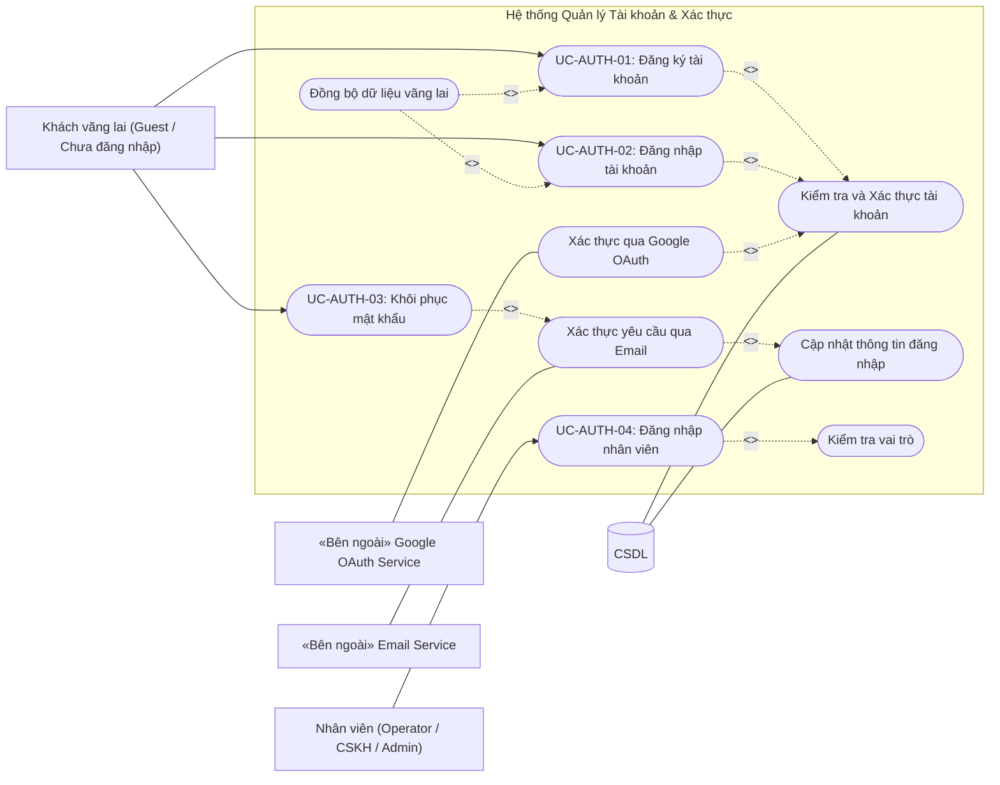

> Thay đổi: bỏ use case "Onboarding" khỏi AUTH ([CHUYỂN → PM]); thêm "Đồng bộ dữ liệu vãng lai" (extend) và UC-AUTH-04.

#### 1.6.2. Đặc tả Use Case

| UC | Tên | Actor | Trigger | PRE | POST | Thay đổi |
|---|---|---|---|---|---|---|
| UC-AUTH-01 | Đăng ký tài khoản | Khách vãng lai | Nhấn "Đăng ký" hoặc hành động yêu cầu đăng nhập | Chưa đăng nhập | Tài khoản + hồ sơ (`onboarding_status = pending`) được tạo; phiên hợp lệ; dữ liệu vãng lai được đồng bộ; chuyển sang `/account/onboarding?flow=signup&returnUrl=…` | [SỬA] bước 8–10 |
| UC-AUTH-02 | Đăng nhập tài khoản | Khách đã có tài khoản | Hành động yêu cầu đăng nhập | Có tài khoản hợp lệ | Phiên được cấp, dữ liệu vãng lai đồng bộ, quay về trang đích | [SỬA] thêm bước đồng bộ |
| UC-AUTH-03 | Khôi phục mật khẩu | Người dùng chưa đăng nhập | Nhấn "Quên mật khẩu?" | Có tài khoản | Mật khẩu mới được lưu, phiên cũ bị thu hồi, chuyển về `/auth/login` | [SỬA] đích điều hướng |
| UC-AUTH-04 | Đăng nhập nhân viên | Nhân viên | Truy cập `/admin/*` hoặc `/admin/dang-nhap` | Tài khoản có vai trò ≠ customer | Phiên nhân viên riêng; vào khu quản trị theo vai trò | [MỚI] |

**UC-AUTH-01 – thay đổi luồng chính (các bước khác [GIỮ] như bản gốc):**
- 7 Hệ thống mã hóa mật khẩu, tạo bản ghi người dùng và hồ sơ với `role = customer`, `onboarding_status = pending`.
- 8 Hệ thống tạo phiên đăng nhập và chạy **Đồng bộ dữ liệu vãng lai** (FR-AUTH-03).
- 9 Hệ thống chuyển hướng sang trang Onboarding của **PM** (UC-PM-01) kèm `returnUrl` đã được kiểm tra an toàn.
- 10 [BỎ – thuộc UC-PM-01] thu thập dòng máy và sở thích.

**UC-AUTH-04 – Đăng nhập nhân viên [MỚI]:**
- MAIN: 1 Nhân viên mở `/admin/dang-nhap`. 2 Nhập email, mật khẩu. 3 Hệ thống xác thực trên phiên nhân viên riêng. 4 Hệ thống đọc `profiles.role`. 5 Vai trò hợp lệ → vào khu quản trị theo vai trò (Admin chọn góc nhìn).
- EXC: 4.1 Vai trò `customer` → đăng xuất phiên nhân viên, báo "Tài khoản này không có quyền nhân viên.". 3.1 Sai thông tin → báo lỗi chung.

#### 1.6.3. BPMN

- **BPMN-AUTH-01 Đăng ký [SỬA]:** giữ nguyên sơ đồ gốc, thay đoạn cuối `Task_Init_Session_Reg → Task_Onboarding → End_Reg_Success` bằng:

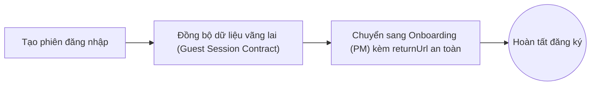

- **BPMN-AUTH-02 Đăng nhập [SỬA]:** chèn `Task_Merge` giữa `Task_Init_Session_Login` và `End_Login_Success`.
- **BPMN-AUTH-03 Khôi phục mật khẩu [SỬA]:** `End_Recover_Success` điều hướng về `/auth/login`; các nút khác [GIỮ].
- **BPMN-AUTH-04 Đăng nhập nhân viên [MỚI]:**

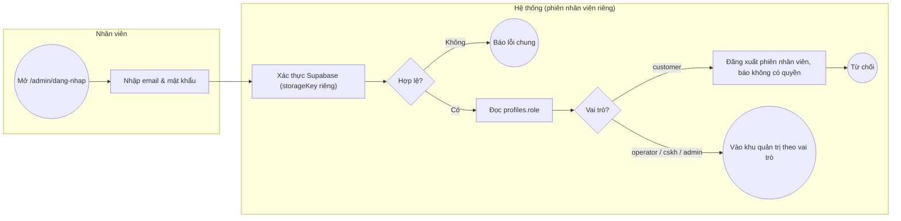

#### 1.6.4. Class Diagram – CD-AUTH [SỬA]

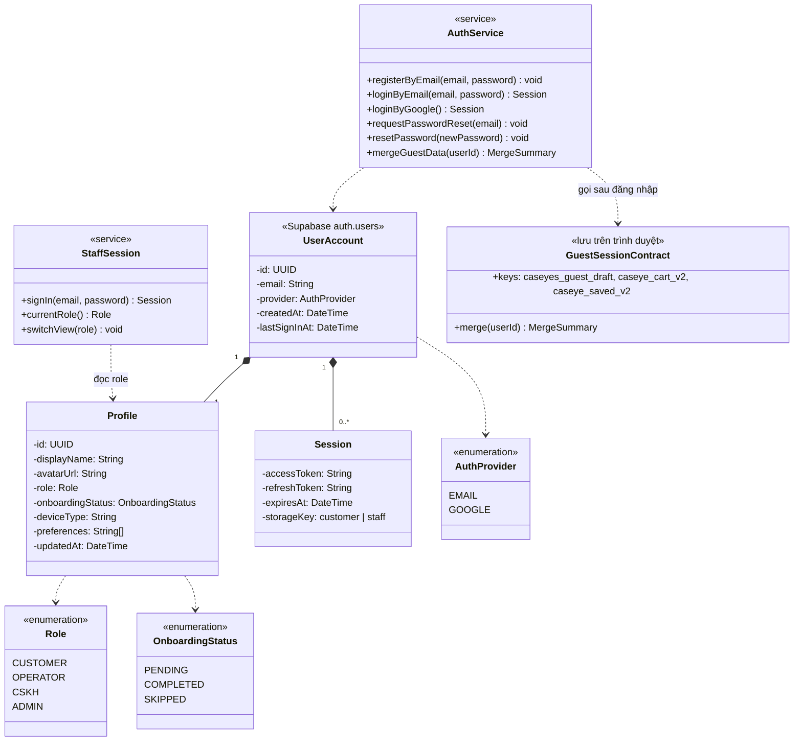

> Thay đổi: bỏ `ResetToken`, `EmailVerification`, `failedLoginAttempts` tự quản (do Supabase Auth đảm nhiệm); bỏ `AccountStatus` (cột `status` đã bị loại khỏi CSDL – trạng thái chờ xóa thuộc PM); thêm `Role`, `StaffSession`, `GuestSessionContract`.

---

## 2. Profile Management (PM)

### 2.1. Tóm tắt thay đổi

| Mã silo | Mức | Vấn đề | Cách khắc phục trong v3 |
|---|---|---|---|
| P1 | 🔴 | Phụ thuộc "ví hoàn tiền", "điểm tích lũy", "voucher" không có chủ | Bỏ khái niệm "ví hoàn tiền" (hoàn tiền là `RefundRequest` của OT chuyển khoản ngân hàng). Điểm thưởng thuộc **Loyalty – hệ thống ngoài**. Voucher thuộc **sổ voucher của P** |
| P2 | 🟠 | PM tự phát voucher riêng | FR-PM-05 phát voucher qua sổ voucher của P (`VoucherRegistry.issue`), cờ `is_rewarded` vẫn do PM giữ |
| P3 | 🟠 | Điều kiện xóa tài khoản lệch, thiếu API | FR-PM-10 định nghĩa **hợp đồng kiểm tra điều kiện xóa** gọi OT `list_open_orders()`, OT `refund_requests`, CS `tickets` mở |
| P4 | 🟠 | Lane "Camunda Engine" chỉ có ở PM | Đổi lane thành "Hệ thống (Angular + Supabase)" trong mọi BPMN-PM |
| P5 | 🟠 | Sổ địa chỉ không có chủ | Thêm BR-PM-15, FR-PM-26 – sổ địa chỉ thuộc PM (bảng `addresses` đã có); P chỉ đọc |
| A2 | 🟠 | Onboarding trùng với AUTH | PM là chủ sở hữu duy nhất (BR-PM-04, BR-PM-07, FR-PM-17/18/27) |
| P6 | 🟡 | Thư viện thiết kế trùng My Designs | FR-PM-02 là khung hiển thị dữ liệu của DES |

### 2.2. Business Requirements

| Mã | Nội dung | Thay đổi |
|---|---|---|
| BR-PM-01 | Hệ thống cho phép khách hàng đã đăng nhập một không gian riêng để quản lý thông tin cá nhân, sổ địa chỉ, đơn hàng, thiết kế… | [SỬA] thêm sổ địa chỉ |
| BR-PM-02 | Hệ thống kích thích người dùng hoàn thiện hồ sơ cá nhân bằng các chính sách khuyến mãi nhằm phục vụ dữ liệu cho các phân tích tương lai. | [GIỮ] |
| BR-PM-03 | Người dùng có toàn quyền đọc, cập nhật thông tin cá nhân. | [GIỮ] |
| BR-PM-04 | Hệ thống cung cấp khách hàng trang Onboarding để thu thập thông tin (tên hiển thị/Creator, dòng máy, gu thẩm mỹ). **PM là chức năng duy nhất sở hữu Onboarding**; AUTH và Checkout chỉ điều hướng tới. | [SỬA] |
| BR-PM-05 | Khách hàng cung cấp số điện thoại phải đảm bảo đúng định dạng VN (10 số, đầu 03/05/07/08/09), chưa được tài khoản khác sử dụng. | [GIỮ] |
| BR-PM-06 | Khách hàng cung cấp ngày sinh, giới tính, danh mục sản phẩm quan tâm hợp lệ: Ngày sinh phải đủ 13 tuổi và không ở trong tương lai. Giới tính là **Nam, Nữ hoặc Khác/Không muốn tiết lộ**. Danh mục quan tâm phải thuộc **bộ từ vựng phong cách chung** của hệ thống (dùng chung với Search và Design Studio). | [SỬA] giới tính theo mã nguồn; thống nhất từ vựng phong cách |
| BR-PM-07 | Mỗi tài khoản chỉ có một trạng thái onboarding (`pending`, `completed`, `skipped`). Hệ thống không tự hiển thị lại Onboarding khi trạng thái đã là `completed` hoặc `skipped`; khách có thể chủ động mở lại từ trang Tài khoản. | [SỬA] làm rõ giá trị trạng thái |
| BR-PM-08 | Đổi mật khẩu, email hoặc SĐT sẽ gửi thông báo đến email/SĐT cũ để cảnh báo bảo mật. | [GIỮ] |
| BR-PM-09 | Đổi mật khẩu phải nhập đúng mật khẩu hiện tại. Mật khẩu mới tối thiểu 8 ký tự, gồm chữ và số, và khác mật khẩu cũ. | [GIỮ] |
| BR-PM-10 | Khi xóa tài khoản, tài khoản cần thỏa điều kiện: Không có đơn hàng chưa khép (Bảng 7.1); Không có khiếu nại đang mở; Không có yêu cầu hủy đơn hoặc yêu cầu hoàn tiền chưa xử lý xong; Tài khoản không phải tài khoản nhân viên. | [SỬA] bỏ "ví hoàn tiền", "giao dịch chưa đối soát" (đơn chỉ tạo sau khi thanh toán thành công – BR-P-01); quy về dữ liệu OT/CS |
| BR-PM-11 | Khi xóa tài khoản, người dùng phải xác thực lại các thông tin trước khi quyết định xóa. | [GIỮ] |
| BR-PM-12 | Khi xóa tài khoản, người dùng có thời gian chờ 30 ngày để khôi phục bằng cách đăng nhập lại. | [GIỮ] |
| BR-PM-13 | Sau khi xóa, dữ liệu cá nhân (tên, SĐT, email, địa chỉ, ảnh) được xóa hoặc ẩn danh. Dữ liệu đơn hàng/hóa đơn được giữ lại ở dạng ẩn danh để phục vụ kế toán, thuế và pháp lý. | [GIỮ] |
| BR-PM-14 | Điểm thưởng Loyalty (hệ thống ngoài) và voucher chưa dùng sẽ mất và người dùng phải được thông báo rõ trước khi xác nhận. | [SỬA] điểm thuộc hệ thống ngoài |
| BR-PM-15 | Khách hàng quản lý **sổ địa chỉ giao hàng** (nhiều địa chỉ, một địa chỉ mặc định); Checkout dùng địa chỉ mặc định để điền sẵn. | [MỚI] – khắc phục P5 |

### 2.3. Functional Requirements

| Mã | Tên | BR | MoSCoW | Mô tả | Trạng thái |
|---|---|---|---|---|---|
| FR-PM-01 | Dashboard tổng quan | BR-PM-01 | M | Hệ thống điều hướng đến route /account, hiển thị tóm tắt thông tin tài khoản, đơn hàng gần nhất và các thiết kế đã lưu. | 🟡 Có các tab; chưa có khối tóm tắt; điểm "350 Points" là giá trị cứng |
| FR-PM-02 | Thư viện thiết kế (khung hiển thị) | BR-PM-01 | M | Tab "Thiết kế" hiển thị danh sách bản vẽ **do Design Studio quản lý** (FR-DES-18), cho phép mở lại canvas; các thao tác nhân bản/đổi tên/xóa dùng chung chức năng của DES (UC-DES-03 AF4). | 🟡 Đọc localStorage dùng chung mọi tài khoản trên trình duyệt |
| FR-PM-03 | Lịch sử đơn hàng (liên kết) | BR-PM-01 | M | Tab "Đơn hàng" hiển thị danh sách rút gọn và liên kết sang trang `/order-tracking` của OT (FR-OT-03). | ✅ (dữ liệu mock khi chưa đăng nhập Supabase) |
| FR-PM-04 | Thanh đo hoàn thiện hồ sơ | BR-PM-02 | S | Hệ thống tính toán và hiển thị tỷ lệ % hoàn thiện hồ sơ kèm banner Call-to-Action (CTA) hướng dẫn nhận voucher. | ⬜ |
| FR-PM-05 | Kích hoạt voucher tự động | BR-PM-02 | C | Khi hồ sơ đạt 100%, PM gọi `VoucherRegistry.issue(userId, 'PROFILE_COMPLETE')` của P để phát mã giảm giá vào tài khoản. | ⬜ |
| FR-PM-06 | Đọc dữ liệu hồ sơ | BR-PM-03 | M | Hệ thống truy vấn dữ liệu từ bảng profiles và addresses, binding lên các trường thông tin trên giao diện. | 🟡 SĐT, ngày sinh, giới tính chưa có cột lưu |
| FR-PM-07 | Cập nhật hồ sơ (CRUD) | BR-PM-03 | M | Hệ thống xử lý form cập nhật thông tin qua Angular Reactive Forms, kiểm tra hợp lệ dữ liệu trước khi gửi request update lên database. Trường email/SĐT chỉ đổi qua luồng xác thực FR-PM-08. | 🟡 Chỉ lưu tên, dòng máy, sở thích |
| FR-PM-08 | Gửi OTP khi đổi Email/SĐT | BR-PM-03 | C | Hệ thống phát hành mã OTP để xác thực người dùng khi phát hiện thao tác thay đổi Email hoặc Số điện thoại (Mockup – dịch vụ OTP bên ngoài). | 🧪 |
| FR-PM-09 | Chống trục lợi voucher (Incentive Lock) | BR-PM-02 | M | Database kiểm tra cờ is_rewarded; hệ thống chỉ kích hoạt tặng voucher 1 lần duy nhất khi hồ sơ đạt 100% và chặn cấp lại nếu user xóa đi điền lại. | ⬜ |
| FR-PM-10 | Kiểm tra điều kiện xóa tài khoản (Dependency Check) | BR-PM-10 | M | PM gọi lần lượt: OT `list_open_orders()` (Bảng 7.1), OT danh sách `cancel_requests`/`refund_requests` chưa khép, CS danh sách ticket mở. Mỗi lý do chặn hiển thị kèm liên kết tới đơn/ticket để xử lý. Kiểm tra lại lần cuối ngay trước khi ghi nhận yêu cầu xóa. | 🧪 Danh sách kiểm tra tĩnh; RPC `list_open_orders` đã có nhưng chưa được gọi |
| FR-PM-11 | Ràng buộc số điện thoại hợp lệ | BR-PM-05 | M | Hệ thống validate thời gian thực định dạng SĐT Việt Nam `^0(3|5|7|8|9)[0-9]{8}$`, kiểm tra trùng lặp trên database và khóa nút submit nếu sai. Dùng chung biểu thức với FR-P-05. | 🟡 Đang dùng `^0\d{9}$`, không kiểm tra trùng |
| FR-PM-12 | Ràng buộc ngày sinh và độ tuổi | BR-PM-06 | M | Hệ thống kiểm tra logic ngày sinh: chặn chọn ngày ở tương lai, tính toán độ tuổi và chặn gửi form nếu người dùng chưa đủ 13 tuổi. | ⬜ |
| FR-PM-13 | Ràng buộc giới tính và sở thích | BR-PM-06 | M | Giới tính: `male`, `female`, `other`. Sở thích chọn từ bộ từ vựng phong cách chung (Bảng 2.1). | 🟡 Có 3 giá trị giới tính nhưng chưa lưu; hai bộ từ vựng khác nhau |
| FR-PM-14 | Bảo toàn form chưa lưu (Unsaved State Guard) | BR-PM-03 | M | Angular CanDeactivate Guard kiểm tra trạng thái dirty khi chuyển route; hiển thị hộp thoại bắt buộc người dùng chọn lưu, tiếp tục sửa hoặc hủy thay đổi. | ⬜ |
| FR-PM-15 | Kiểm soát cập nhật đồng thời (Optimistic Concurrency) | BR-PM-03 | S | Hệ thống so sánh trường updated_at trong payload với database; từ chối ghi đè nếu phát hiện sai lệch phiên bản và tự động fetch lại dữ liệu mới nhất. | ⬜ (cột `updated_at` đã có) |
| FR-PM-16 | Cơ chế chịu lỗi mạng (Network Fallback) | BR-PM-03 | S | Hệ thống đóng băng trạng thái form khi gặp lỗi timeout hoặc mất mạng, ngăn reload làm mất dữ liệu nhập và hiển thị nút thử lại (retry). | 🟡 |
| FR-PM-17 | Giao diện Onboarding | BR-PM-04 | M | Màn hình `/account/onboarding` gồm 3 bước: (1) Tên Creator (2–40 ký tự, bắt buộc), (2) Chọn dòng máy (tùy chọn), (3) Gu thẩm mỹ (tùy chọn, từ Bảng 2.1). Có nút "Bỏ qua" (xác nhận) và luôn quay về `returnUrl`. | ✅ |
| FR-PM-18 | Khóa trạng thái Onboarding | BR-PM-07 | M | Hệ thống lưu trạng thái onboarding vào database; chỉ tự động hiển thị Onboarding khi trạng thái là `pending`; cập nhật trạng thái chỉ thành công khi bản ghi đang `pending` (tránh ghi đè). Banner nhắc trên trang Tài khoản chỉ hiện với `pending`. | 🟡 Banner hiện cả với `skipped`; `?flow=signup` mở lại được |
| FR-PM-19 | Cảnh báo bảo mật thông tin liên lạc | BR-PM-08 | M | Hệ thống tự động gửi thông báo bảo mật đến email hoặc số điện thoại cũ ngay khi phát sinh thay đổi mật khẩu, email hoặc SĐT (qua dịch vụ Email bên ngoài). | ⬜ |
| FR-PM-20 | Đổi mật khẩu an toàn | BR-PM-09 | M | Hệ thống xác thực mật khẩu hiện tại (đăng nhập lại bằng mật khẩu cũ) và kiểm tra mật khẩu mới: độ dài tối thiểu 8 ký tự, gồm cả chữ và số, không trùng mật khẩu cũ. Tài khoản OAuth-only được hướng dẫn tạo mật khẩu qua FR-AUTH-06. | 🟡 Không kiểm tra mật khẩu hiện tại |
| FR-PM-21 | Xác thực lại khi xóa tài khoản | BR-PM-11 | M | Hệ thống yêu cầu người dùng tái xác thực danh tính (nhập lại mật khẩu; tài khoản Google: OTP qua email) trước khi ghi nhận yêu cầu xóa tài khoản. | 🧪 |
| FR-PM-22 | Cảnh báo mất quyền lợi tài khoản | BR-PM-14 | M | Hệ thống hiển thị pop-up cảnh báo rõ ràng về việc điểm thưởng Loyalty và voucher chưa sử dụng sẽ bị hủy bỏ vĩnh viễn trước khi xác nhận xóa. | 🟡 Chỉ có dòng chữ |
| FR-PM-23 | Thời gian chờ xóa và khôi phục (Soft Delete) | BR-PM-12 | M | Hệ thống lưu `deletion_requested_at` trên hồ sơ, chuyển tài khoản sang trạng thái chờ 30 ngày; cho phép người dùng khôi phục và hủy xóa bằng cách đăng nhập lại trong khung thời gian này. | 🧪 Chỉ là tín hiệu bộ nhớ, mất khi tải lại |
| FR-PM-24 | Xóa và ẩn danh dữ liệu cá nhân | BR-PM-13 | M | Sau thời hạn chờ 30 ngày, tác vụ định kỳ tự động xóa cứng hoặc ẩn danh toàn bộ dữ liệu cá nhân (tên, SĐT, email, địa chỉ, ảnh đại diện). | ⬜ |
| FR-PM-25 | Lưu trữ ẩn danh chứng từ đơn hàng | BR-PM-13 | M | Hệ thống thay `orders.user_id` bằng khóa ẩn danh và duy trì dữ liệu lịch sử đơn hàng, hóa đơn ở dạng ẩn danh để phục vụ lưu trữ kế toán, thuế và pháp lý. | ⬜ (ràng buộc FK hiện chặn xóa) |
| FR-PM-26 | Sổ địa chỉ giao hàng | BR-PM-15 | M | Thêm/sửa/xóa địa chỉ (người nhận ≥ 2 ký tự, SĐT theo FR-PM-11, số nhà, phường/xã, quận/huyện, tỉnh/thành); đặt một địa chỉ mặc định (thao tác nguyên tử); địa chỉ đầu tiên tự là mặc định; xóa địa chỉ mặc định thì địa chỉ còn lại đầu tiên được đặt mặc định. Checkout (FR-P-04) đọc địa chỉ mặc định. | 🟡 CRUD đã có; đặt mặc định chưa nguyên tử; Checkout chưa đọc |

**Bảng 2.1 – Bộ từ vựng phong cách chung (dùng cho PM, SRCH, DES):** Y2K · Tối giản (Minimal) · Grunge · Anime · Pastel · Gorpcore · Dễ thương (Cute) · Hoa lá · Vintage · Abstract. *(Hợp nhất từ preset Onboarding, modal Account và lexicon Search.)*

### 2.4. Edge Cases & Business Rules

| Mã | Tên | BR | MoSCoW | Mô tả | Trạng thái |
|---|---|---|---|---|---|
| FR-PM-EX-01 | Khai sai tuổi để nhận voucher | BR-PM-02, 06 | S | Sau khi đã nhận voucher hoàn thiện hồ sơ, ngày sinh bị khóa sửa (chỉ CSKH hỗ trợ). | ⬜ |
| FR-PM-EX-02 | SĐT đang thuộc tài khoản chờ xóa | BR-PM-05 | S | SĐT của tài khoản chờ xóa vẫn coi là đã sử dụng cho đến khi ẩn danh xong. | ⬜ |
| FR-PM-EX-03 | Tài khoản Google xóa tài khoản | BR-PM-11 | M | Xác thực lại bằng OTP gửi email Google; nếu không truy cập được email → hướng dẫn liên hệ CSKH. | 🧪 |
| FR-PM-EX-04 | Phát sinh khiếu nại/hoàn tiền trong 30 ngày chờ xóa | BR-PM-10, 12 | M | Đồng hồ xóa tạm dừng; khách được thông báo và tài khoản giữ trạng thái chờ đến khi xử lý xong. | ⬜ |
| FR-PM-EX-05 | Tác vụ ẩn danh lỗi giữa chừng | BR-PM-13 | M | Tác vụ idempotent, ghi nhật ký từng bước, chạy lại không gây sai lệch. | ⬜ |
| FR-PM-EX-06 | Sai mật khẩu/OTP xác thực xóa quá 5 lần | BR-PM-11 | M | Khóa chức năng xóa 15 phút và gửi cảnh báo bảo mật. | ⬜ |
| FR-PM-EX-07 | Điều kiện xóa thay đổi giữa hai lần kiểm tra | BR-PM-10 | M | Kiểm tra lần cuối trước khi ghi nhận; nếu không đạt hiển thị lý do chặn. | ⬜ |
| FR-PM-EX-08 | Hai tab cùng sửa hồ sơ | BR-PM-03 | S | Theo FR-PM-15. | ⬜ |
| FR-PM-EX-09 | Mất mạng khi lưu | BR-PM-03 | S | Theo FR-PM-16. | 🟡 |
| FR-PM-EX-10 | Lưu Onboarding lỗi | BR-PM-04 | M | Thử lại 1 lần; nếu vẫn lỗi đặt `skipped`, quay về `returnUrl` và cho phép hoàn tất sau từ trang Tài khoản. | ✅ |
| FR-PM-EX-11 | Đặt địa chỉ mặc định đồng thời | BR-PM-15 | M | Thao tác đặt mặc định thực hiện trong một giao dịch; CSDL ràng buộc tối đa một địa chỉ mặc định mỗi tài khoản. | 🟡 |
| FR-PM-EX-12 | Xóa địa chỉ đang dùng cho đơn chưa giao | BR-PM-15 | S | Cho phép xóa khỏi sổ; đơn đã đặt dùng snapshot địa chỉ nên không bị ảnh hưởng. | ✅ (snapshot trong đơn) |
| FR-PM-EX-13 | Trường bắt buộc chưa có nơi lưu | BR-PM-03 | M | Biểu mẫu không được bắt buộc nhập trường không được lưu (SĐT, email) – chỉ bắt buộc trường có cột tương ứng. | ⬜ Lỗi hiện tại – xem Phụ lục B |
| FR-PM-EX-14 | Nhân viên yêu cầu xóa tài khoản | BR-PM-10 | M | Tài khoản vai trò ≠ customer không tự xóa được; liên hệ Admin. | ⬜ |
| FR-PM-EX-15 | Bản vẽ của tài khoản khác hiển thị trên cùng trình duyệt | BR-PM-01 | M | Danh sách thiết kế phải lọc theo `user_id` (xem FR-DES-18). | ⬜ Lỗi hiện tại |

### 2.5. CX touchpoint & Data foundation

| Loại | Đề xuất | Chi tiết |
|---|---|---|
| **CX touchpoint** | **Màn hình chặn xóa tài khoản có hướng dẫn hành động** | Thay vì danh sách tĩnh, liệt kê từng việc còn tồn (ví dụ "Đơn CC-261115-0001 đang giao – dự kiến 18/11", "Yêu cầu hoàn tiền chờ bạn nhập tài khoản") kèm nút đi thẳng tới đơn/ticket; kèm tùy chọn tải về dữ liệu cá nhân trước khi xóa (phù hợp Nghị định 13/2023). |
| **Data foundation** | **Dữ liệu zero-party từ Onboarding có cấu trúc** | Lưu `onboarding_answers` dạng có cấu trúc: `{creator_name, device_model_id, style_codes[] (Bảng 2.1), completed_at, source (signup/checkout/account)}` và sự kiện `pm.onboarding.completed/skipped`. Đây là nguồn cá nhân hóa trực tiếp cho gợi ý Search, Kho mẫu DES và phân khúc khách hàng. |

### 2.6. Mô hình hóa

#### 2.6.1. Use Case Diagram – UCD-PM [SỬA]

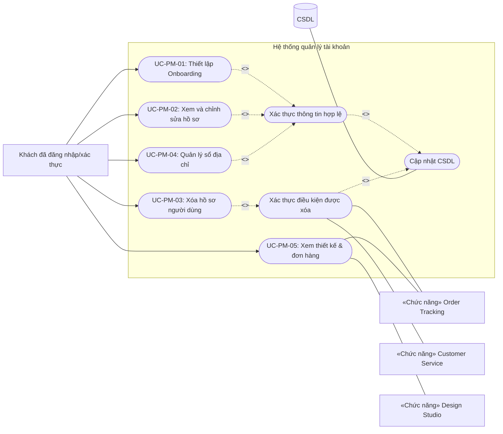

#### 2.6.2. Đặc tả Use Case [MỚI – bổ sung đặc tả còn thiếu]

| UC | Actor | Trigger | PRE | POST | MAIN (tóm tắt) | ALT / EXC |
|---|---|---|---|---|---|---|
| UC-PM-01 Thiết lập Onboarding | Khách vừa đăng ký; khách `pending` vào Checkout | AUTH chuyển hướng sau đăng ký; hộp thoại "Thiết lập ngay" ở Checkout; nút trên trang Tài khoản | Đã đăng nhập | `onboarding_status` = `completed` hoặc `skipped`; quay về `returnUrl` | 1 Hiển thị bước Tên Creator (điền sẵn tên hiển thị). 2 Chọn dòng máy. 3 Chọn gu thẩm mỹ. 4 Lưu hồ sơ, `completed`. 5 Quay về `returnUrl` | ALT: Bỏ qua → xác nhận → `skipped`. EXC: lưu lỗi → FR-PM-EX-10; trạng thái đã `completed` → không tự hiển thị |
| UC-PM-02 Xem và chỉnh sửa hồ sơ | Khách đã đăng nhập | Chọn "Hồ sơ của tôi" | Đã đăng nhập | Hồ sơ được cập nhật, có audit log | Theo BPMN-PM-02 | ALT A2–A6: đổi ảnh, Email/SĐT (OTP mock), mật khẩu, hoàn thiện hồ sơ. EXC: dữ liệu sai, xung đột phiên bản, mất mạng |
| UC-PM-03 Xóa hồ sơ | Khách đã đăng nhập | Chọn "Xóa tài khoản" | Đã đăng nhập, vai trò customer | Tài khoản chờ xóa 30 ngày hoặc bị chặn kèm lý do | Theo BPMN-PM-03-1 | Theo FR-PM-EX-03, 04, 06, 07 |
| UC-PM-04 Quản lý sổ địa chỉ | Khách đã đăng nhập | Mở mục Địa chỉ | Đã đăng nhập | Sổ địa chỉ cập nhật, đúng một địa chỉ mặc định | 1 Xem danh sách. 2 Thêm/sửa (validate). 3 Đặt mặc định. 4 Xóa (xác nhận) | EXC: FR-PM-EX-11 |
| UC-PM-05 Xem thiết kế & đơn hàng | Khách đã đăng nhập | Mở tab Thiết kế / Đơn hàng | Đã đăng nhập | Danh sách hiển thị đúng của tài khoản | 1 Hiển thị dữ liệu DES/OT. 2 Mở lại canvas hoặc trang đơn | EXC: lỗi tải → nút Thử lại |

#### 2.6.3. BPMN

- **BPMN-PM-01 Onboarding [SỬA]:** lane "Hệ thống" thay cho hệ thống chung; thêm bước 3 bước của FR-PM-17:

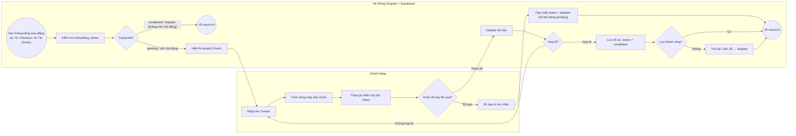

- **BPMN-PM-02 Xem/sửa hồ sơ:** [GIỮ] cấu trúc; [SỬA] tên lane "Hệ thống (Camunda Engine)" → "Hệ thống (Angular + Supabase)".
- **BPMN-PM-03-1 Xóa tài khoản [SỬA]:** nút `uc03_6` đổi thành "Gọi OT list_open_orders, OT refund/cancel requests, CS tickets mở (Dependency Check)"; nút `uc03_24` "Kiểm tra lại điều kiện (lần cuối)"; nút `uc03_28` "Ghi deletion_requested_at, hủy mọi session, hủy email tiếp thị"; lane đổi tên như trên.
- **BPMN-PM-03-2 Khôi phục khi đăng nhập lại:** [GIỮ] (lane đổi tên).
- **BPMN-PM-03 Tác vụ ẩn danh định kỳ [SỬA]:** thêm bước "Kiểm tra tài khoản không có khiếu nại/hoàn tiền mở (FR-PM-EX-04)" trước bước ẩn danh; ẩn danh `orders.user_id` theo FR-PM-25.

#### 2.6.4. Class Diagram – CD-PM [MỚI – bản gốc chưa có]

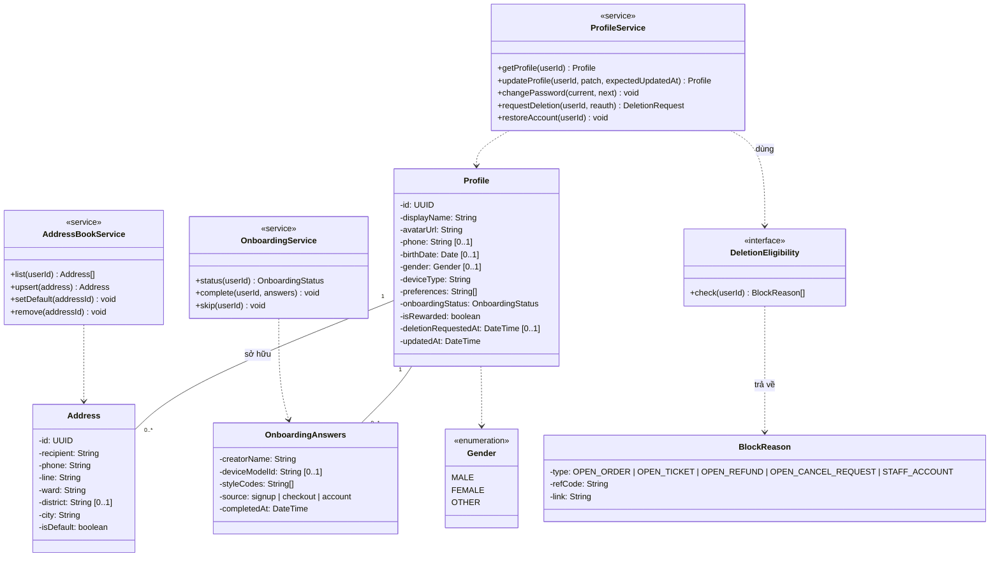

> `DeletionEligibility` được hiện thực bằng các truy vấn tới OT (`list_open_orders`, `refund_requests`, `cancel_requests`) và CS (ticket mở) – PM không lưu bản sao dữ liệu đơn hàng.

---

## 3. Shop & Cart (SH)

### 3.1. Tóm tắt thay đổi

| Mã silo | Mức | Vấn đề | Cách khắc phục trong v3 |
|---|---|---|---|
| S1 | 🔴 | Mục SH chứa bản FR-DES-01..31 lỗi thời ("Mua ngay", `is_editable`) | **[BỎ]** toàn bộ bản sao; viết mới bộ FR-SH-01..18 truy vết đúng BR-SH |
| S2 | 🔴 | Tìm kiếm riêng + AI ảnh trên server + AestheticProfile mâu thuẫn SRCH | BR-SH-02, UC-SH-02 **[CHUYỂN → SRCH]**. Shop chỉ giữ **bộ lọc danh mục**; tìm ảnh xử lý trên trình duyệt (SRCH); **[BỎ]** AestheticProfile. Bỏ tham số `?q=` còn sót |
| S3 | 🔴 | Hủy đơn riêng mâu thuẫn OT | UC-SH-09 **[CHUYỂN → OT]**. Shop chỉ nhận sự kiện `OrderCancelled` để cập nhật hồ sơ rủi ro (FR-SH-17) |
| S4 | 🟠 | `TermsAcceptance` tại giỏ trùng PolicyConsent | **[BỎ]** bản ghi đồng ý tại giỏ; đồng ý chính sách chỉ ghi **một lần** tại Checkout (FR-P-18) |
| S5 | 🟠 | Khái niệm "cọc" chỉ có ở SH | **[BỎ]** cọc; thay bằng quy tắc của P: khách rủi ro cao **bị khóa COD, bắt buộc trả trước** (FR-SH-18 → FR-P-12) |
| S6 | 🟠 | Inventory không có tài liệu | Inventory là **hệ thống ngoài** (mục 0.3); SH đọc tồn kho qua `stock_availability` |
| S7 | 🟠 | Ranh giới Catalog (IN_STOCK) và mẫu Studio (CUSTOM) chưa rõ | BR-SH-07: Catalog chỉ chứa hàng có sẵn có giá riêng; mẫu Studio đồng giá 250.000đ thuộc DES; PDP có lối vào "Tự thiết kế" |
| S8 | 🟡 | Giỏ vãng lai mâu thuẫn | Cho phép giỏ vãng lai (FR-SH-09), đăng nhập ở bước Checkout |

### 3.2. Business Requirements

| Mã | Nội dung | Thay đổi |
|---|---|---|
| BR-SH-01 | Khách hàng cần tìm kiếm và lọc sản phẩm theo dòng máy, phong cách, giá và tags để rút ngắn thời gian chọn mẫu và tăng khả năng chốt đơn | [SỬA] "tìm kiếm" từ khóa do SRCH đảm nhiệm; Shop cung cấp bộ lọc |
| BR-SH-02 | ~~Khách hàng cần tìm mẫu bằng từ khóa hoặc ảnh tham khảo…~~ | [CHUYỂN → SRCH] (BR-SRCH-01, BR-SRCH-02) |
| BR-SH-03 | Khách hàng cần xem trước sản phẩm 3D xoay 360 độ đúng dòng máy để giảm lo ngại sai lệch kiểu dáng | [GIỮ] |
| BR-SH-04 | Doanh nghiệp cần kiểm soát rủi ro hủy đơn: ghi nhận lịch sử hủy do lỗi khách và áp dụng hạn chế phương thức thanh toán với khách rủi ro cao. *(Minh bạch điều khoản đơn hàng được thực hiện tại Checkout – BR-P-11, FR-OT-17.)* | [SỬA] bỏ "cọc", chuyển phần điều khoản sang P/OT |
| BR-SH-05 | Khách hàng cần xem thông tin vật liệu, độ bền, khả năng chống sốc và preview theo đúng model trước khi thêm giỏ | [GIỮ] |
| BR-SH-06 | Khách hàng cần quản lý giỏ hàng, chỉnh số lượng, sửa thiết kế hoặc lưu để mua sau; hệ thống cần cảnh báo tồn kho trước khi checkout | [GIỮ] |
| BR-SH-07 | Catalog Cửa hàng chỉ chứa **hàng có sẵn (IN_STOCK)** – ốp in sẵn và phụ kiện – có giá theo dòng máy/biến thể; mẫu thiết kế tùy biến (CUSTOM) thuộc Design Studio. Hai hành trình được nối với nhau bằng lối vào "Tự thiết kế phiên bản của bạn". | [MỚI] – khắc phục S7 |

### 3.3. Functional Requirements [MỚI – thay thế bản FR-DES lỗi thời]

| Mã | Tên | BR | MoSCoW | Mô tả | Trạng thái |
|---|---|---|---|---|---|
| FR-SH-01 | Lưới sản phẩm Cửa hàng | BR-SH-01, 07 | M | Trang `/shop` hiển thị lưới sản phẩm IN_STOCK (ảnh, tên, giá theo dòng máy đang chọn, nhãn BEST SELLER/NEW DROP/LIMITED, nhãn "Tạm hết"), phân trang 12 mục; 3 kiểu xem (lưới/lớn/danh sách). | ✅ (dữ liệu tĩnh) |
| FR-SH-02 | Bộ lọc danh mục | BR-SH-01 | M | Lọc theo dòng máy, màu phôi, phong cách (Bảng 2.1), **khoảng giá** và **tags**; trạng thái bộ lọc lưu trên URL (`?model=&color=&style=&price=&tag=&sort=&page=`). | 🟡 Thiếu lọc giá và tags |
| FR-SH-03 | Sắp xếp | BR-SH-01 | M | Nổi bật (hàng tạm hết xếp cuối, ưu tiên nhãn), giá tăng, giá giảm, tên. | ✅ |
| FR-SH-04 | Trang chi tiết sản phẩm (PDP) | BR-SH-05 | M | `/shop/:id?model=&sku=`: chọn hãng, dòng máy, màu phôi; tab Thông số (vật liệu, độ bền, chống sốc, kích thước in, hoàn thiện, mã SKU); sản phẩm liên quan; nút "Thêm vào giỏ". | 🟡 Thông số vật liệu là văn bản tĩnh |
| FR-SH-05 | Xem 3D/360° | BR-SH-03 | S | Chuyển 2D/3D bằng `<model-viewer>` cho dòng máy có mô hình 3D; dòng chưa có hiển thị ảnh 2D kèm nhãn "3D cho ‹dòng máy› sắp có"; tải lỗi/quá 8 giây → ảnh dự phòng. | 🟡 Thiếu xử lý lỗi/timeout |
| FR-SH-06 | Lối vào "Tự thiết kế" | BR-SH-07 | S | PDP và lưới có CTA "Tự thiết kế phiên bản của bạn" dẫn tới `/design-studio/templates` (giữ dòng máy đang chọn). | 🟡 Chỉ có ở lưới |
| FR-SH-07 | Xem nhanh (Quick view) & Yêu thích | BR-SH-01 | C | Xem nhanh sản phẩm trong modal; đánh dấu yêu thích lưu theo thiết bị/tài khoản. | ✅ |
| FR-SH-08 | Thêm vào giỏ | BR-SH-06 | M | Kiểm tra tồn kho (FR-SH-13) → tạo/gộp CartItem `{lineId, productId, variantId/sku, modelId, name, unitPrice, priceAtAdd, quantity, productType = IN_STOCK, snapshot}`; số lượng không vượt tồn kho khả dụng và trần 99; hiển thị mini-cart. Phụ kiện là `IN_STOCK`. | 🟡 Phụ kiện đang gắn `custom: true` – xem Phụ lục B |
| FR-SH-09 | Giỏ hàng vãng lai | BR-SH-06, BR-AUTH-01 | M | Khách vãng lai thêm giỏ và mở trang giỏ hàng; dữ liệu lưu `caseye_cart_v2`; đăng nhập yêu cầu ở bước Checkout và giỏ được gộp theo FR-AUTH-03. | 🟡 Logic gộp có; đang chặn thêm giỏ và trang `/cart` bằng đăng nhập |
| FR-SH-10 | Quản lý giỏ hàng | BR-SH-06 | M | Hiển thị preview, dòng máy, số lượng, đơn giá, trạng thái tồn kho, tổng tiền; tăng/giảm số lượng (giảm về 0 → xóa); xóa có hoàn tác 6 giây. | ✅ |
| FR-SH-11 | Lưu để mua sau | BR-SH-06 | S | Chuyển mặt hàng sang danh sách "Lưu để mua sau" (loại khỏi tổng tiền), chuyển lại giỏ hoặc xóa. | ✅ |
| FR-SH-12 | Sửa thiết kế từ giỏ | BR-SH-06 | S | Mặt hàng CUSTOM có nút "Sửa thiết kế" mở lại bản vẽ trong Design Studio; khi lưu, Studio tạo dòng giỏ mới thay thế dòng cũ (snapshot cũ không bị sửa ngầm). | ⬜ |
| FR-SH-13 | Kiểm tra tồn kho (qua hệ thống kho ngoài) | BR-SH-06 | M | Đọc `stock_availability` khi thêm giỏ, đổi số lượng và khi bấm "Thanh toán"; mặt hàng thiếu hàng bị đánh dấu và chặn thanh toán riêng mặt hàng đó. Bản thiết kế CUSTOM kiểm tra tồn kho phôi trắng của dòng máy. | 🧪 Tồn kho tĩnh trên giao diện, không kiểm tra lại |
| FR-SH-14 | Chuyển sang Checkout | BR-SH-06 | M | Nút "Thanh toán" kiểm tra: ≥ 1 mặt hàng còn hàng, tồn kho mới nhất; chuyển giỏ chuẩn hóa `{items, priceAtAdd}` sang `/checkout`. **Không ghi đồng ý chính sách tại giỏ** (do FR-P-18 đảm nhiệm). | 🟡 Có checkbox điều khoản tại giỏ cần gỡ |
| FR-SH-15 | Không áp mã giảm giá tại giỏ | BR-SH-06 | M | Mã giảm giá chỉ nhập tại Checkout (FR-P-34) để có một nơi tính tiền duy nhất; giỏ hiển thị gợi ý "Nhập mã ở bước thanh toán". | 🟡 Đang có mã `CASEYE10` tại giỏ, bị mất khi sang Checkout |
| FR-SH-16 | Cung cấp dữ liệu cho Search | BR-SH-01 | M | Khai báo `ShopSearchSource` (sản phẩm, phụ kiện, dòng máy tương thích, phong cách, nhãn, còn hàng, giá từ) cho SRCH; trường văn bản tìm kiếm chỉ chứa dòng máy **tương thích**, không chứa toàn bộ danh sách dòng máy. | 🟡 Đang chứa mọi dòng máy |
| FR-SH-17 | Hồ sơ rủi ro khách hàng | BR-SH-04 | C | Nhận sự kiện `OrderCancelled{cause, customerFault}` và `DeliveryFailed{customerFault}` từ OT; tăng `cancelCount`; vượt ngưỡng cấu hình (mặc định 3 lần/90 ngày) thì gắn cờ High Risk và cảnh báo Admin (mock). | 🧪 Chỉ có sự kiện phát ra |
| FR-SH-18 | Hạn chế thanh toán với khách rủi ro cao | BR-SH-04 | C | Khách có cờ High Risk: Checkout khóa COD (FR-P-12 mở rộng) kèm giải thích. Admin xem danh sách, gỡ/xác nhận cờ kèm ghi chú (mock). | ⬜ |

### 3.4. Edge Cases & Business Rules

| Mã | Tên | BR | MoSCoW | Mô tả | Trạng thái |
|---|---|---|---|---|---|
| FR-SH-EX-01 | Bộ lọc không có kết quả | BR-SH-01 | M | Hiển thị "Chưa có mẫu phù hợp", gợi ý bỏ bớt bộ lọc, nút "Xóa bộ lọc" và CTA "Tự thiết kế". | ✅ |
| FR-SH-EX-02 | Tham số URL không hợp lệ | BR-SH-01 | M | Bỏ giá trị sai (dòng máy không tồn tại, giá min > max, trang ngoài phạm vi), áp dụng phần còn lại và hiển thị thông báo nhỏ. | 🟡 Bỏ qua im lặng |
| FR-SH-EX-03 | Tải catalog lỗi/quá thời gian | BR-SH-01 | M | Thông báo lỗi, giữ bộ lọc, nút Thử lại. | ⬜ (dữ liệu tĩnh) |
| FR-SH-EX-04 | Sản phẩm ngừng bán/không tồn tại | BR-SH-05 | M | PDP hiển thị "Không tìm thấy sản phẩm" kèm gợi ý mẫu tương tự; mặt hàng ngừng bán trong giỏ được đánh dấu, không xóa im lặng. | 🟡 |
| FR-SH-EX-05 | Không tải được giá/thông số | BR-SH-05 | M | Ẩn khối lỗi, chặn "Thêm vào giỏ" cho đến khi có giá hợp lệ. | ⬜ |
| FR-SH-EX-06 | Mô hình 3D lỗi/hỏng | BR-SH-03 | S | Chuyển ảnh dự phòng, thông báo ngắn, các chức năng khác vẫn dùng được. | 🟡 |
| FR-SH-EX-07 | Hết hàng khi thêm giỏ | BR-SH-06 | M | Báo "Tạm hết hàng", không tạo dòng giỏ, đề xuất "Báo khi có hàng" hoặc đổi dòng máy. | ✅ (trừ "Báo khi có hàng") |
| FR-SH-EX-08 | Số lượng vượt tồn kho/trần 99 | BR-SH-06 | M | Áp dụng giới hạn ở **mọi** lối thêm (thêm mới, gộp, gộp sau đăng nhập). | 🟡 Gộp khi thêm chưa giới hạn |
| FR-SH-EX-09 | Bấm thêm nhiều lần liên tiếp | BR-SH-06 | M | Gộp vào cùng dòng giỏ theo `lineId`; với bản thiết kế, cùng `designId` + phiên bản không tạo dòng lặp. | 🟡 Bản thiết kế tạo dòng mới mỗi lần |
| FR-SH-EX-10 | Giá thay đổi giữa lúc thêm giỏ và Checkout | BR-SH-06 | M | Lưu `priceAtAdd`; Checkout so sánh với giá hiện hành và yêu cầu khách xác nhận (FR-P-03). | ⬜ |
| FR-SH-EX-11 | Nhiều tab/thiết bị sửa giỏ | BR-SH-06 | S | Đồng bộ qua sự kiện `storage`; khi xung đột lấy bản mới nhất và thông báo. | ✅ (ghi đè bản mới nhất) |
| FR-SH-EX-12 | Phiên hết hạn khi đang ở giỏ | BR-SH-06 | M | Giỏ chuyển sang chế độ vãng lai, gộp lại khi đăng nhập. | 🟡 |
| FR-SH-EX-13 | Hệ thống kho không phản hồi / dữ liệu mâu thuẫn | BR-SH-06 | M | Coi như chưa xác nhận tồn kho, tạm chặn thanh toán mặt hàng, cho thử lại, ghi log đối soát. | ⬜ |
| FR-SH-EX-14 | Liên kết tên mặt hàng thiết kế trong giỏ | BR-SH-06 | M | Mặt hàng CUSTOM liên kết tới bản vẽ trong Studio, không liên kết `/shop/design`. | ⬜ Lỗi hiện tại |
| FR-SH-EX-15 | Phụ kiện không có trang chi tiết | BR-SH-05 | S | Phụ kiện có PDP rút gọn hoặc modal Xem nhanh; kết quả tìm kiếm phụ kiện mở đúng modal. | 🟡 |
| FR-SH-EX-16 | Gỡ cờ rủi ro | BR-SH-04 | C | Cờ High Risk tự hết hiệu lực sau 5 đơn hoàn tất liên tiếp hoặc do Admin gỡ. | ⬜ |

### 3.5. CX touchpoint & Data foundation

| Loại | Đề xuất | Chi tiết |
|---|---|---|
| **CX touchpoint** | **Cảnh báo sớm ràng buộc thanh toán & ngày giao ngay tại giỏ** | Giỏ hàng hiển thị khoảng ngày giao dự kiến (EDD từ OT) và nhãn "Đơn có sản phẩm thiết kế riêng: thanh toán trước 100%, không áp dụng COD/Hỏa tốc" *trước khi* vào Checkout; gợi ý "Tách đơn" để hàng có sẵn được giao Hỏa tốc. Tránh bất ngờ ở bước thanh toán – điểm rơi rớt lớn nhất. |
| **Data foundation** | **Phễu Browse → Cart có cấu trúc** | Ghi `shop.product.viewed`, `shop.filter.applied {filters, resultCount}`, `shop.viewer3d.opened`, `shop.cart.added {productId, modelId, priceAtAdd, source}`, `shop.cart.removed`, `shop.cart.saved_for_later`; lưu `priceAtAdd` trên CartItem. Cho phép đo tỷ lệ xem → thêm giỏ theo dòng máy/phong cách và phân tích giỏ bỏ dở. |

### 3.6. Mô hình hóa

#### 3.6.1. Use Case Diagram – UCD-SH [SỬA]

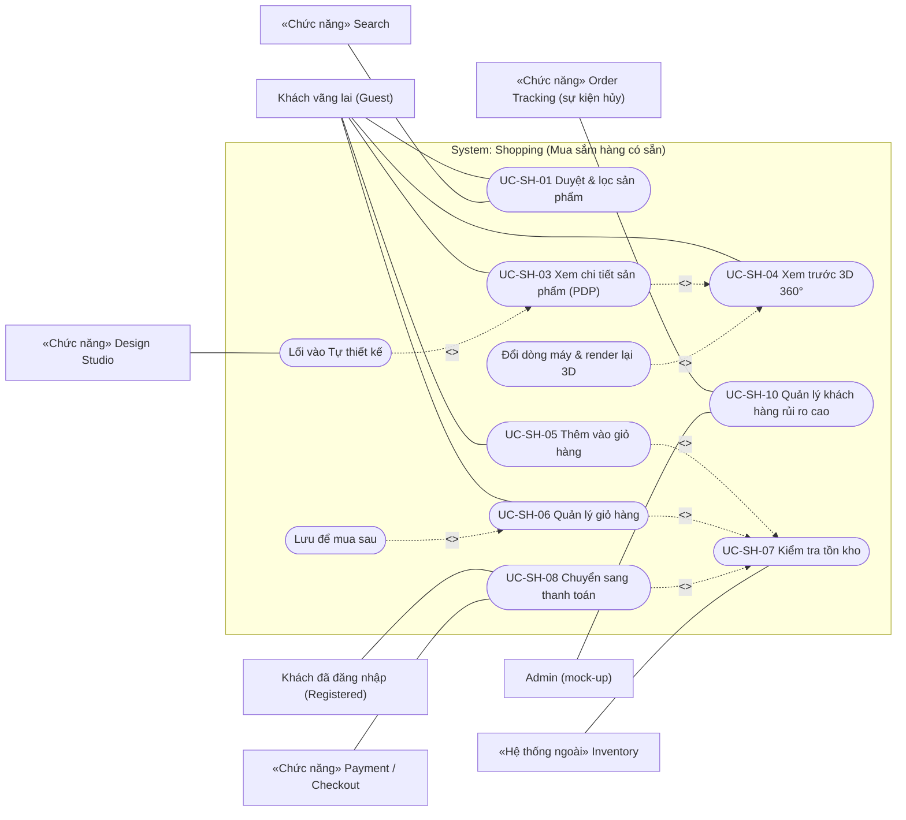

> Thay đổi: bỏ "Tìm kiếm Omni-search", "Tìm bằng hình ảnh", "Ghi log hành vi lọc/tìm kiếm" ([CHUYỂN → SRCH]); bỏ "Yêu cầu hủy đơn", "Chặn hủy khi đang in" ([CHUYỂN → OT]); Guest được thêm giỏ và quản lý giỏ.

#### 3.6.2. Đặc tả Use Case

| UC | Tên | Thay đổi so với bản gốc |
|---|---|---|
| UC-SH-01 | Duyệt và lọc sản phẩm | [SỬA] bước 3 thêm khoảng giá, tags; bước 5 ghi sự kiện qua `analytics_events` (bất đồng bộ); EXC Flow 2 hiển thị thông báo khi bỏ tham số sai |
| UC-SH-02 | ~~Tìm bằng hình ảnh, lưu hồ sơ thẩm mỹ~~ | [CHUYỂN → SRCH] UC-SRCH-03; [BỎ] AestheticProfile |
| UC-SH-03 | Xem chi tiết sản phẩm | [SỬA] bước 6: "Tự thiết kế phiên bản của bạn" (sang DES) hoặc "Thêm vào giỏ"; ALT Flow 2 (dòng máy không tương thích) [GIỮ] |
| UC-SH-04 | Xem sản phẩm dưới dạng 3D và 360° | [SỬA] Actor phụ "3D Rendering Engine" → thư viện `<model-viewer>` trên trình duyệt; EXC Flow 2 [BỎ] "nạp phiên bản trước" |
| UC-SH-05 | Thêm vào giỏ hàng | [SỬA] Actor: Khách vãng lai hoặc đã đăng nhập; ALT Flow 1 "Phôi hết hàng": **không tạo** CartItem, đề xuất "Báo khi có hàng" |
| UC-SH-06 | Quản lý giỏ hàng | [SỬA] Actor như UC-SH-05; thêm ALT "Sửa thiết kế" (FR-SH-12); ALT "Xóa" dùng hoàn tác 6 giây thay cho hộp xác nhận |
| UC-SH-07 | Kiểm tra tồn kho | [SỬA] Actor phụ "Inventory" là **hệ thống ngoài**; EXC Flow 2 "Giữ chỗ phôi thất bại" [BỎ] (không giữ chỗ tại giỏ) |
| UC-SH-08 | ~~Xác nhận điều khoản và~~ chuyển sang thanh toán | [SỬA] bỏ bước 4–8 (điều khoản, TermsAcceptance) – chuyển FR-P-18; còn: kiểm tra tồn kho → chuyển giỏ sang Checkout; khách vãng lai được đăng nhập tại Checkout (UC-P-01 A1.1) |
| UC-SH-09 | ~~Yêu cầu hủy đơn~~ | [CHUYỂN → OT] UC-OT-02, UC-OT-12 |
| UC-SH-10 | Quản lý khách hàng rủi ro cao | [SỬA] bỏ "điều chỉnh yêu cầu cọc" → "bật/tắt hạn chế COD"; mức mock-up |

#### 3.6.3. BPMN-SH [SỬA]

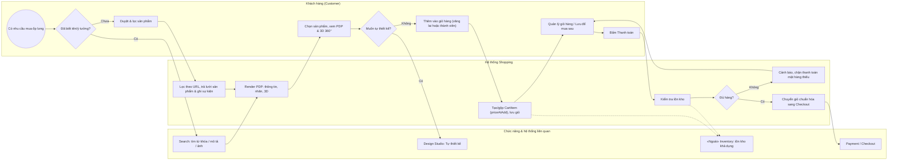

#### 3.6.4. Class Diagram – CD-SH [MỚI – bản gốc chưa có]

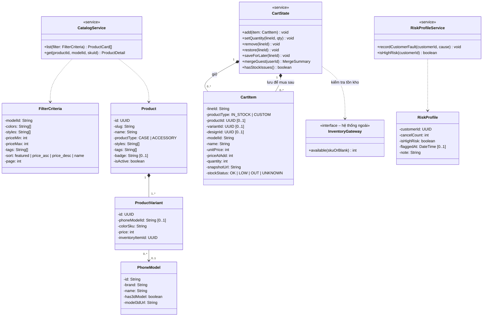

> CartItem dùng ràng buộc **một nguồn**: `variantId` (IN_STOCK) **hoặc** `designId` (CUSTOM) – khớp ràng buộc `one_source` của `order_items`.

---

## 4. Search (SRCH)

> Bối cảnh, mục tiêu và phạm vi: **[GIỮ]** như bản gốc (mục 1 tài liệu Search). Bổ sung: Search là **chủ sở hữu duy nhất** của tìm kiếm từ khóa, gợi ý theo mô tả, tìm bằng ảnh và nhật ký ý định trên toàn website.

### 4.1. Tóm tắt thay đổi

| Mã silo | Mức | Vấn đề | Cách khắc phục trong v3 |
|---|---|---|---|
| R1 | 🔴 | Mâu thuẫn quyền riêng tư với SH (AI server, AestheticProfile) | Giữ nguyên hướng xử lý ảnh **100% trên trình duyệt** (đã triển khai); [BỎ] UC-SH-02 và AestheticProfile |
| R2 | 🟠 | Hành vi "không khớp" khác DES | Thống nhất theo FR-SRCH-EX-01 (không trả đề xuất ngẫu nhiên); DES dùng chung thành phần gợi ý của SRCH (FR-DES-05/06 sửa lại) |
| R3 | 🟠 | Ba nơi ghi nhật ký ý định | SRCH sở hữu nhật ký; bộ lọc Shop và gợi ý trong Studio ghi qua `SearchService.log()` → `analytics_events` |
| R4 | 🟠 | Nguồn chính sách/CSKH gắn vào OrderTracking | Đổi thành `HelpCenterSearchSource` do **CS sở hữu nội dung**; OT cung cấp trang Chính sách đơn hàng như một mục |
| R5 | 🟡 | `SearchMode` thiếu IMAGE; thống kê không có giao diện | Bổ sung `IMAGE`; thống kê hiển thị ở khu quản trị (mock) |

### 4.2. Business Requirements

| Mã | Nội dung | Thay đổi |
|---|---|---|
| BR-SRCH-01 | Khách hàng cần một công cụ tìm kiếm thống nhất trên toàn bộ hệ thống website, cho phép truy vấn đồng thời sản phẩm ốp có sẵn, mẫu thiết kế và trang thông tin hỗ trợ, thay thế cho các ô tìm kiếm rời rạc tại thanh điều hướng (header), phân hệ Cửa hàng và Design Studio. | [GIỮ] |
| BR-SRCH-02 | Khách hàng chưa xác định được tên gọi cụ thể của sản phẩm cần được hệ thống gợi ý dựa trên mô tả bằng văn bản hoặc hình ảnh tham khảo. Mỗi đề xuất phải đi kèm cơ sở lý giải rõ ràng; trường hợp không nhận diện được nhu cầu, hệ thống không được trả về kết quả ngẫu nhiên. | [GIỮ] – áp dụng cho cả lối vào từ Design Studio |
| BR-SRCH-03 | Khi truy vấn không trả về kết quả phù hợp, hệ thống cần cung cấp các phương án điều hướng thay thế cho khách hàng, bao gồm chuyển sang chế độ gợi ý theo mô tả hoặc chuyển tiếp sang không gian tự thiết kế với chính ý tưởng vừa nhập. | [GIỮ] |
| BR-SRCH-04 | Khách hàng có thể truy cập nhanh trang chi tiết đơn hàng thông qua mã đơn hàng. Giao diện tìm kiếm không liệt kê danh sách đơn hàng; việc xác thực quyền truy cập được thực hiện độc lập tại trang chi tiết đơn hàng. | [GIỮ] |
| BR-SRCH-05 | Cơ chế xếp hạng ưu tiên hiển thị nhóm sản phẩm: các trang thông tin hỗ trợ chỉ xuất hiện khi có độ khớp cao và giới hạn tối đa 2 mục; sản phẩm tạm hết hàng vẫn được hiển thị nhưng **luôn xếp sau mọi sản phẩm còn hàng trong cùng nhóm** kèm nhãn trạng thái "Tạm hết". | [SỬA] làm rõ "xếp sau" là tuyệt đối |
| BR-SRCH-06 | Doanh nghiệp cần nắm bắt xu hướng tìm kiếm và các truy vấn không có kết quả mà vẫn đảm bảo quyền riêng tư: nhật ký hệ thống chỉ lưu trữ từ khóa **đã che thông tin cá nhân**, số lượng kết quả, phương thức tìm kiếm **(từ khóa / mô tả / hình ảnh / bộ lọc)** và thời điểm thực hiện (không lưu dữ liệu định danh cá nhân); hình ảnh do khách hàng tải lên được xử lý hoàn toàn tại trình duyệt phía máy khách, không truyền tải dữ liệu ra bên ngoài. | [SỬA] thêm che PII và các phương thức |

### 4.3. Functional Requirements

| Mã | Tên | BR | MoSCoW | Mô tả | Trạng thái |
|---|---|---|---|---|---|
| FR-SRCH-01 | Mở tìm kiếm | BR-SRCH-01 | M | Cho phép mở giao diện tìm kiếm thông qua thanh tìm kiếm trên thanh điều hướng (header), tổ hợp phím tắt tìm kiếm nhanh (Ctrl/⌘ K) hoặc nút chức năng Gợi ý theo mô tả (tại thanh điều hướng và Design Studio). Mỗi lần kích hoạt sẽ khởi tạo một phiên tìm kiếm mới: trường nhập liệu trống (ngoại trừ trường hợp khởi tạo kèm ý tưởng có sẵn), xóa trạng thái hình ảnh cũ, khóa cuộn nền phía sau để duy trì một thanh cuộn duy nhất và hỗ trợ phím thoát (Esc) để đóng giao diện. | ✅ |
| FR-SRCH-02 | Gợi ý trước khi gõ | BR-SRCH-01 | S | Hiển thị danh mục Tìm kiếm gần đây (tối đa 8 mục, kèm tùy chọn xóa lịch sử), danh sách từ khóa phổ biến, danh mục dòng thiết bị **đang được bán** (lấy từ danh mục thiết bị chung) và 4 mẫu thiết kế thịnh hành. Khi khách đã có dòng máy (Onboarding hoặc `caseyes_active_model`), dòng máy đó xếp đầu. | 🟡 Danh sách dòng máy cứng, có dòng không bán |
| FR-SRCH-03 | Kết quả nhanh khi gõ | BR-SRCH-01, BR-SRCH-05 | M | Sau 150 ms kể từ khi người dùng ngừng nhập liệu, hệ thống phân nhóm kết quả gồm: Mẫu thiết kế (3 mục), Ốp có sẵn (3 mục) và Thông tin hỗ trợ (tối đa 2 mục); cuối danh sách cung cấp nút "Xem tất cả N kết quả" (N = số mẫu thiết kế + ốp có sẵn, **không tính** mục hỗ trợ, khớp với trang /tim-kiem). Hỗ trợ điều hướng giữa các mục kết quả bằng các phím mũi tên lên và xuống. | 🟡 N đang tính cả mục hỗ trợ |
| FR-SRCH-04 | Hiểu tiếng Việt | BR-SRCH-01 | M | Hỗ trợ truy vấn không dấu tiếng Việt (ví dụ: nhập "hoa la" trả về nhóm "Hoa lá"); chấp nhận sai lệch tối đa một ký tự đối với từ có độ dài từ 4 ký tự trở lên; hỗ trợ nhận diện từ đồng nghĩa (ví dụ: "dẻo" ánh xạ sang chất liệu ốp TPU). Cơ chế tính điểm xếp hạng được quy định tại Bảng 3.1. | ✅ |
| FR-SRCH-05 | Nhận dòng máy | BR-SRCH-01 | S | Tự động bóc tách tên dòng điện thoại ra khỏi chuỗi từ khóa: ví dụ, truy vấn "ốp mèo ip15 pro max" sẽ hiển thị thẻ nhận diện "dòng máy iPhone 15 Pro Max" và thực thi tìm kiếm với từ khóa chính "ốp mèo". Thẻ nhận diện là **bộ lọc có thể tắt**: khi bật, chỉ hiện sản phẩm tương thích dòng máy và liên kết kết quả mang theo `?model=`. Dòng máy không được bán → thông báo "Chưa hỗ trợ dòng máy này". | 🟡 Chỉ hiển thị nhãn, chưa lọc |
| FR-SRCH-06 | Lối tắt mã đơn | BR-SRCH-04 | S | Khi chuỗi nhập liệu khớp với cấu trúc mã đơn hàng CC-xxxxxx-xxxx (không phân biệt chữ hoa, chữ thường, dấu gạch tùy chọn), hệ thống hiển thị lối tắt "Mở đơn hàng CC-…"; khi nhấn phím xác nhận (Enter), hệ thống điều hướng trực tiếp tới đường dẫn /order-tracking/<mã đơn>. | ✅ |
| FR-SRCH-07 | Gợi ý theo mô tả | BR-SRCH-02 | M | Cung cấp khung nhập liệu đa dòng kèm các câu mô tả tham khảo; chỉ phân tích khi mô tả ≥ 3 ký tự (ô rỗng vô hiệu hóa lệnh gửi và hiện nhắc "Vui lòng nhập mô tả ý tưởng thiết kế"). Hệ thống tổng hợp lại nhu cầu nhận diện được ("Hệ thống nhận diện nhu cầu: …") và trả về tối đa 12 thẻ kết quả, mỗi thẻ đi kèm lý do đề xuất (ví dụ: "Phù hợp với: tím · pastel"); bộ trọng số đánh giá được trình bày tại Bảng 3.2. Giao diện luôn đi kèm nút điều hướng "Tự thiết kế với ý tưởng này". **Đây là thành phần dùng chung cho nút "Gợi ý mẫu theo mô tả" của Design Studio.** | ✅ (thiếu câu nhắc ô rỗng) |
| FR-SRCH-08 | Tìm bằng ảnh | BR-SRCH-02, BR-SRCH-06 | S | Tiếp nhận tệp hình ảnh định dạng JPG, PNG hoặc WebP với dung lượng tối đa 5 MB và thực hiện xử lý trực tiếp trên trình duyệt người dùng. Hệ thống trích xuất bảng màu kèm tên tông màu ("Tông màu chủ đạo nhận diện được: xanh lá · xanh dương"), chỉ trả về các mẫu tương đồng về màu sắc (chỉ số tương đồng ≥ 0,4, tối đa 12) kèm lý do đề xuất. Giới hạn kỹ thuật: thuật toán đối sánh dựa trên đặc trưng màu sắc, chưa hỗ trợ nhận diện ngữ nghĩa đối tượng trong ảnh. | ✅ |
| FR-SRCH-09 | Trang kết quả /tim-kiem | BR-SRCH-01, BR-SRCH-05 | M | Hiển thị các thẻ phân loại: Tất cả /Mẫu thiết kế / Ốp có sẵn kèm số lượng tương ứng; cung cấp bộ lọc phong cách (tối đa 6 nhãn phổ biến nhất) và tùy chọn sắp xếp theo độ phù hợp hoặc mức giá. Trang kết quả không bố trí thanh tìm kiếm thứ hai; nút "Sửa tìm kiếm" dùng để mở lại giao diện lớp phủ tìm kiếm. | ✅ |
| FR-SRCH-10 | Không có kết quả | BR-SRCH-03 | M | Hiển thị hai nút điều hướng: "Gợi ý theo mô tả" và "Tự thiết kế với ý tưởng này". Lựa chọn thứ hai điều hướng tới /design-studio/templates?y=<ý tưởng>, tại đó Design Studio hiển thị thanh thông báo "Ý tưởng của bạn" cùng nút "Bắt đầu từ phôi trắng". | ✅ |
| FR-SRCH-11 | Mở sản phẩm từ kết quả | BR-SRCH-01 | M | Thẻ mẫu thiết kế điều hướng tới /design-studio và tự động mở hộp thoại chi tiết mẫu tương ứng (`?template=`); thẻ ốp có sẵn dẫn tới trang chi tiết sản phẩm thuộc phân hệ Cửa hàng; **thẻ phụ kiện mở Xem nhanh phụ kiện**; thẻ thông tin hỗ trợ dẫn tới trang chính sách tương ứng. | 🟡 Phụ kiện chỉ dẫn về `/shop` |
| FR-SRCH-12 | Nhật ký tìm kiếm | BR-SRCH-06 | S | Mỗi phiên tìm kiếm ghi nhận vào `analytics_events` (`search.query.submitted`): từ khóa đã che PII, số lượng kết quả theo nhóm, phương thức `KEYWORD / DESCRIBE / IMAGE / FILTER`, dấu thời gian, mục được chọn (nếu có); không lưu thông tin định danh người dùng. Ghi cả khi mở trực tiếp `/tim-kiem?q=` và khi tìm bằng ảnh (chỉ lưu tên tông màu, không lưu ảnh). Thống kê từ khóa phổ biến và từ khóa không có kết quả hiển thị trong khu quản trị (mock-up). | 🟡 Lưu localStorage 300 dòng; không ghi chế độ ảnh, không ghi khi mở `/tim-kiem`; chưa có giao diện |
| FR-SRCH-13 | Nguồn dữ liệu tìm kiếm | BR-SRCH-01 | M | Mỗi chức năng tự khai báo nguồn qua token `SEARCH_SOURCES`: `ShopSearchSource` (SH), `DesignTemplateSearchSource` (DES, nạp lười, **thử lại khi lỗi**), `HelpCenterSearchSource` (CS – chính sách đơn hàng, FAQ, CSKH, theo dõi đơn). | 🟡 Nguồn mẫu thiết kế không thử lại khi lỗi |

> Bảng 3.1 (điểm xếp hạng văn bản) và Bảng 3.2 (trọng số gợi ý theo mô tả: chủ đề 4, phong cách 3, màu 2,5, chất liệu 1,5, dịp 1): **[GIỮ]** – khớp mã nguồn `rank.ts`.

### 4.4. Edge Cases & Business Rules

| Mã yêu cầu | Tên yêu cầu | BR | MoSCoW | Mô tả | Trạng thái |
|---|---|---|---|---|---|
| FR-SRCH-EX-01 | Mô tả không chứa ý muốn nhận ra được | BR-SRCH-02 | Must have | Không trả về đề xuất ngẫu nhiên; hiển thị thông báo "Hệ thống chưa nhận diện được yêu cầu cụ thể", cung cấp câu mô tả tham khảo và nút "Tự thiết kế với ý tưởng này". | ✅ |
| FR-SRCH-EX-02 | Ảnh sai định dạng hoặc quá 5 MB | BR-SRCH-06 | Must have | Hiển thị thông báo lỗi cụ thể, dừng tiến trình xử lý và cho phép khách hàng chọn lại tệp hình ảnh khác. | ✅ |
| FR-SRCH-EX-03 | Không có mẫu cùng tông với ảnh | BR-SRCH-02, 03 | Should have | Thông báo rõ ràng về việc không có mẫu trùng khớp hoàn toàn tông màu, đồng thời đề xuất 6 mẫu có dải màu gần nhất kèm nút "Tự thiết kế theo tông màu này". | ✅ |
| FR-SRCH-EX-04 | Từ khóa quá ngắn | BR-SRCH-01 | Must have | Đối với từ có độ dài dưới 4 ký tự, hệ thống không áp dụng cơ chế khớp tiền tố và không kích hoạt thuật toán sửa lỗi chính tả (nhằm tránh trường hợp truy vấn "hoa" trả về trang "hoàn tiền"). | ✅ |
| FR-SRCH-EX-05 | Mã đơn đúng dạng nhưng không xem được | BR-SRCH-04 | Must have | Công cụ tìm kiếm không kiểm tra sự tồn tại của đơn hàng; trang chi tiết đơn hàng chịu trách nhiệm xác thực và thông báo nếu đơn hàng không tồn tại hoặc không thuộc quyền sở hữu của tài khoản đang đăng nhập. | ✅ |
| FR-SRCH-EX-06 | Trang hỗ trợ lấn kết quả sản phẩm | BR-SRCH-05 | Should have | Các trang thông tin hỗ trợ chỉ xuất hiện khi nội dung tiêu đề hoặc từ khóa đặc trưng của trang khớp trực tiếp, giới hạn tối đa 2 mục (ví dụ: truy vấn "hủy đơn" trả về tối đa 2 trang chính sách liên quan). | ✅ |
| FR-SRCH-EX-07 | Khách gõ liên tục | BR-SRCH-01 | Should have | Áp dụng cơ chế trì hoãn (debounce) 150 ms trước khi thực thi truy vấn; đảm bảo kết quả phản hồi của truy vấn cũ không ghi đè lên kết quả của truy vấn mới nhất. | ✅ |
| FR-SRCH-EX-08 | Một nguồn chưa tải xong hoặc lỗi | BR-SRCH-01 | Should have | Hệ thống vẫn hiển thị kết quả từ các nguồn khả dụng còn lại, không làm gián đoạn phiên tìm kiếm; kho dữ liệu mẫu thiết kế của Design Studio được tải theo yêu cầu (lazy loading) ở lần truy vấn đầu tiên **và được thử lại ở lần truy vấn kế tiếp nếu lần trước lỗi** (hiện dòng "Một số mẫu thiết kế chưa tải được"). | 🟡 |
| FR-SRCH-EX-09 | [MỚI] Từ khóa chứa thông tin cá nhân | BR-SRCH-06 | Must have | Chuỗi khớp mã đơn, SĐT, email không được ghi nguyên văn vào nhật ký mà thay bằng nhãn loại (`<ORDER_CODE>`, `<PHONE>`, `<EMAIL>`); không lưu vào "Tìm kiếm gần đây". | ⬜ |
| FR-SRCH-EX-10 | [MỚI] Dò mã đơn hàng | BR-SRCH-04 | Should have | Trang chi tiết đơn giới hạn số lần mở mã đơn không thuộc tài khoản (≤ 10 lần/10 phút/phiên) trước khi yêu cầu đăng nhập lại. | ⬜ |
| FR-SRCH-EX-11 | [MỚI] Dòng máy không được bán | BR-SRCH-01 | Should have | Theo FR-SRCH-05: thông báo chưa hỗ trợ và gợi ý dòng máy gần nhất; không trả về rỗng im lặng. | ⬜ |
| FR-SRCH-EX-12 | [MỚI] Từ chung chung khớp mọi sản phẩm | BR-SRCH-05 | Should have | Văn bản tìm kiếm của sản phẩm chỉ chứa dòng máy tương thích; từ như "galaxy", "iphone" khi không phải alias đầy đủ được coi là bộ lọc hãng, không cộng điểm văn bản cho mọi sản phẩm. | ⬜ |
| FR-SRCH-EX-13 | [MỚI] Từ tiếng Anh / viết tắt | BR-SRCH-01 | Could have | Từ điển đồng nghĩa bổ sung từ tiếng Anh phổ biến (cute, cat, flower, minimal) và viết tắt (dth → dễ thương). | 🟡 |
| FR-SRCH-EX-14 | [MỚI] Ảnh quá nhiều màu | BR-SRCH-02 | Could have | Khi không có màu nào chiếm ≥ 12%, giải thích giới hạn đối sánh màu và gợi ý chuyển sang "Gợi ý theo mô tả". | ⬜ |
| FR-SRCH-EX-15 | [MỚI] Không đọc được ảnh | BR-SRCH-06 | Must have | Ảnh hỏng hoặc trình duyệt không giải mã được → "Không đọc được ảnh này…", cho chọn lại. | ✅ |
| FR-SRCH-EX-16 | [MỚI] Hàng tạm hết lẫn với hàng còn | BR-SRCH-05 | Must have | Sắp xếp hai tầng: còn hàng trước, sau đó điểm phù hợp; áp dụng cả overlay và /tim-kiem. | 🟡 Đang trừ điểm thay vì xếp tuyệt đối |

### 4.5. CX touchpoint & Data foundation

| Loại | Đề xuất | Chi tiết |
|---|---|---|
| **CX touchpoint** | **Tìm kiếm cá nhân hóa theo dòng máy của khách** | Dòng máy từ Onboarding/`caseyes_active_model` được bật sẵn thành chip "Chỉ hiện mẫu cho iPhone 15 Pro Max" (tắt được); gợi ý trước khi gõ ưu tiên phong cách đã chọn ở Onboarding. Khách thấy ngay sản phẩm *mua được cho máy của mình* – giảm thao tác lọc và tránh mua nhầm dòng máy. |
| **Data foundation** | **Nhật ký ý định có kết quả nhấp chuột (search-to-cart)** | Mở rộng FR-SRCH-12: `normalized_query`, `detected_model`, `detected_concepts[]`, `result_count_by_group`, `clicked_item_id`, `click_position`, `ranking_version`; nối với `shop.cart.added` / `design.cart.added` qua `session_id`. Tổng hợp hàng tuần **danh sách truy vấn không có kết quả** làm đầu vào cho đội tạo mẫu mới của Design Studio. |

### 4.6. Mô hình hóa

#### 4.6.1. Use Case Diagram – DIAG-SRCH [SỬA]

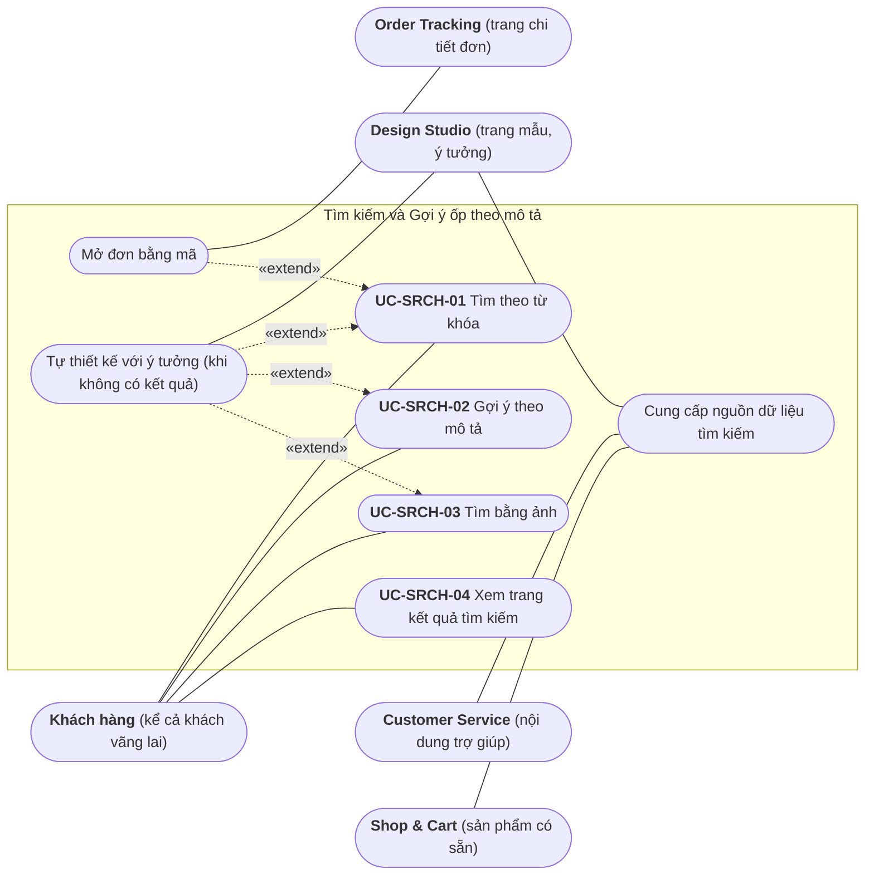

#### 4.6.2. Đặc tả Use Case

| UC | Thay đổi |
|---|---|
| UC-SRCH-01 Tìm theo từ khóa | [SỬA] bước 4: "…bỏ dấu, tách dòng máy (bật chip lọc dòng máy), đổi từ đồng nghĩa và xếp hạng (còn hàng trước)…"; bước 5: "…và ghi nhật ký (đã che PII)". Các bước khác [GIỮ] |
| UC-SRCH-02 Gợi ý theo mô tả | [SỬA] Trigger bổ sung "nút Gợi ý mẫu theo mô tả trong Kho mẫu Design Studio"; thêm EXC 2.1: mô tả < 3 ký tự → vô hiệu hóa gửi, hiện câu nhắc |
| UC-SRCH-03 Tìm bằng ảnh | [SỬA] bước 5: ghi nhật ký phương thức IMAGE (chỉ tên tông màu); thêm EXC 2.2 ảnh không đọc được; ALT 5.2 ảnh quá nhiều màu |
| UC-SRCH-04 Xem trang kết quả tìm kiếm | [SỬA] bước 1: ghi nhật ký khi mở trực tiếp `/tim-kiem?q=`; bước 4: "hàng tạm hết luôn xếp sau với nhãn Tạm hết" |

#### 4.6.3. BPMN-SRCH [SỬA]

[GIỮ] toàn bộ cấu trúc sơ đồ gốc; thay đổi các nút sau:

| Nút | Bản gốc | v3 |
|---|---|---|
| `pool_src` | "Nguồn tìm kiếm: Shop · Design Studio · Quản lý đơn hàng (chính sách, CSKH)" | "Nguồn tìm kiếm: Shop (ốp, phụ kiện) · Design Studio (mẫu thiết kế) · Customer Service (trợ giúp, chính sách đơn hàng)" |
| `tk34` | "Xếp hạng trên các nguồn, gom nhóm kết quả kèm lý do" | "Xếp hạng (còn hàng trước), áp chip dòng máy, gom nhóm kết quả kèm lý do" |
| `tk37` | "Ghi nhật ký: từ khóa, số kết quả, cách tìm, thời điểm (không lưu người tìm)" | "Ghi nhật ký: từ khóa đã che PII, số kết quả theo nhóm, cách tìm (từ khóa/mô tả/ảnh), thời điểm, mục được chọn" |
| `tk9` (mới nhánh) | – | "Nhập mô tả (≥ 3 ký tự)" |

#### 4.6.4. Class Diagram – CD-SRCH [SỬA]

[GIỮ] các lớp `SearchEngine`, `SearchService`, `ColorIndex`, `QueryIntent`, `SearchItem`, `SearchHit`, `ColorProfile`, `ColorSwatch`, `RecentSearch`, `ConceptGroup`, `ItemKind`. Thay đổi:

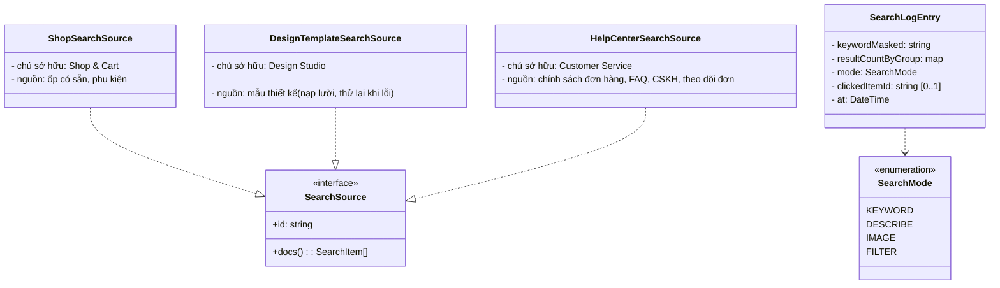

> `SearchSource.load()` đổi thành `docs()` theo mã nguồn; `OrderTrackingSearchSource` đổi thành `HelpCenterSearchSource`; `SearchMode` bổ sung `IMAGE`, `FILTER`; `SearchItem` bổ sung trường `phoneModels` để lọc dòng máy.

---

## 5. Design Studio (DES)

### 5.1. Tóm tắt thay đổi

| Mã silo | Mức | Vấn đề | Cách khắc phục trong v3 |
|---|---|---|---|
| D1 | 🔴 | Trùng quy trình kiểm duyệt với OT, khác quy tắc và người duyệt | Kiểm duyệt **[CHUYỂN → OT]** (FR-OT-15): **mọi đơn có hàng CUSTOM** vào `Pending_Review` (khớp `place_order`), người duyệt là **Operator**. DES chỉ gắn cờ `requires_moderation` + lý do và cung cấp luồng mở lại Canvas để gửi duyệt lại. [BỎ] `ModerationQueueItem`, `DesignReview` khỏi DES |
| D2 | 🔴 | DES hoàn tiền tự động qua Payment Gateway | [BỎ]. "Hủy đơn & Hoàn tiền 100%" gọi OT `cancel_rejected_order()` → OT tạo `RefundRequest(S2)`, Admin chuyển khoản thủ công (BR-OT-05) |
| D3 | 🟠 | Package CartOrder và enum `OrderStatusDetail` riêng | Thu hẹp còn tham chiếu (`designId`, `phoneModelId`, `printFileUrl`); dùng `OrderStatus` 12 giá trị của OT |
| D4 | 🟠 | Gợi ý theo mô tả trùng SRCH, hành vi "không khớp" ngược nhau | FR-DES-05/06 dùng thành phần FR-SRCH-07; không trả đề xuất ngẫu nhiên; `?y=` hiển thị banner ý tưởng + **lọc/cuộn** tới mẫu phù hợp |
| D5 | 🟠 | Quy tắc ảnh khác SRCH, SH | Theo Bảng 0.6 (DES chấp nhận PNG/JPG/WebP – khớp mã nguồn) |
| – | 🟠 | (Phát hiện khi đối chiếu) Bản vẽ, consent, ảnh chỉ nằm ở localStorage | FR-DES-18/25/14 yêu cầu lưu bảng `designs`, `design_consents`, Storage `design-assets` |

### 5.2. Business Requirements

| Mã | Nội dung | Thay đổi |
|---|---|---|
| BR-DES-01 | Khách hàng cần chọn đúng dòng máy điện thoại của mình trước khi bắt đầu thiết kế để chiếc ốp lưng đặt in vừa khít phần cứng thực tế (vị trí cụm camera, kích thước thân máy) và hệ thống nạp đúng phôi in. | [GIỮ] |
| BR-DES-02 | Khách hàng cần tiếp cận Studio qua một lối vào tập trung duy nhất tại Kho mẫu (/design-studio/templates), hệ thống ghi nhớ dòng máy đã chọn và dành vị trí số 1 cho "Ốp Lưng Trắng Tiêu Chuẩn" (#tự_thiết_kế) để người dùng tự do sáng tạo từ số 0. | [GIỮ] |
| BR-DES-03 | Khách hàng cần tìm ý tưởng thiết kế bằng ngôn ngữ tự nhiên hoặc theo phong cách nghệ thuật (#Cute, #Tối_giản, #Hoa_lá, #Abstract…) để hệ thống lọc nhanh các mẫu phôi phù hợp mà không cần nhớ mã sản phẩm. *Tìm theo ngôn ngữ tự nhiên dùng thành phần Gợi ý theo mô tả của Search (BR-SRCH-02).* | [SỬA] ghi rõ chủ sở hữu |
| BR-DES-04 | Mọi tác phẩm trong Design Studio là mẫu phôi số phục vụ in theo yêu cầu (POD). Khách hàng bắt buộc đưa mẫu lên Canvas để khởi tạo mã thiết kế độc bản (DesignID) trước khi đặt hàng; loại bỏ hoàn toàn luồng "Mua ngay" hàng in sẵn. | [GIỮ] |
| BR-DES-05 | Khách hàng cần bộ công cụ chỉnh sửa trực quan (thêm ảnh, chữ, sticker, đổi màu nền), nhấp đúp soạn chữ trực tiếp, cắt xén 4 phía và kéo tràn viền mờ 50% để tự cá nhân hóa ốp lưng mà không cần kỹ năng đồ họa. | [GIỮ] |
| BR-DES-06 | Khách hàng cần xem trước 2D thời gian thực và mô hình 3D WebGL xoay 360° (cho các dòng có mô hình 3D; dòng khác dùng chuẩn phôi in 2D) để an tâm về thẩm mỹ trước khi thanh toán. | [GIỮ] |
| BR-DES-07 | Khách hàng cần được hệ thống tự động tối ưu ảnh dung lượng lớn (> 10MB, bảo toàn độ trong suốt PNG), cảnh báo ảnh độ phân giải thấp (< 150 DPI) và bảo vệ vùng in an toàn để tránh lỗi in nhòe mờ. | [GIỮ] |
| BR-DES-08 | Khách hàng thành viên cần lưu nhiều bản vẽ vào "My Designs" **gắn với tài khoản (lưu trên CSDL)**, đặt tên ở lần lưu đầu tiên, được lưu ngầm tự động chu kỳ 60 giây, có tiện ích nhân bản, đổi tên, xóa có xác nhận và được cảnh báo khi thoát lúc còn thay đổi chưa lưu. | [SỬA] gắn tài khoản |
| BR-DES-09 | Khách hàng vãng lai cần được sáng tạo không rào cản: bản nháp tự lưu vào trình duyệt, được mời đăng nhập để bảo vệ công sức và tự động đồng bộ sang tài khoản ngay sau khi đăng nhập (theo Guest Session Contract – FR-AUTH-03). | [SỬA] tham chiếu hợp đồng chung |
| BR-DES-10 | Khách hàng cần đưa chính xác cấu hình bản vẽ hoàn thiện (DesignID, **phiên bản bản vẽ**, ảnh xem trước độ phân giải cao, thông số phôi in) vào giỏ hàng để xưởng POD nhận đúng thiết kế đã duyệt. | [SỬA] thêm phiên bản |
| BR-DES-11 | Doanh nghiệp định hình 100% mẫu hiển thị trong Design Studio là mẫu phôi mở được phép tùy biến, tách biệt hoàn toàn với các sản phẩm trong Catalog. | [GIỮ] |
| BR-DES-12 | Doanh nghiệp cần thu thập telemetry hành vi phi chặn (nguồn vào Studio, phong cách được quan tâm, thời điểm lưu, điểm bỏ dở) để phân tích hành trình khách hàng và tối ưu giao diện. | [GIỮ] – ghi vào `analytics_events` |
| BR-DES-13 | Doanh nghiệp cần ngăn nội dung phản cảm, vi phạm pháp luật trên ốp lưng thông qua bộ lọc từ khóa cấm tức thì (BANNED_KEYWORDS) và quy trình hậu kiểm có kiểm duyệt viên **(Operator – hàng chờ duyệt thiết kế của Order Tracking)** trước khi xuất xưởng. | [SỬA] chủ sở hữu kiểm duyệt |
| BR-DES-14 | Doanh nghiệp cần xác nhận cam kết bản quyền điện tử (ConsentRecord) với ảnh do người dùng tải lên, có tùy chọn "Ghi nhớ và không nhắc lại" để vừa đảm bảo pháp lý vừa giữ trải nghiệm liền mạch. | [GIỮ] |
| BR-DES-15 | Khách hàng cần được thông báo rõ lý do khi bản thiết kế bị từ chối in và được chủ động chọn: (1) mở lại Canvas để chỉnh sửa và gửi duyệt lại, hoặc (2) hủy đơn và nhận hoàn tiền 100% **(Order Tracking tạo yêu cầu hoàn, Admin xác nhận chuyển khoản)**. | [SỬA] |
| BR-DES-16 | Doanh nghiệp chuẩn hóa một dòng phôi Polycarbonate cao cấp (viền dẻo TPU chống sốc, lưng cứng chống ố) và chính sách đồng giá 250.000 VNĐ cho toàn bộ sản phẩm custom; không hiển thị giá ở kho mẫu để khách tập trung vào sáng tạo. | [GIỮ] |

### 5.3. Functional Requirements

| Mã | BR | MoSCoW | Mô tả | Trạng thái |
|---|---|---|---|---|
| FR-DES-01 | BR-DES-01 | M | Khách hàng chọn Hãng và Dòng máy qua một modal, bấm "Tiếp tục"; hệ thống nạp Base SKU, cụm camera và mặt nạ vùng in (SafeZoneMask), ghi nhớ caseyes_active_model **và khôi phục dòng máy này khi tải lại trang**. Danh mục dòng máy lấy từ danh mục thiết bị chung (`phone_models` đang hoạt động). | 🟡 Không khôi phục sau F5; danh mục cứng 5 dòng |
| FR-DES-02 | BR-DES-01 | S | Khi đổi dòng máy lúc Canvas đã có layer, hệ thống hiển thị modal "Đổi dòng điện thoại" **cảnh báo các phần tử có thể xê dịch** và chỉ co dãn lại bố cục sau khi khách bấm "Xác nhận & Cập nhật phôi ốp"; "Hủy bỏ" giữ nguyên máy cũ. | 🟡 Modal cảnh báo không bao giờ hiện (lỗi thứ tự gọi) |
| FR-DES-03 | BR-DES-02 | M | Thanh điều hướng chính có một mục "Thiết kế" duy nhất dẫn vào Kho mẫu (/design-studio/templates). | ✅ |
| FR-DES-04 | BR-DES-02 | M | Banner trang chủ có một nút CTA duy nhất "Bắt đầu thiết kế ngay!" dẫn vào /design-studio; nếu chưa có dòng máy, hệ thống mở modal cho phép chọn dòng máy. | ✅ |
| FR-DES-05 | BR-DES-03 | S | Nút "Gợi ý mẫu theo mô tả" trong Kho mẫu mở thành phần Gợi ý theo mô tả của Search (FR-SRCH-07). Khi vào Kho mẫu với `?y=<ý tưởng>`, hệ thống hiển thị banner "Ý tưởng của bạn", **lọc và cuộn tới các mẫu phù hợp** (theo FR-SRCH-07), kèm nút "Bắt đầu từ phôi trắng". Ô rỗng thì vô hiệu hóa lệnh gửi. | 🟡 `?y=` chỉ hiện banner |
| FR-DES-06 | BR-DES-03 | S | Khi mô tả không khớp mẫu nào, áp dụng FR-SRCH-EX-01: thông báo thân thiện "Chưa tìm thấy mẫu chính xác theo mô tả của bạn", gợi ý cách diễn đạt lại, nút "Tự thiết kế với ý tưởng này"; khu vực riêng **"Mẫu đang được yêu thích"** (tối đa 4, ghi rõ không phải kết quả phù hợp). | 🟡 Chưa có khu mẫu yêu thích |
| FR-DES-07 | BR-DES-02 | M | Kho mẫu đặt "Ốp Lưng Trắng Tiêu Chuẩn" ở vị trí số 1 cùng thanh lọc phong cách dạng viên thuốc (Tất cả, Đã thích, #Cute, #Tối_giản, #Hoa_lá…), cho phép chọn nhiều phong cách; trạng thái lọc phản ánh trên URL (`?category=`). | 🟡 Lọc chưa lên URL |
| FR-DES-08 | BR-DES-04 | M | Thẻ mẫu chỉ mở xem chi tiết trên 1 modal (3D/2D, mô tả, hashtag, góp ý thẩm mỹ, yêu thích), không hiển thị giá và không có nút "Mua ngay". | ✅ (góp ý chỉ lưu bộ nhớ) |
| FR-DES-09 | BR-DES-04 | M | Bấm "Dùng mẫu này & Vào Studio" trên modal xem chi tiết mẫu sẽ nạp toàn bộ layer SVG, ảnh, chữ của mẫu lên Canvas và khởi tạo Design ở trạng thái DRAFT **(sinh DesignID, lưu `template_id`)**. | 🟡 Chưa sinh DesignID |
| FR-DES-10 | BR-DES-11 | M | 100% mẫu trong kho đều chỉnh sửa được trên Canvas; mẫu có cờ `is_active = false` (ví dụ do khiếu nại bản quyền) không hiển thị. | ✅ (chưa có cờ `is_active`) |
| FR-DES-11 | BR-DES-05 | M | Canvas hỗ trợ 4 loại phần tử qua Tool Rail ("Thêm ảnh", "Thêm chữ", "Sticker", "Nền"); kéo thả, xoay, co dãn tự do. | ✅ |
| FR-DES-12 | BR-DES-05 | S | Bảng thuộc tính hỗ trợ font, cỡ chữ, màu, độ mờ, lật ảnh, đổi thứ tự lớp (Layers), Undo /Redo (tối đa 30 bước) và danh sách Phím tắt. | ✅ |
| FR-DES-13 | BR-DES-05 | M | Nhấp đúp vào layer chữ trên Canvas để sửa in-place; tự xóa layer chữ rỗng khi rời ô nhập. | ✅ |
| FR-DES-14 | BR-DES-07 | M | Phần tử Thêm ảnh nhận ảnh PNG, JPG, WebP ("Bấm hoặc kéo thả ảnh"); ảnh > 10MB được nén về kích thước tối ưu, giữ nguyên kênh Alpha của PNG (có thông báo đã tối ưu ảnh); ảnh hợp lệ được tải lên Storage `design-assets` thay vì lưu base64. | 🟡 Lưu base64 trong localStorage |
| FR-DES-15 | BR-DES-07 | S | Ảnh < 150 DPI sẽ kích hoạt 1 modal cảnh báo "Ảnh có thể in mờ" với hai lựa chọn "Tiếp tục dùng" (gắn cờ `is_low_dpi`, hiện biểu tượng cảnh báo trong Layers) hoặc "Thay ảnh khác" (mở lại khung tải ảnh). Thứ tự kiểm tra: định dạng → nén → cam kết bản quyền → DPI. | 🟡 Thiếu biểu tượng Layers; thứ tự DPI trước cam kết |
| FR-DES-16 | BR-DES-06 | M | Khung 2D kết xuất thời gian thực (< 100ms) đúng hình dạng thân máy, cụm camera và nút vật lý của dòng máy. | ✅ |
| FR-DES-17 | BR-DES-06 | S | Khung "Preview 3D (Xoay 360°)" bằng <model-viewer> cho các dòng có mô hình (has_3d_model = true); dòng khác hiển thị nhãn chuẩn phôi in 2D. | ✅ |
| FR-DES-18 | BR-DES-08 | M | Khách đã đăng nhập bấm "Lưu thiết kế" lần đầu (hoặc biểu tượng bút chì cạnh tiêu đề) → Hiện modal "Đặt tên cho bản thiết kế"; bấm "Lưu thiết kế" để lưu vào bảng `designs` (gắn `user_id`, `canvas_json`, `preview_url`, `phone_model_id`, `template_id`, `version`). My Designs chỉ hiển thị bản vẽ của tài khoản đang đăng nhập; bản vẽ xác định theo DesignID (không theo tên). | 🧪 Lưu localStorage dùng chung, khớp theo tên |
| FR-DES-19 | BR-DES-09 | M | Khách vãng lai bấm "Lưu thiết kế" hoặc "Thêm vào giỏ" → hệ thống ghi ngầm caseyes_guest_draft vào localStorage và hiển thị modal ("Đăng nhập / Đăng ký ngay" & "Để sau (Tiếp tục thiết kế)"). Ghi local thất bại thì báo khách và giữ nguyên canvas. | 🟡 Chưa bắt lỗi ghi localStorage |
| FR-DES-20 | BR-DES-09 | M | Ngay sau khi đăng nhập thành công (ở bất kỳ trang nào), hệ thống phát hiện nháp vãng lai, đồng bộ vào tài khoản theo FR-AUTH-03, xóa key tạm, mở modal Đặt tên (nếu chưa có tên) và thông báo đồng bộ thành công; nếu khách đang ở luồng "Thêm vào giỏ" thì tiếp tục thêm giỏ và điều hướng sang giỏ hàng. | 🟡 Chỉ chạy khi Studio đang mở; không tiếp tục luồng giỏ |
| FR-DES-21 | BR-DES-10 | M | Nút "Thêm vào giỏ" lưu bản vẽ (FR-DES-18), rồi đóng gói `{designId, designVersion, phoneModelId, baseSku, previewUrl (PNG), unitPrice = 250.000, requiresModeration = true, quantity = 1, productType = CUSTOM}` vào Line Item của Shopping & Cart, hiển thị Toast xác nhận. Ảnh preview được tạo cho **mọi** dòng máy (kể cả dòng không có 3D). | 🟡 Thiếu DesignID/canvas; dòng không 3D không có preview |
| FR-DES-22 | BR-DES-08 | S | Lưu ngầm định kỳ 60 giây vào **một** khóa nháp duy nhất (`caseyes_guest_draft` khi vãng lai; bản ghi `designs` khi đã đăng nhập); khu vực nút Lưu hiển thị trạng thái "Bản nháp được lưu liên tục" kèm mốc thời gian lưu gần nhất; khôi phục nháp khi mở lại Studio. | 🟡 Hai cơ chế/khóa nháp song song |
| FR-DES-23 | BR-DES-12 | C | Ghi sự kiện telemetry bất đồng bộ vào `analytics_events` (nguồn vào Studio, mẫu đã áp dụng, công cụ sử dụng, thời điểm lưu, thêm giỏ, bỏ dở) không làm chậm Canvas. | ⬜ |
| FR-DES-24 | BR-DES-14 | M | Trước khi nạp ảnh cá nhân, hệ thống hiển thị modal báo "Chính sách nội dung in ấn" yêu cầu tick "Tôi cam kết sở hữu bản quyền" rồi bấm "Đồng ý & Nạp lên Canvas". | ✅ |
| FR-DES-25 | BR-DES-14 | S | Mỗi lần xác nhận (kể cả khi đã chọn "Ghi nhớ và không nhắc lại") tạo bản ghi `design_consents {consent_id, user_id hoặc session_id, design_id, image_hash, policy_version, remember_choice, accepted_at}` gắn với ImageElement; tùy chọn ghi nhớ bỏ qua modal ở các lần sau. Operator xem được bản ghi khi duyệt (UC-OT-11). | 🧪 Bản ghi tạo ra rồi bị bỏ, không lưu |
| FR-DES-26 | BR-DES-13 | S | Kiểm tra nội dung chữ theo thời gian thực với BANNED_KEYWORDS (so khớp theo **từ**, không theo chuỗi con); phát hiện vi phạm thì báo đỏ và khóa nút "Cập nhật chữ". | 🟡 So khớp chuỗi con |
| FR-DES-27 | BR-DES-13 | S | [SỬA] Bản thiết kế trong giỏ mang cờ `requiresModeration = true`; khi đặt hàng, OT đưa **mọi** đơn có hàng CUSTOM vào hàng chờ duyệt (FR-OT-15). DES không quản lý hàng chờ. | ✅ (tại OT) |
| FR-DES-28 | BR-DES-15 | S | Khi Operator từ chối, trang Chi tiết đơn (OT) hiển thị lý do và 2 hành động "Chỉnh sửa thiết kế" / "Hủy đơn & Hoàn tiền 100%". "Chỉnh sửa thiết kế" mở `/design-studio/editor?order=<mã>&action=edit-design`, nạp đúng phiên bản bản vẽ của đơn. | 🟡 Nút chỉnh sửa gửi lại bản cũ, không mở Canvas |
| FR-DES-29 | BR-DES-15 | S | Ở chế độ `action=edit-design`, thanh đáy Canvas thay "Thêm vào giỏ" bằng "Gửi duyệt lại": lưu phiên bản mới và gọi OT `resubmit_design(order, designVersion)` (tối đa 2 lần – OT kiểm soát); quá 7 ngày không xử lý thì OT tự hủy và tạo yêu cầu hoàn 100%. | ⬜ |
| FR-DES-30 | BR-DES-13 | C | Tiếp nhận khiếu nại bản quyền và cung cấp công cụ cho Admin (mock-up) vô hiệu hóa mẫu (`is_active = false`) hoặc bản vẽ vi phạm. | ⬜ |
| FR-DES-31 | BR-DES-05 | S | Chế độ "Tràn viền (Mờ 50%)" / "Chỉ vùng in": phần tử kéo ra ngoài biên hiển thị mờ 50%, thành phẩm tự cắt đúng biên ốp khi xuất file in hoặc hiển thị 3D. | ✅ |
| FR-DES-32 | BR-DES-05 | S | Công cụ cắt xén ảnh 4 phía với 4 tay nắm dạng viên thuốc bám theo khung cắt. | ✅ |
| FR-DES-33 | BR-DES-16 | M | Studio dùng duy nhất phôi "Polycarbonate Ultra-Defense" (viền TPU chống sốc) và đơn giá đồng nhất 250.000 VNĐ ("Đồng giá in hoàn thiện"), lấy từ `phone_models.custom_price`. | 🟡 Giá hằng số trên giao diện; tên chất liệu chưa có TPU |
| FR-DES-34 | BR-DES-08 | S | Bấm "Thoát" khi Canvas còn thay đổi chưa lưu → hiện modal "Xác nhận rời khỏi Studio" với "Rời khỏi Studio" (về trang kho mẫu thiết kế) hoặc "Ở lại chỉnh sửa". | ✅ |

### 5.4. Edge Cases & Business Rules

| Mã | Tên | BR | MoSCoW | Mô tả | Trạng thái |
|---|---|---|---|---|---|
| FR-DES-EX-01 | Gửi mô tả rỗng | BR-DES-03 | M | Vô hiệu hóa lệnh gửi, nhắc "Vui lòng nhập mô tả ý tưởng thiết kế trước khi yêu cầu gợi ý", không phát sinh truy vấn. | 🟡 |
| FR-DES-EX-02 | Hủy bỏ đổi dòng máy | BR-DES-01 | M | Đóng modal, giữ nguyên 100% dòng máy và layer hiện tại. | ✅ |
| FR-DES-EX-03 | Tải lên tệp sai định dạng | BR-DES-07 | M | Từ chối tệp, Toast "Định dạng tệp không được hỗ trợ. Vui lòng chỉ tải lên ảnh PNG, JPG hoặc WebP!", giữ nguyên Canvas. | ✅ |
| FR-DES-EX-04 | Nhập chữ chứa từ khóa cấm | BR-DES-13 | M | Báo đỏ "Nội dung chứa từ ngữ vi phạm quy chuẩn cộng đồng. Vui lòng chỉnh sửa lại!", khóa nút "Cập nhật chữ"; khi sửa in-place cũng hiển thị lý do (không bỏ qua im lặng). | 🟡 Sửa in-place bỏ qua im lặng |
| FR-DES-EX-05 | Trình duyệt chặn ghi localStorage hoặc bộ nhớ đầy | BR-DES-09 | M | Bắt ngoại lệ, thông báo "Không thể lưu tạm vào trình duyệt. Vui lòng đăng nhập tài khoản ngay để bảo vệ bài vẽ!", giữ nguyên layer. | ⬜ |
| FR-DES-EX-06 | Thêm vào giỏ khi Canvas trống | BR-DES-10 | M | Chặn, Toast "Bản thiết kế đang trống…". | ✅ |
| FR-DES-EX-07 | Phôi ốp của dòng máy tạm hết hàng | BR-DES-10 | M | Kiểm tra tồn kho phôi trắng (Inventory ngoài) trước khi thêm giỏ; thông báo và đề xuất "Lưu thiết kế". | ⬜ |
| FR-DES-EX-08 | Đặt mua bản thiết kế đang bị từ chối | BR-DES-15 | M | Phiên bản bản vẽ gắn với đơn đang `Action_Required` không được thêm giỏ lần nữa cho đến khi chỉnh sửa (tạo phiên bản mới). | ⬜ (cờ REJECTED không bao giờ được đặt) |
| FR-DES-EX-09 | Gửi duyệt lại nhưng không sửa | BR-DES-15 | S | Nút "Gửi duyệt lại" chỉ bật khi phiên bản bản vẽ đã thay đổi so với lần bị từ chối. | ⬜ |
| FR-DES-EX-10 | Vượt giới hạn 2 lần gửi duyệt lại | BR-DES-15 | M | OT trả `cannot_resubmit`; Canvas thông báo và chỉ còn "Hủy đơn & Hoàn tiền 100%". Lần gửi thứ 2 được cảnh báo trước là lần cuối. | 🟡 |
| FR-DES-EX-11 | Quá hạn 7 ngày không xử lý | BR-DES-15 | M | Ngày thứ 3 nhắc; quá 7 ngày OT tự hủy, hoàn kho, tạo hoàn 100% (S2). | ✅ (tại OT) |
| FR-DES-EX-12 | Mở cùng bản vẽ ở hai tab/thiết bị | BR-DES-08 | S | Lưu kèm `version`; phát hiện phiên bản cũ hơn thì cảnh báo và cho chọn giữ bản nào. | ⬜ |
| FR-DES-EX-13 | Sửa bản vẽ đã nằm trong giỏ/đơn | BR-DES-10 | M | Dòng giỏ giữ snapshot phiên bản cũ; thông báo "Thay đổi này không áp dụng cho sản phẩm đã ở trong giỏ", gợi ý cập nhật dòng giỏ. | ⬜ |
| FR-DES-EX-14 | Mẫu bị vô hiệu hóa do khiếu nại bản quyền | BR-DES-13 | C | Mẫu ẩn khỏi kho và tìm kiếm; bản vẽ đã lưu từ mẫu vẫn mở được nhưng đơn mới sẽ được Operator duyệt kỹ. | ⬜ |
| FR-DES-EX-15 | Dòng máy ngừng hỗ trợ khi mở bản vẽ cũ | BR-DES-01 | S | Thông báo và yêu cầu chọn dòng máy khác (luồng đổi dòng máy FR-DES-02). | ⬜ |
| FR-DES-EX-16 | Mất mạng khi tải ảnh lên Storage | BR-DES-07 | M | Hủy yêu cầu dở dang, giữ Canvas, cho thử lại. | ⬜ |
| FR-DES-EX-17 | Ảnh vượt hạn mức sau nén | BR-DES-07 | S | Nếu sau nén vẫn > 10 MB hoặc > 6000 px, thông báo yêu cầu chọn ảnh khác. | 🟡 |
| FR-DES-EX-18 | Nhấp "Thêm vào giỏ" nhiều lần | BR-DES-10 | M | Cùng `designId` + `designVersion` chỉ tạo một dòng giỏ (tăng số lượng nếu khách xác nhận). | ⬜ Mỗi lần tạo dòng mới |
| FR-DES-EX-19 | Vào bằng `?template=` khi chưa có dòng máy | BR-DES-01 | M | Mở modal chọn dòng máy trước, sau đó mở chi tiết mẫu. | ⬜ |
| FR-DES-EX-20 | Kéo phần tử ra ngoài sân khấu | BR-DES-05 | C | Hỏi xác nhận (hoặc hỗ trợ Undo) trước khi xóa phần tử bị kéo ra xa. | 🟡 Xóa ngay (có Undo) |

### 5.5. CX touchpoint & Data foundation

| Loại | Đề xuất | Chi tiết |
|---|---|---|
| **CX touchpoint** | **"Kiểm tra sẵn sàng in" trước khi thêm vào giỏ** | Khi bấm "Thêm vào giỏ", chạy kiểm tra tức thì: từ cấm, DPI, phần tử chạm cụm camera/ngoài vùng in, ảnh chưa có cam kết; hiển thị thẻ "Thiết kế đã sẵn sàng in ✓" hoặc danh sách điểm cần sửa (bấm vào để chọn đúng layer). Kèm thông tin "Thường được duyệt trong 4 giờ làm việc". Giảm tỷ lệ bị Operator từ chối – nguyên nhân chính kéo dài thời gian giao đơn custom. |
| **Data foundation** | **Lịch sử phiên bản bản vẽ gắn với đơn hàng** | Bảng `design_versions {design_id, version, canvas_json, preview_url, created_at, reason (save/autosave/resubmit)}`; `order_items.design_version` (đã có cột) trỏ đúng phiên bản; giữ `template_id` gốc xuyên suốt tới đơn. Cho phép: đối chiếu khi khiếu nại (CS cần "thiết kế gốc"), đo "mẫu nào tạo doanh thu / bị từ chối / bị khiếu nại nhiều", và cung cấp file in chính xác cho xưởng. |

### 5.6. Mô hình hóa

#### 5.6.1. Use Case Diagram [SỬA]

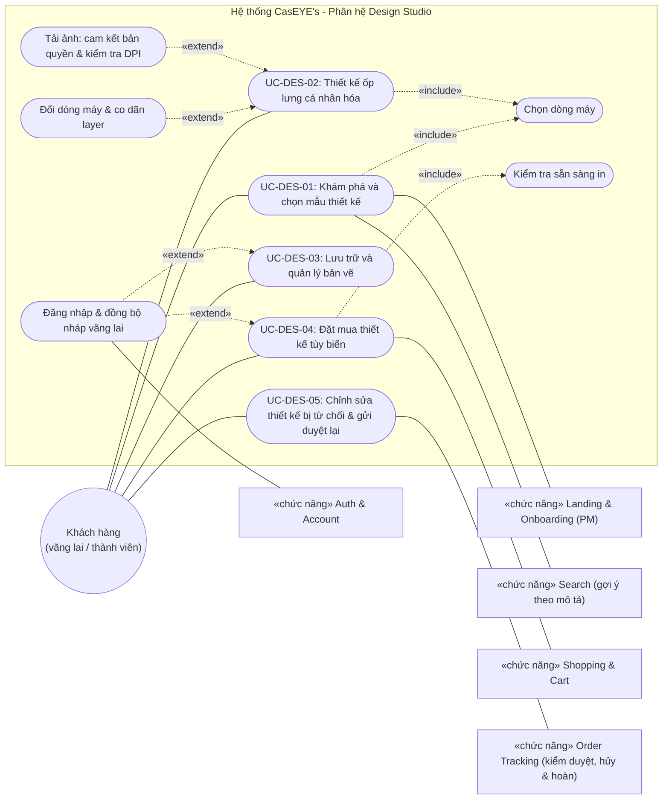

> Thay đổi: bỏ actor "Quản trị viên kiểm duyệt in" và SUB5 "Duyệt / Từ chối bản in POD" ([CHUYỂN → OT] UC-OT-11); bỏ hộp đen "Payment Gateway" khỏi UC-DES-05 (hủy & hoàn do OT); thêm SUB6.

#### 5.6.2. Đặc tả Use Case

| UC | Thay đổi so với bản gốc (các bước không nêu: [GIỮ]) |
|---|---|
| UC-DES-01 | PF bước 4: "…tạo Design (DRAFT) **có DesignID**, lưu `template_id`…". AF2: dùng thành phần Gợi ý theo mô tả của Search; `?y=` lọc/cuộn tới mẫu phù hợp. AF3: [SỬA] "Không có mẫu phù hợp" → áp dụng FR-SRCH-EX-01 và khu "Mẫu đang được yêu thích" tách biệt. AF4: thêm nhánh `?template=` khi chưa có dòng máy (FR-DES-EX-19) |
| UC-DES-02 | PF bước 2: thứ tự kiểm tra định dạng (PNG/JPG/WebP) → nén → cam kết → DPI; ảnh hợp lệ tải lên Storage. AF3: "Thay ảnh khác" mở lại khung tải ảnh; gắn biểu tượng DPI thấp trong Layers |
| UC-DES-03 | PF bước 3: lưu bảng `designs` theo DesignID (không theo tên); AF2 bước 4: đồng bộ chạy ở mọi trang (FR-DES-20); EF1 [GIỮ] |
| UC-DES-04 | PF bước 1: thêm "Kiểm tra sẵn sàng in" (SUB6); bước 2: lưu phiên bản bản vẽ, tạo preview PNG cho mọi dòng máy, `requiresModeration = true` cho mọi bản thiết kế; AF2 bước 3: sau đăng nhập tự thêm giỏ và điều hướng sang giỏ hàng; thêm EF4 = FR-DES-EX-18 |
| UC-DES-05 | [SỬA] Tên: "Chỉnh sửa thiết kế bị từ chối & gửi duyệt lại". Supporting Actor: **Order Tracking** (thay "Quản trị viên kiểm duyệt" và "Payment Gateway"). Trigger: khách bấm "Chỉnh sửa thiết kế" tại Chi tiết đơn `Action_Required`. PF: 1 Canvas mở với `?order=&action=edit-design`, nạp phiên bản bản vẽ của đơn và đánh dấu layer bị nêu trong lý do (nếu có). 2 Khách sửa. 3 Bấm "Gửi duyệt lại" → lưu phiên bản mới → OT `resubmit_design()` → đơn về `Pending_Review`. AF1 "Hủy đơn & Hoàn tiền 100%": [CHUYỂN → OT] UC-OT-02 ALT 1.1. EF1–EF3: theo FR-DES-EX-09, 10, 11 |

#### 5.6.3. BPMN – Quy trình cộng tác cấp 1 [SỬA]

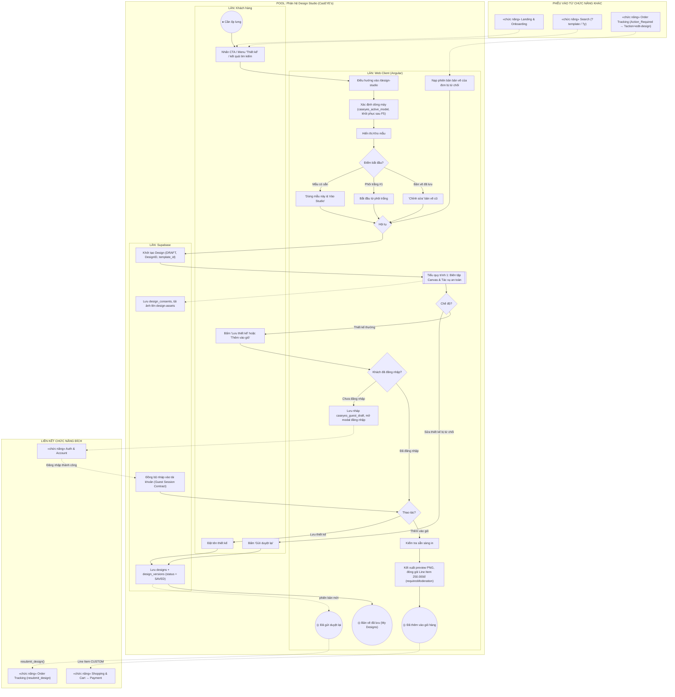

> Thay đổi: luồng Action_Required không còn nhánh "Hủy đơn & Hoàn tiền" trong DES (thuộc OT); thêm "Kiểm tra sẵn sàng in", lưu CSDL và consent.

- **Tiểu quy trình 1 – Biên tập Canvas & Tác vụ an toàn:** [GIỮ] sơ đồ gốc, [SỬA] nhóm "Tác vụ an toàn tích hợp" theo thứ tự `GwFormat (PNG/JPG/WebP) → GwSize (nén > 10MB) → GwConsent → ActSaveConsent (lưu design_consents) → GwDpi → ActStorageUpload`; `GwBanned` so khớp theo từ.
- **Tiểu quy trình 2 – Hậu kiểm POD & xử lý đơn bị từ chối:** [CHUYỂN → OT] (BPMN-OT-3 và BPMN-OT-4). Quy tắc "đơn không có ảnh cá nhân bỏ qua duyệt" **[BỎ]** – mọi đơn CUSTOM đều qua duyệt; "Payment Gateway hoàn 100%" **[BỎ]** – thay bằng RefundRequest S2 do Admin xác nhận.

#### 5.6.4. Class Diagram [SỬA]

Giữ package **Catalog**, **DesignCore**, **Compliance (rút gọn)**; thu hẹp **Users** và **CartOrder** thành tham chiếu.

```mermaid
classDiagram
direction TB
class PhoneModel { +String id +String brand +String name +Boolean has_3d_model +String model_3d_url +Integer custom_price +getSafeZone() SafeZoneMask }
class Template { +String id +String name +String category +String[] hashtags +Boolean is_blank_canvas +Boolean is_trending +Boolean is_active +createDesignInstance(modelId) Design }
class Design { +UUID id +UUID user_id +String guest_session_id +String phone_model_id +String template_id +String title +DesignStatus status +Integer version +Boolean requires_moderation +DateTime last_auto_saved_at +addElement(e) +autoSave(json) +serializeToJSON() String +exportPrintHiRes() String }
class DesignVersion { +UUID design_id +Integer version +JSON canvas_json +String preview_url +String reason +DateTime created_at }
class DesignElement { <<abstract>> +String id +ElementType type +Float pos_x +Float pos_y +Float width +Float height +Float rotation +Float opacity +Integer z_index }
class ImageElement { +String storage_path +Boolean is_compressed +Float dpi_value +Boolean is_low_dpi +UUID consent_id +Float crop_top +Float crop_right +Float crop_bottom +Float crop_left }
class TextElement { +String content +String font_family +Integer font_size +String font_color +validateContent() Boolean }
class StickerElement { +String sticker_id }
class CaseBackground { +String mode +String color_1 +String color_2 +Integer angle +String image_url }
class SafeZoneMask { +String model_id +Float camera_cutout_x +Float camera_cutout_y +Float camera_cutout_w +Float camera_cutout_h +validatePlacement(e) Boolean }
class DesignConsent { +UUID consent_id +UUID user_id +String session_id +UUID design_id +String image_hash +String policy_version +Boolean remember_choice +DateTime accepted_at }
class BannedKeyword { +String keyword +String category +Boolean is_active +matches(text) Boolean }
class CustomLineItem { <<gửi sang Shop & Cart>> +UUID design_id +Integer design_version +String phone_model_id +String preview_url +Integer unit_price +Boolean requires_moderation }
class OrderTrackingPort { <<interface – chức năng OT>> +resubmitDesign(orderId, designVersion) void +getRejectedDesign(orderId) DesignVersion }
class DesignStatus { <<enumeration>> DRAFT SAVED ARCHIVED }
PhoneModel "1" --> "1" SafeZoneMask : configures
Template ..> Design : «create»
Design "1" *-- "0..*" DesignElement : layers
Design "1" *-- "1..*" DesignVersion : versions
DesignElement <|-- ImageElement
DesignElement <|-- TextElement
DesignElement <|-- StickerElement
Design "1" *-- "1" CaseBackground
DesignElement ..> SafeZoneMask : bounded by
ImageElement "1" --> "0..1" DesignConsent
TextElement ..> BannedKeyword : checks
Design ..> CustomLineItem : packages
Design ..> OrderTrackingPort : gửi duyệt lại
```

> Thay đổi: `DesignStatus` chỉ còn trạng thái của **bản vẽ** (DRAFT, SAVED, ARCHIVED) – trạng thái kiểm duyệt/sản xuất là trạng thái **đơn hàng** của OT; bỏ `OrderStatusDetail`, `ModerationQueueItem`, `DesignReview`, `RefundRequest`, `Order`, `Cart` khỏi DES; thêm `DesignVersion`, `DesignConsent`, `OrderTrackingPort`; `BaseSKU` (tồn kho phôi) thuộc hệ thống kho ngoài.

---

## 6. Payment / Checkout (P)

> Mô tả bối cảnh (BPMN-P-01, NHÓM A): **[GIỮ]**. Bổ sung: cổng thanh toán, ngân hàng và hệ thống kho là **hệ thống bên ngoài** (mục 0.3); Checkout chỉ tạo đơn **sau khi** cổng thanh toán xác nhận thành công (đơn trả trước) hoặc ngay khi đặt (COD).

### 6.1. Tóm tắt thay đổi

| Mã silo | Mức | Vấn đề | Cách khắc phục trong v3 |
|---|---|---|---|
| Y1 | 🔴 | P không có năng lực hoàn tiền nhưng CS/DES gửi hoàn tiền sang P | Hoàn tiền sau khi đơn đã tạo **thuộc OT** (`RefundRequest`, Admin chuyển khoản – hệ thống ngân hàng ngoài). P chỉ xử lý **hủy giao dịch khi chưa tạo được đơn** (FR-P-35) qua interface cổng thanh toán |
| Y2 | 🔴 | Đơn dở dang không có trạng thái ở OT | Chốt mô hình theo mã nguồn: **đơn chỉ tồn tại trong CSDL sau khi thanh toán thành công**. Giai đoạn chờ/thử lại 15 phút là `CheckoutSession` phía trình duyệt (không phải đơn hàng). FR-P-25 "thanh toán tiếp từ Đơn hàng của tôi" **[BỎ]** (W) |
| Y3 | 🟠 | Mô hình 4 nhóm trạng thái riêng | 4 nhóm trạng thái chỉ là **mô hình hiển thị phiên Checkout**; trạng thái đơn chính thức là `orders.status_detail` + `payment_status` của OT; lịch sử trạng thái là `order_status_history` của OT |
| Y4 | 🟠 | Sổ voucher | P là chủ sở hữu **sổ voucher mua hàng** (bảng `vouchers`); OT phát voucher đền bù vào `order_vouchers` và có thể dùng tại Checkout qua cùng hàm kiểm tra |
| Y5 | 🟠 | Giữ chỗ tồn kho 15 phút không có chủ | Giữ chỗ là chức năng của **hệ thống kho ngoài**; trong phạm vi đồ án: kiểm tra tồn kho trước khi gọi cổng thanh toán (FR-P-14) và trừ kho nguyên tử trong `place_order` – đồng hồ 15:00 là thời hạn của phiên thử lại (🧪) |
| Y6 | 🟡 | EDD hai công thức | Checkout hiển thị EDD do **OT `computeEdd`** tính (một công thức) |
| Y7 | 🟡 | FR-P-08 trỏ BR-P-17; BR-P-14 thiếu FR | Sửa truy vết: FR-P-08 → BR-P-16; BR-P-14 → FR-P-09 |

### 6.2. Business Requirements

| Mã | Nội dung | Thay đổi |
|---|---|---|
| BR-P-01 | Khách đã đăng nhập chuyển giỏ thành đơn qua quy trình checkout và thanh toán trên website. Trên giao diện UI triển khai thực tế, luồng gồm 3 bước Tracker (Giỏ hàng → Thanh toán → Hoàn tất) và 4 màn hình trạng thái (Form Đặt hàng → Cổng đối soát SafePay → Thành công / Gián đoạn). Khách vãng lai khi bấm Checkout phải đăng nhập/đăng ký (và được hỏi tùy chọn thiết lập hồ sơ Onboarding nếu chưa hoàn tất) mà không mất giỏ hàng. **Đơn hàng chỉ được tạo trong hệ thống khi thanh toán trả trước thành công hoặc khi đặt đơn COD.** | [SỬA] thêm câu cuối |
| BR-P-02 | Thông tin giao hàng đầy đủ, hợp lệ (6 trường bắt buộc: Họ tên, SĐT định dạng Việt Nam, Tỉnh/TP, Quận/Huyện, Phường/Xã, Số nhà/tên đường). Hỗ trợ tự điền địa chỉ mặc định **từ sổ địa chỉ của PM**, chỉnh sửa ngay tại Checkout qua Modal địa chỉ; quản lý sổ địa chỉ nhiều địa chỉ thuộc phân hệ PM. | [SỬA] bỏ "bản đồ GPS" (trang trí, không có dịch vụ bản đồ) |
| BR-P-03 | Phí vận chuyển tính theo gói giao cố định (Giao tiêu chuẩn: 25.000₫; Giao Hỏa tốc 24H: 45.000₫ – chỉ áp dụng cho đơn toàn hàng có sẵn). Khách thấy phí và **khoảng ngày giao dự kiến do Order Tracking tính** trước khi đặt. | [SỬA] EDD một nguồn |
| BR-P-04 | Minh bạch cấu thành tổng tiền: TotalAmount = Subtotal + ShippingFee + GiftPrice − DiscountAmount (làm tròn đồng, không bao giờ âm; ràng buộc DB orders_money_check), cập nhật real-time khi thay đổi gói giao, gói quà hoặc voucher. **Máy chủ tự tính lại phí giao và giảm giá, không tin giá trị từ trình duyệt.** Cảnh báo đổi giá/kho so với lúc vào giỏ. | [SỬA] |
| BR-P-05 | Đơn có ít nhất 1 sản phẩm thiết kế riêng (CUSTOM / in độc bản) bắt buộc thanh toán trước 100%; đồng thời khóa cả phương thức COD và gói giao Hỏa tốc 24H (chỉ mở lại khi giỏ toàn hàng có sẵn IN_STOCK). **Khách bị gắn cờ rủi ro cao (BR-SH-04) cũng bị khóa COD.** | [SỬA] thay "cọc" của SH |
| BR-P-06 | Hỗ trợ 4 nhóm phương thức thanh toán: Chuyển khoản VietQR Pro (MB Bank), Ví điện tử (3 cổng con: MoMo, ZaloPay, ShopeePay), Thẻ Quốc tế (Visa/Mastercard/JCB qua cổng OnePay 3D-Secure mô phỏng) và COD (chỉ đơn toàn hàng có sẵn). Khi chuyển sang OT, các kênh trả trước quy về `payment_method = prepaid` kèm `payment_channel` chi tiết. | [SỬA] khớp giá trị CSDL |
| BR-P-07 | Thanh toán trực tuyến mô phỏng qua Cổng đối soát SafePay Mascot (tiến trình 10% → 100%, hỗ trợ 3 chế độ kiểm thử: Ngẫu nhiên 80/20, Luôn thành công, Luôn gián đoạn). Khi thất bại/gián đoạn, giữ nguyên **phiên thanh toán** (mã tham chiếu phiên, giỏ hàng, file thiết kế và voucher) trong 15 phút để thử lại hoặc đổi phương thức. | [SỬA] "mã đơn" → "mã tham chiếu phiên" |
| BR-P-08 | Đơn chỉ được tạo khi mọi sản phẩm hợp lệ tại thời điểm đặt hàng. Với sản phẩm thiết kế riêng, mã phôi (baseSku) tương ứng dòng máy và chất liệu ốp được truyền sang phân hệ Quản lý đơn hàng (OrderIntake) để kiểm tra và trừ tồn kho ốp phôi. | [GIỮ] |
| BR-P-09 | Vòng đời tồn kho: **kiểm tra tồn kho trước khi chuyển sang cổng thanh toán**; trừ tồn kho chính thức khi đơn được tạo qua RPC place_order; hoàn tồn kho khi đơn bị hủy (OT). Giữ chỗ tạm trong thời gian chờ thanh toán là năng lực của hệ thống kho bên ngoài (mô phỏng bằng đồng hồ 15:00). | [SỬA] |
| BR-P-10 | Tạo đơn nguyên tử (ACID) thông qua RPC place_order (OrderIntake), lưu snapshot bất biến (tên sản phẩm, dòng máy, chất liệu, giá, địa chỉ, **ghi chú shipper, lời nhắn gói quà**, phiên bản & thời điểm đồng ý chính sách) và chống tạo đơn trùng (idempotency trên frontend **và backend bằng khóa `checkout_ref`**). | [SỬA] |
| BR-P-11 | Hàng thiết kế riêng (CUSTOM): đóng băng thông số và ảnh xem trước bản thiết kế (previewUrl, designId, **designVersion**, specs) gắn vào đơn; hiển thị thông số độ phân giải ảnh in và bắt buộc khách tự tích ô xác nhận chính sách sản xuất hàng in độc bản (không tick sẵn) kèm lưu thời điểm đồng ý (policyAcceptedAt). | [SỬA] |
| BR-P-12 | Hỗ trợ áp dụng và gỡ mã giảm giá (Voucher) đơn giản (1 mã/đơn) từ **sổ voucher** (bảng `vouchers`: mã, loại giảm, giá trị, hạn dùng, giá trị đơn tối thiểu, phạm vi custom/phôi, số lượt) – bao gồm voucher đền bù do OT phát. Không tự áp mã khi khách chưa chọn. | [SỬA] |
| BR-P-13 | Phiên Checkout hiển thị 4 nhóm trạng thái nghiệp vụ (orderStatus, paymentStatus, productionStatus, shippingStatus) **như mô hình hiển thị**; trạng thái chính thức và lịch sử thay đổi (timestamp, trạng thái mới, lý do, tác nhân) do Order Tracking ghi nhận. | [SỬA] |
| BR-P-14 | Khách quay lại chỉnh sửa giỏ, F5 tải lại trang hoặc điều hướng qua query params không bị mất dữ liệu đơn hàng đang xử lý nhờ cơ chế lưu phiên sessionStorage (key: caseeye_active_checkout_order – Single Source of Truth). | [GIỮ] – liên kết FR-P-09 |
| BR-P-15 | Bảo mật thông tin thanh toán và tuân thủ dữ liệu: không lưu số thẻ hay mã bảo mật CVV; áp dụng Row Level Security (RLS) trên Supabase; ghi nhận bằng chứng đồng ý chính sách đơn hàng (policy_consents). Thu thập log hành vi checkout chi tiết phục vụ phân tích. | [GIỮ] |
| BR-P-16 | Hỗ trợ ghi chú cho shipper (không bắt buộc) và tùy chọn dịch vụ cộng thêm "Gói quà Hologram & Thiệp viết tay" (+25.000₫, nhập lời nhắn tối đa 150 ký tự). | [GIỮ] |

### 6.3. Functional Requirements

| Mã | BR | MoSCoW | Mô tả | Trạng thái |
|---|---|---|---|---|
| FR-P-01 | BR-P-01 | M | Kiểm tra đăng nhập (route `/checkout` có guard) và trạng thái hồ sơ trước khi thanh toán. Khách đã đăng nhập nhưng chưa hoàn tất thiết lập hồ sơ (onboarding_status = pending) được hiển thị hộp thoại hỏi ý kiến ("Thiết lập ngay" hoặc "Để sau, tiếp tục thanh toán"), không tự ý chuyển hướng làm mất giỏ hàng. Nạp dữ liệu giỏ hàng chung (CartState) vào Checkout. | 🟡 `/checkout` chưa có guard |
| FR-P-02 | BR-P-01, BR-P-15 | M | Tổ chức luồng Checkout theo Tracker 3 bước chuẩn TMĐT (Giỏ hàng → Thanh toán → Hoàn tất) điều phối 4 màn hình sub-component: Form đặt hàng (form) → Cổng đối soát SafePay (processing) → Đặt hàng thành công (success) hoặc Gián đoạn/Thử lại (failed). Đồng bộ bước qua URL query params (? step=...&orderCode=...). | ✅ |
| FR-P-03 | BR-P-04, BR-P-08 | M | Kiểm tra lại giá (so với `priceAtAdd`) và tồn kho khi vào trang thanh toán. Nếu giá đổi hoặc hàng hết so với lúc bỏ vào giỏ thì hiện danh sách thay đổi và yêu cầu khách đồng ý rồi mới tiếp tục. | ⬜ |
| FR-P-04 | BR-P-02 | M | Địa chỉ giao hàng: tự điền địa chỉ mặc định từ sổ địa chỉ PM (FR-PM-26); cho chọn địa chỉ khác trong sổ; bấm "Đổi địa chỉ" để mở Modal nhập/sửa đầy đủ 6 trường (Họ tên, SĐT, Tỉnh/TP, Quận/Huyện tự động lọc theo Tỉnh, Phường/Xã, Số nhà/tên đường) và tùy chọn "Lưu vào sổ địa chỉ". | 🟡 Địa chỉ mặc định là dữ liệu mẫu cứng |
| FR-P-05 | BR-P-02 | M | Kiểm tra hợp lệ thông tin địa chỉ trong Modal: Họ tên (≥ 2 ký tự), SĐT `^0(3|5|7|8|9)[0-9]{8}$` (dùng chung FR-PM-11), đầy đủ Tỉnh/TP, Quận/Huyện, Phường/Xã, Địa chỉ chi tiết. Hiển thị thông báo lỗi inline ngay dưới từng trường không hợp lệ. | 🟡 Biểu thức SĐT không neo đầu/cuối |
| FR-P-06 | BR-P-03 | M | Tính phí vận chuyển theo gói và hiển thị khoảng ngày giao dự kiến do OT `computeEdd` tính (giờ chốt mẻ 16:00, ngày làm việc, thời gian xử lý theo loại đơn, thời gian vận chuyển theo gói). Địa chỉ ngoài vùng hỗ trợ báo lỗi không cho đi tiếp. | 🟡 Checkout đang hiển thị lịch tĩnh +2..+4 ngày |
| FR-P-07 | BR-P-03, BR-P-05 | S | Cung cấp lựa chọn Giao Hỏa tốc 24H (Express, 45.000₫, giao trong 24h / trong ngày nếu xác nhận trước 14:00). Tự động khóa (disable) kèm nhãn "Tạm khóa – Chỉ áp dụng cho hàng có sẵn" khi giỏ có sản phẩm thiết kế riêng; máy chủ từ chối nếu vi phạm. | ✅ |
| FR-P-08 | BR-P-16 | M | Ô ghi chú cho shipper (không bắt buộc) và tùy chọn bật/tắt "Gói quà Hologram & Thiệp viết tay" (+25.000₫) kèm ô nhập lời nhắn chúc mừng giới hạn tối đa 150 ký tự (có bộ đếm ký tự real-time). **Ghi chú và lời nhắn được truyền vào đơn (OT) và hiển thị cho Operator khi đóng gói.** | 🟡 Không truyền sang đơn |
| FR-P-09 | BR-P-14, BR-P-15 | S | Lưu trữ tự động trạng thái phiên thanh toán (activeOrder) vào sessionStorage (caseeye_active_checkout_order) để khôi phục nguyên vẹn thông tin và bước thanh toán khi khách F5 tải lại trang hoặc quay lại. Phiên được **xóa sạch** khi đặt hàng thành công hoặc bắt đầu đơn mới. | 🟡 `placedOrderCode` không được reset |
| FR-P-10 | BR-P-04 | M | Bảng tóm tắt đơn hàng (Sidebar sticky + Mobile sticky bar): hiển thị từng sản phẩm (ảnh preview, dòng máy, chất liệu, thời gian in, huy hiệu chất lượng), quà tặng đính kèm, tạm tính, phí ship, phí gói quà, giảm giá voucher, tổng thanh toán = tạm tính + phí ship + phí gói quà − giảm giá (không bao giờ âm, ràng buộc orders_money_check). | ✅ |
| FR-P-11 | BR-P-06 | M | Chọn phương thức thanh toán: (1) Chuyển khoản VietQR Pro – MB Bank (kèm mã QR, STK, chủ TK, nội dung chuyển khoản là **mã tham chiếu phiên thanh toán** và nút sao chép 1 chạm), (2) Ví điện tử (mở rộng chọn 1 trong 3 ví: MoMo, ZaloPay, ShopeePay), (3) Thẻ Quốc tế (Visa, Mastercard, JCB – OnePay 3D-Secure), (4) Thanh toán khi nhận hàng (COD). | 🧪 Nội dung chuyển khoản cố định |
| FR-P-12 | BR-P-05 | M | Khóa COD và Hỏa tốc 24H khi đơn có sản phẩm thiết kế riêng (hasCustom = true); khóa COD khi khách có cờ High Risk (FR-SH-18). Thẻ COD bị làm mờ kèm cảnh báo giải thích và tự chọn sẵn VietQR Pro. Khi giỏ chỉ còn hàng có sẵn (stockOnly = true) và khách không bị gắn cờ, COD và Hỏa tốc tự động mở lại. | ✅ (chưa có nhánh High Risk) |
| FR-P-13 | BR-P-10 | M | Chống bấm "Xác nhận & Đặt hàng" nhiều lần (Idempotency): khóa nút đặt hàng khi đang submit (isSubmitting), sinh `checkout_ref` duy nhất cho mỗi phiên; RPC `place_order` từ chối tạo đơn thứ hai với cùng `checkout_ref` và trả về đơn đã tạo (chống trùng khi F5 hoặc mở lại link ? step=success). | 🟡 Chỉ chống trùng phía trình duyệt |
| FR-P-14 | BR-P-08, BR-P-09 | M | Kiểm tra tồn kho lần cuối **trước khi chuyển sang cổng thanh toán** (đơn trả trước) hoặc trước khi đặt (COD). Nếu có món thiếu hàng thì không tiếp tục, nói rõ món nào thiếu bao nhiêu và giữ nguyên các món còn lại để khách điều chỉnh. `place_order` tiếp tục kiểm tra nguyên tử khi trừ kho. | 🟡 Chỉ kiểm tra trong `place_order` (sau thanh toán) |
| FR-P-15 | BR-P-10 | M | Tạo đơn hàng trọn vẹn qua giao diện OrderIntake (RPC place_order của phân hệ OT): truyền đầy đủ snapshot người nhận, địa chỉ, gói giao, ghi chú shipper, phương thức & kênh thanh toán, mã giao dịch, danh sách sản phẩm (kèm baseSku, `designId` + `designVersion` cho hàng custom, gói quà và lời nhắn nếu có), phiên bản và thời điểm đồng ý chính sách, `checkout_ref`; sau đó xóa giỏ hàng. | 🟡 Thiếu ghi chú, lời nhắn, phiên bản bản vẽ |
| FR-P-16 | BR-P-11 | M | Đóng băng thông số và hình ảnh bản thiết kế gắn với từng dòng sản phẩm của đơn hàng (previewUrl, designId, designVersion, device, material) – tham chiếu đúng phiên bản trong `design_versions` của DES, không tạo bản ghi thiết kế rỗng. | 🟡 Tạo `designs` với `canvas_json = {}` |
| FR-P-17 | BR-P-11 | S | Hiển thị huy hiệu chất lượng ảnh in tại thẻ sản phẩm trong Tóm tắt đơn hàng theo cờ `is_low_dpi` của bản vẽ ("Đạt chuẩn in" / "Có thể in mờ"). Cảnh báo tương tác "Sửa lại / Vẫn đặt in" nếu DPI thấp. | 🟡 Huy hiệu tĩnh |
| FR-P-18 | BR-P-11, BR-P-16 | M | Ô tích xác nhận chính sách đơn hàng bắt buộc (không tick sẵn) ở cuối Tóm tắt đơn hàng, kèm link mở trang Chính sách đơn hàng và hiển thị số phiên bản (ORDER_POLICY_VERSION). **Đây là điểm ghi nhận đồng ý chính sách duy nhất của toàn hệ thống.** Nếu chưa tích mà bấm Đặt hàng thì báo lỗi inline và chặn gửi đơn; khi tích thì lưu timestamp (consentAcceptedAt) truyền vào bảng policy_consents. | 🟡 Lưu `now()` của máy chủ thay vì thời điểm tích |
| FR-P-19 | BR-P-09 | S | Bảo lưu phiên thanh toán (giỏ, thiết kế, voucher) trong thời gian chờ thanh toán với đồng hồ đếm ngược 15:00 (900 giây) hiển thị trực quan trên màn hình gián đoạn thanh toán. | 🧪 |
| FR-P-20 | BR-P-09 | M | Trừ tồn kho chính thức trên cơ sở dữ liệu (bản sao tồn kho của hệ thống kho ngoài) khi đơn được tạo; hoàn tồn kho do OT thực hiện khi đơn bị hủy. | ✅ |
| FR-P-21 | BR-P-09 | S | Khi đồng hồ bảo lưu 15:00 đếm về 00:00 (hết hạn), hệ thống hủy phiên thanh toán (nhả voucher đã chọn), vô hiệu hóa nút thử lại và hiển thị nút "Tạo lại đơn hàng mới" đưa khách quay về Form (giỏ hàng vẫn giữ). | 🧪 |
| FR-P-22 | BR-P-07 | M | Màn hình Cổng đối soát thanh toán giả lập (SafePay Mascot Portal): hiển thị linh vật SafePay, thanh tiến trình 10% → 100% qua 3 giai đoạn (Khởi tạo giao dịch → Khớp sao kê đối soát → Duyệt file & In UV) và trả kết quả theo 3 chế độ cấu hình trên Dev Dock (Ngẫu nhiên 80/20, Luôn thành công, Luôn gián đoạn). | 🧪 |
| FR-P-23 | BR-P-07, BR-P-15 | M | Lưu thông tin giao dịch thanh toán (transactionId dạng TXN-CEYxxxxx **duy nhất cho mỗi lần thử**, paymentMethod, paymentChannel kèm ví con, paymentTimestamp) và truyền sang OT. Hệ thống tuyệt đối không thu thập hay lưu số thẻ/CVV. | 🟡 Mã giao dịch đầu cố định; thiếu ví con, thời điểm |
| FR-P-24 | BR-P-07 | M | Xử lý khi thanh toán thất bại/gián đoạn (Màn 4 – checkout-failed): bảo toàn nguyên vẹn phiên thanh toán (mã tham chiếu, giỏ hàng, file in custom và voucher); hiển thị thông báo trấn an, checklist 3 bước kiểm tra nhanh, nút "Thử thanh toán lại ngay" (làm mới transactionId trên cùng phiên) và các nút chuyển nhanh sang ví MoMo, ZaloPay, ShopeePay hoặc Thẻ Quốc tế. | 🧪 |
| FR-P-25 | BR-P-07 | W | ~~Cho phép thanh toán tiếp đơn dở dang từ trang "Đơn hàng của tôi"~~ – [BỎ] vì đơn chưa thanh toán không tồn tại trong hệ thống (BR-P-01). | – |
| FR-P-26 | BR-P-06 | S | Chuyển khoản VietQR Pro giả lập: hiển thị trực tiếp ngay trên Form đặt hàng khi chọn VietQR gồm mã QR, thông tin ngân hàng MB Bank, số tài khoản, chủ tài khoản, nội dung chuyển khoản là mã tham chiếu phiên và các nút sao chép nhanh. | 🧪 |
| FR-P-27 | BR-P-13 | M | Trang đặt hàng thành công (Màn 3 – checkout-success): hiệu ứng chúc mừng, **mã đơn do OrderIntake cấp (CC-YYMMDD-NNNN)** kèm nút sao chép, huy hiệu trạng thái thanh toán, tóm tắt đơn đã đóng băng, ngày giao dự kiến (EDD của OT), tiến độ các giai đoạn xử lý theo loại đơn, thẻ điểm Cosmic Club (giá trị minh họa – Loyalty là hệ thống ngoài), nút "Theo dõi đơn hàng" (/order-tracking/:code) và "Tiếp tục mua sắm". | 🟡 Mã đơn hiển thị là mã mẫu `CE-89421` |
| FR-P-28 | BR-P-13 | S | Gửi thông báo xác nhận đơn hàng: thông báo trong ứng dụng (bảng `notifications`) và email qua dịch vụ Email bên ngoài (hộp thư giả lập) kèm tóm tắt đơn, ảnh thiết kế và link theo dõi. | 🟡 Có thông báo trong ứng dụng; email chưa có |
| FR-P-29 | BR-P-13 | M | Xóa giỏ hàng sau khi RPC place_order tạo đơn thành công trên hệ thống (cart.items.set([])). | ✅ |
| FR-P-30 | BR-P-13 | M | Cập nhật 4 nhóm trạng thái hiển thị trên CheckoutOrder theo từng bước của phiên; sau khi tạo đơn, mọi trạng thái hiển thị đọc từ OT. | ✅ (mô hình hiển thị) |
| FR-P-31 | BR-P-13 | M | Đẩy đơn mới sang phân hệ Quản lý đơn hàng (OT /Admin) thông qua RPC place_order kèm snapshot sản phẩm, bản thiết kế và bằng chứng đồng ý chính sách. | ✅ |
| FR-P-32 | BR-P-15 | S | Ghi nhận log hành vi người dùng ẩn danh tại Checkout vào `analytics_events` (thời gian hoàn tất, bước bỏ ngang, số lần sửa địa chỉ, phương thức thử, lý do thất bại, thiết bị) phục vụ phân tích. | ⬜ |
| FR-P-33 | BR-P-15 | S | Ô đồng ý nhận ưu đãi marketing tách riêng với điều khoản bắt buộc và lưu thời điểm đồng ý. | ⬜ |
| FR-P-34 | BR-P-12 | C | Nhập và gỡ mã giảm giá (Voucher) trực tiếp tại Checkout; kiểm tra qua sổ voucher (hạn dùng, giá trị tối thiểu, phạm vi, số lượt, voucher đền bù của chính khách); tự động trừ tiền và hiển thị số tiền tiết kiệm ngay trong Tóm tắt đơn hàng. Không tự áp mã mặc định. | 🟡 Mã cứng CASEFIRST/VIP30; CASEFIRST tự áp sẵn |
| FR-P-35 | BR-P-07, BR-P-10 | M | [MỚI] Nếu cổng thanh toán báo thành công nhưng `place_order` thất bại (hết hàng, lỗi máy chủ): hệ thống thử lại `place_order` với cùng `checkout_ref` (tối đa 2 lần); nếu vẫn lỗi, gọi `PaymentGateway.void(txnRef)` (hủy/hoàn giao dịch tại cổng – mô phỏng), hiển thị màn hình "Chưa tạo được đơn – giao dịch đã được hủy", giữ giỏ hàng và ghi sự cố để Admin đối soát. | ⬜ |

### 6.4. Edge Cases & Business Rules

| Mã | Tên | BR | MoSCoW | Mô tả | Trạng thái |
|---|---|---|---|---|---|
| FR-P-EX-01 | Chưa tích chính sách | BR-P-11 | M | Không tạo đơn, tô viền đỏ khung xác nhận, "Vui lòng tích chọn xác nhận thiết kế in để tiếp tục đặt hàng!". | ✅ |
| FR-P-EX-02 | Giỏ trống khi vào Checkout | BR-P-01 | M | Điều hướng về Giỏ hàng. | ✅ |
| FR-P-EX-03 | Bấm thẻ COD đang khóa | BR-P-05 | M | Bỏ qua, giữ phương thức trả trước, hiện lý do. | ✅ |
| FR-P-EX-04 | Voucher sai/hết lượt/hết hạn | BR-P-12 | M | "Mã voucher không hợp lệ hoặc đã hết lượt dùng!" dưới ô nhập; tổng tiền không đổi. | 🟡 |
| FR-P-EX-05 | Voucher hết hạn khi đang ở màn gián đoạn | BR-P-12 | S | Khi thử lại, kiểm tra lại voucher; nếu không còn hợp lệ, thông báo và tính lại tổng tiền trước khi chuyển cổng. | ⬜ |
| FR-P-EX-06 | Giá/tồn kho thay đổi so với giỏ | BR-P-04 | M | Theo FR-P-03. | ⬜ |
| FR-P-EX-07 | Bấm đặt hàng nhiều lần / F5 tại bước success | BR-P-10 | M | Theo FR-P-13 (khóa `checkout_ref` phía máy chủ). | 🟡 |
| FR-P-EX-08 | Thanh toán thành công nhưng tạo đơn lỗi | BR-P-10 | M | Theo FR-P-35. | ⬜ |
| FR-P-EX-09 | Kết quả thanh toán đến sau khi hết 15:00 | BR-P-09 | M | Phiên đã hết hạn: không tạo đơn, gọi `PaymentGateway.void`, thông báo khách tạo lại đơn. | ⬜ |
| FR-P-EX-10 | Thanh toán trùng (hai tab, thử lại nhanh) | BR-P-10 | M | `checkout_ref` chỉ tạo một đơn; giao dịch thừa được `void` và ghi sự cố đối soát. | ⬜ |
| FR-P-EX-11 | Đổi địa chỉ ra ngoài vùng Hỏa tốc | BR-P-03 | S | Tự chuyển về Giao tiêu chuẩn và báo chênh lệch phí. | ⬜ |
| FR-P-EX-12 | Giỏ hỗn hợp IN_STOCK + CUSTOM | BR-P-05 | S | Áp dụng trả trước 100% cho cả đơn; hiển thị gợi ý "Tách đơn" (đơn hàng có sẵn có thể COD/Hỏa tốc). | 🟡 Chưa có gợi ý tách đơn |
| FR-P-EX-13 | Khách quay lại giỏ xóa hết hàng CUSTOM | BR-P-05 | M | `applyCartRules()` tự mở lại COD và Hỏa tốc. | ✅ |
| FR-P-EX-14 | Trình duyệt gửi phí/giảm giá sai | BR-P-04 | M | `place_order` tự tính lại phí giao theo gói và giảm giá theo sổ voucher; bỏ qua giá trị từ trình duyệt. | ⬜ Máy chủ đang tin giá trị client |
| FR-P-EX-15 | Phiên Checkout cũ còn sót | BR-P-14 | M | Phiên được làm sạch sau khi tạo đơn; lần checkout sau luôn tạo đơn mới. | ⬜ Lỗi `placedOrderCode` |
| FR-P-EX-16 | Khách vãng lai mở trực tiếp /checkout | BR-P-01 | M | Chuyển sang đăng nhập (giữ giỏ), quay lại Checkout. | ⬜ Đang tạo đơn trong kho mock |
| FR-P-EX-17 | Phụ kiện bị coi là hàng CUSTOM | BR-P-05 | M | Phân loại `productType` từ SH (phụ kiện là IN_STOCK); không khóa COD sai. | ⬜ Lỗi hiện tại |
| FR-P-EX-18 | Bản thiết kế không có ảnh preview | BR-P-11 | M | Chặn đặt hàng với dòng CUSTOM thiếu preview/phiên bản; yêu cầu mở lại Studio để tạo lại. | ⬜ |
| FR-P-EX-19 | Lỗi RPC place_order | BR-P-10 | M | Hiển thị lỗi cụ thể (placeOrderError) **trước** khi vào màn success; không hiển thị "Đặt hàng thành công" khi chưa có mã đơn. | 🟡 |
| FR-P-EX-20 | Khách quay lại Form từ cổng đối soát | BR-P-07 | S | Hủy bộ đếm tiến trình, quay về Màn 1 với toàn bộ dữ liệu đã nhập. | ✅ |

### 6.5. CX touchpoint & Data foundation

| Loại | Đề xuất | Chi tiết |
|---|---|---|
| **CX touchpoint** | **Màn gián đoạn thanh toán "biết mình đang được giữ gì"** | Màn 4 hiển thị đồng hồ 15:00 cùng danh sách cụ thể đang được bảo lưu ("Thiết kế *Mèo pastel* – iPhone 15 Pro Max", "Mã CASEFIRST –50.000₫"), lý do thất bại do cổng trả về (nếu có) và 1 phương thức thay thế được đề xuất dựa trên tỷ lệ thành công cao nhất. Giảm lo lắng và tăng tỷ lệ thử lại thành công. |
| **Data foundation** | **Bảng lần thử thanh toán và phễu Checkout** | `payment_attempts {checkout_ref, attempt_no, method, channel, sub_wallet, result, failure_code, latency_ms, created_at}` (ghi mọi lần thử, không chỉ lần cuối) + sự kiện `checkout.step.viewed / address.edited / voucher.applied / cod.locked / payment.failed / order.placed`. Đo tỷ lệ thành công theo cổng/ví, điểm bỏ ngang, hiệu quả voucher (ROI khuyến mãi). |

### 6.6. Mô hình hóa

#### 6.6.1. Use Case Diagram – UCD-P [SỬA]

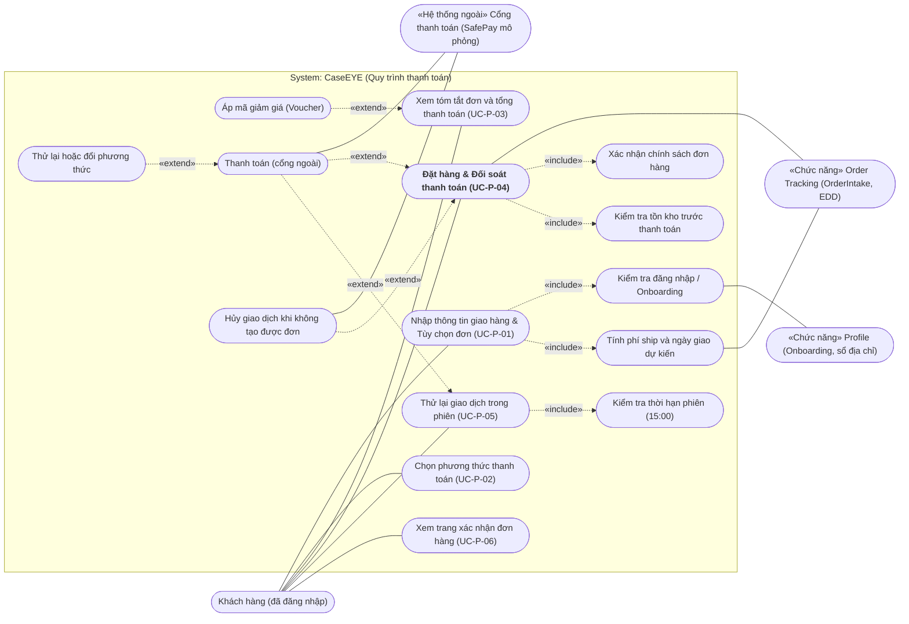

#### 6.6.2. Đặc tả Use Case

| UC | Thay đổi so với bản gốc (các bước không nêu: [GIỮ]) |
|---|---|
| UC-P-01 | MAIN bước 4: địa chỉ mặc định lấy từ sổ địa chỉ PM; bước 6: EDD từ OT `computeEdd`. ALT A2.1 (đổi giá/tồn kho): nâng thành luồng chính bắt buộc (FR-P-03). A3.4: thêm tùy chọn "Lưu vào sổ địa chỉ". [BỎ] "bản đồ định vị GPS" |
| UC-P-02 | Thêm ALT A5: khách High Risk → COD khóa kèm giải thích. Nội dung chuyển khoản VietQR = mã tham chiếu phiên |
| UC-P-03 | ALT A1: voucher kiểm tra qua sổ voucher; không tự áp mã. ALT A3.1: huy hiệu theo `is_low_dpi` |
| UC-P-04 | MAIN bước 3: sinh `checkout_ref`, **kiểm tra tồn kho (FR-P-14)** trước khi chuyển Màn 2. Bước 8: `place_order` kèm `checkout_ref`, ghi chú shipper, lời nhắn quà, `designVersion`, thời điểm tích chính sách. POST "Khi thất bại": [SỬA] "phiên thanh toán được bảo lưu (chưa có đơn trong hệ thống)". EXC mới 8.2 = FR-P-35 |
| UC-P-05 | [SỬA] Tên: "Thử lại giao dịch trong phiên". Trigger chỉ còn "Giao dịch thất bại tại Màn 2". ALT A3.1 (thanh toán tiếp từ Đơn hàng của tôi) [BỎ]. EXC 2.1 [GIỮ]; thêm EXC 2.2 = FR-P-EX-09 |
| UC-P-06 | MAIN bước 2: mã đơn thật `CC-YYMMDD-NNNN`; bước 4: tiến độ theo loại đơn (đơn chỉ hàng có sẵn không hiển thị bước in); bước 5: điểm Cosmic Club là giá trị minh họa từ hệ thống Loyalty ngoài. ALT A3.1: thông báo trong ứng dụng đã có; email qua dịch vụ ngoài |

#### 6.6.3. BPMN-P [SỬA]

```mermaid
flowchart LR
subgraph Pool_casEYES ["casEYES - Thanh toán"]
direction TB
subgraph Lane_KH ["Khách hàng"]
start(("Bấm “Thanh toán” tại Giỏ hàng"))
tLogin["Đăng nhập / thiết lập Onboarding (hoặc chọn “Để sau”)"]
tInfo["Chọn/sửa địa chỉ, gói giao, gói quà, ghi chú; áp Voucher"]
tPay["Chọn PT thanh toán, tích đồng ý chính sách, bấm “Đặt hàng”"]
tConfirm["Xem Màn 3: Đặt hàng thành công"]
endOK(("Đặt hàng thành công"))
end
subgraph Lane_WS ["Website / Hệ thống casEYES"]
tCheck["Kiểm tra đăng nhập & trạng thái Onboarding"]
gwLogin{"Đã đăng nhập / Onboarding?"}
gwMerge1{"X"}
tLoad["Nạp CartState, phân loại CUSTOM / IN_STOCK, kiểm tra giá & tồn kho so với giỏ"]
tCalc["Tính phí giao, phí quà, giảm giá, tổng tiền; lấy EDD từ OT"]
gwCustom{"Có hàng CUSTOM hoặc khách High Risk?"}
tLock["Khóa COD (& Hỏa tốc nếu có CUSTOM); bắt buộc trả trước 100%"]
gwMerge2{"X"}
gwRetry{"X"}
tStock["Sinh checkout_ref; kiểm tra tồn kho lần cuối"]
gwStock{"Đủ hàng?"}
tStockErr["Báo món thiếu, quay về Form"]
gwMethod{"Phương thức thanh toán?"}
tSend["Chuyển sang SafePay (Màn 2), gửi yêu cầu thanh toán"]
evtResult(("Message Catch: Nhận kết quả"))
gwResult{"Kết quả?"}
gwOrder{"X"}
tPlace["Gọi RPC place_order (checkout_ref, snapshot, PolicyConsent)"]
gwPlaced{"Tạo đơn thành công?"}
tVoid["Thử lại 2 lần → gọi PaymentGateway.void; báo khách, giữ giỏ"]
endVoid(("Chưa tạo được đơn – giao dịch đã hủy"))
tHand["Xóa giỏ hàng & phiên; đơn thuộc OT"]
tFail["Hiển thị Màn 4; bảo lưu phiên (giỏ, thiết kế, voucher) 15:00"]
gwWait{"Event-Based Gateway"}
evtRetry(("Message Catch: Thử lại / Đổi phương thức"))
tRefresh["Làm mới transactionId trên cùng phiên; kiểm tra lại voucher"]
evtTimeout(("Timer Catch: Hết 15:00"))
tRelease["Hủy phiên, nhả voucher đã chọn"]
endExp(("Hết hạn: “Tạo lại đơn hàng mới”"))
end
end
subgraph External_Pools ["Hệ thống / Chức năng khác"]
poolSP["«Ngoài» Cổng thanh toán (SafePay)"]
poolOT["«Chức năng» Order Tracking (OrderIntake)"]
poolInv["«Ngoài» Inventory"]
end
start --> tCheck --> gwLogin
gwLogin -- "Chưa đăng nhập / Pending Onboarding" --> tLogin --> gwMerge1
gwLogin -- "Rồi" --> gwMerge1
gwMerge1 --> tLoad --> tInfo --> tCalc --> gwCustom
gwCustom -- "Có" --> tLock --> gwMerge2
gwCustom -- "Không" --> gwMerge2
gwMerge2 --> gwRetry --> tPay --> tStock --> gwStock
gwStock -- "Không" --> tStockErr --> tInfo
gwStock -- "Có" --> gwMethod
gwMethod -- "COD" --> gwOrder
gwMethod -- "Trả trước" --> tSend --> evtResult --> gwResult
gwResult -- "Thành công" --> gwOrder
gwResult -- "Thất bại / Gián đoạn" --> tFail --> gwWait
gwOrder --> tPlace --> gwPlaced
gwPlaced -- "Có" --> tHand --> tConfirm --> endOK
gwPlaced -- "Không" --> tVoid --> endVoid
gwWait --> evtRetry --> tRefresh --> gwRetry
gwWait --> evtTimeout --> tRelease --> endExp
tSend -. "Yêu cầu thanh toán (checkout_ref, transactionId, method, totalAmount)" .-> poolSP
poolSP -. "Kết quả" .-> evtResult
tVoid -. "void(txnRef)" .-> poolSP
tStock -. "available()" .-> poolInv
tPlace -. "RPC place_order" .-> poolOT
```

#### 6.6.4. Class Diagram – CD-P [SỬA]

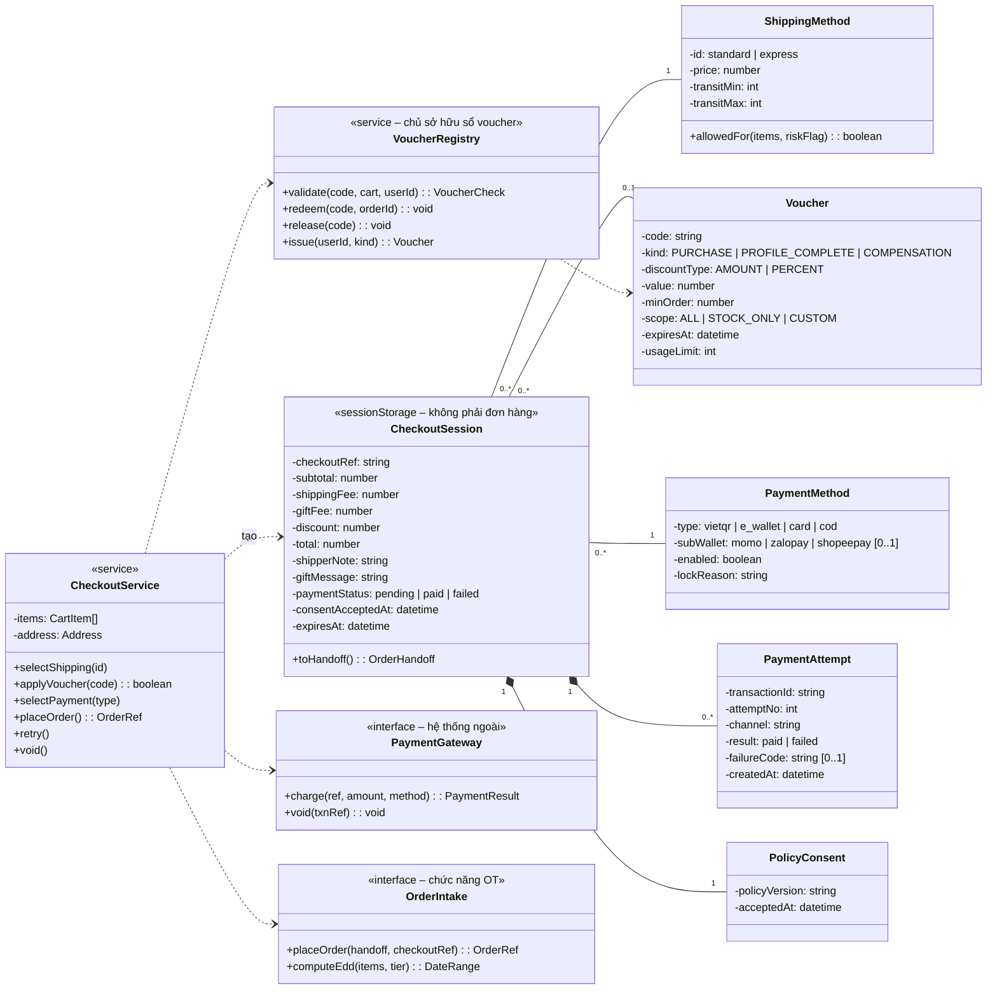

> Thay đổi: `CheckoutOrder` đổi tên `CheckoutSession` (chỉ tồn tại phía trình duyệt); `PaymentTransaction` → `PaymentAttempt` (mọi lần thử); thêm `VoucherRegistry`, `PaymentGateway` (ngoài), `OrderIntake.computeEdd`.

---

## 7. Order Tracking (OT)

> Bối cảnh: **[GIỮ]** – "Website bán hai loại sản phẩm: hàng có sẵn (IN_STOCK) và thiết kế theo yêu cầu (CUSTOM, tạo ở Design Studio)… Chức năng Quản lý đơn hàng & Giao vận nhận đơn sau khi khách đặt hàng ở Thanh toán và theo đơn đến khi hoàn tất, hủy hoặc hoàn tiền." Bổ sung: OT là **nguồn sự thật duy nhất** về trạng thái đơn, kiểm duyệt thiết kế, hủy đơn và yêu cầu hoàn tiền. Các hệ thống Loyalty, Notification (email), ngân hàng, đơn vị vận chuyển, kho là **hệ thống bên ngoài** (mục 0.3). Khu quản trị Operator/CSKH/Admin ở mức mock-up.

### 7.1. Tóm tắt thay đổi

| Mã silo | Mức | Vấn đề | Cách khắc phục trong v3 |
|---|---|---|---|
| O1 | 🔴 | Phụ thuộc phân hệ chưa tồn tại (Loyalty, Notification, Payment API) | Khai báo là **interface hệ thống ngoài** (mục 0.3) với hàng đợi gửi lại; thu cước giao lại qua `PaymentGateway.charge` (mô phỏng) |
| O2 | 🟠 | Từ điển khiếu nại khác CS | Dùng chung `IssueType` / `Resolution` (mục 0.5); CS sở hữu ticket, OT sở hữu kết quả trên đơn |
| O3 | 🟠 | Thiếu trạng thái đơn chờ thanh toán | Không cần: đơn chỉ được tạo sau khi thanh toán thành công (BR-P-01) |
| O4 | 🟠 | Không có mô hình tồn kho | Tồn kho là hệ thống ngoài; `restock_order()` gọi `Inventory.release` (mô phỏng bằng bảng bản sao) – bổ sung hoàn kho cho mọi nhánh hủy |
| D1 (từ DES) | 🔴 | Kiểm duyệt trùng DES | OT là chủ sở hữu duy nhất; mọi đơn CUSTOM vào `Pending_Review`; người duyệt Operator; luồng sửa thiết kế mở Canvas của DES |
| C2 (từ CS) | 🔴 | Không có luồng kết quả ticket về OT | `apply_ticket_result` (đã có) là điểm nhận duy nhất; CS gọi khi chốt ticket |

### 7.2. Business Requirements

| Mã | Nội dung | Thay đổi |
|---|---|---|
| BR-OT-01 | Khách hàng cần theo dõi tiến độ xử lý, sản xuất và giao nhận của từng đơn, kèm khoảng ngày giao dự kiến, để yên tâm sau khi thanh toán và chủ động thời gian nhận hàng. | [GIỮ] |
| BR-OT-02 | Doanh nghiệp cần kiểm soát đơn trước khi sản xuất: **mọi** đơn có hàng thiết kế theo yêu cầu phải được nhân viên (Operator) duyệt bản thiết kế final; khách tự hủy được đơn COD trong thời gian đổi ý ngắn, còn đơn đã thanh toán hủy qua yêu cầu do CSKH xem xét. | [SỬA] nhấn mạnh "mọi" |
| BR-OT-03 | Doanh nghiệp cần cập nhật trạng thái sản xuất, kiểm tra chất lượng (QC), đóng gói và vận chuyển theo trình tự, có lưu vết, để đảm bảo tiến độ và quy được trách nhiệm khi có sự cố. | [GIỮ] |
| BR-OT-04 | Đơn hàng cần một mốc hoàn tất chính thức (khách xác nhận đã nhận hàng hoặc hệ thống tự hoàn thành sau 72 giờ) làm căn cứ gửi sự kiện cộng điểm sang hệ thống Loyalty, phát ưu đãi hậu mãi và thu thập đánh giá. | [SỬA] Loyalty là hệ thống ngoài |
| BR-OT-05 | Khách hàng cần kênh báo sự cố ngay từ chi tiết đơn; doanh nghiệp cần quy tắc rõ ràng cho đơn giao thất bại (lưu kho 14 ngày, giao lại tối đa 1 lần) và hoàn tiền có kiểm soát (chỉ theo các tình huống ở Bảng 7.4, do Admin xác nhận và chuyển khoản **ngoài hệ thống**). | [GIỮ] (đánh số bảng theo tài liệu này) |
| BR-OT-06 | Doanh nghiệp cần ghi nhận dữ liệu sau mua (lý do hủy, nhóm vi phạm thiết kế, nguyên nhân giao thất bại, loại khiếu nại, đánh giá sao, **mẻ in**) để phân tích trải nghiệm và chuyển các sự kiện lỗi do khách sang Mua sắm cập nhật hồ sơ rủi ro. | [SỬA] thêm mẻ in |

### 7.3. Functional Requirements

| Mã | Tên | BR | MoSCoW | Mô tả | Trạng thái |
|---|---|---|---|---|---|
| FR-OT-01 | Timeline vòng đời đơn | BR-OT-01 | M | Chi tiết đơn hiển thị thanh tiến trình 5 mốc (Xác nhận → Đang in → Đóng gói → Đang giao → Hoàn thành), ánh xạ từ trạng thái nội bộ theo Bảng 7.2. Các trạng thái ngoại lệ (Action_Required, Delivery_Failed, Return_Requested, Cancelled, Refunded) hiển thị bằng nhãn và hộp thông tin riêng, tách khỏi thanh tiến trình. | ✅ |
| FR-OT-02 | Hybrid View | BR-OT-01 | M | Đơn chỉ có hàng có sẵn ẩn mốc "Đang in" (còn 4 mốc); đơn có hàng thiết kế theo yêu cầu và đơn hỗn hợp hiển thị đủ 5 mốc. | ✅ |
| FR-OT-03 | Lịch sử đơn hàng | BR-OT-01 | M | Trang /order-tracking liệt kê đơn dạng thẻ, mới nhất trước, có tab lọc theo trạng thái và ô tìm theo mã đơn; bấm vào đơn để mở trang chi tiết. Tab "Lịch sử đơn hàng" trong My Profile dẫn liên kết sang trang này; khách chưa đăng nhập được chuyển sang Đăng nhập rồi quay lại. | ✅ |
| FR-OT-04 | Chi tiết đơn và ngày giao dự kiến | BR-OT-01 | M | Chi tiết đơn hiển thị chú thích từng bước, sản phẩm kèm ảnh xem trước thiết kế, ghi chú shipper/lời nhắn quà (nếu có), nhãn "giao chung một kiện" cho đơn hỗn hợp và khoảng ngày giao dự kiến (EDD). EDD = ngày bắt đầu xử lý (đơn xác nhận trước 16:00 tính từ hôm đó, sau 16:00 tính từ ngày làm việc kế tiếp) + thời gian xử lý theo Bảng 7.5 + thời gian vận chuyển theo gói giao; **OT là nơi duy nhất tính EDD (`computeEdd`) và cung cấp cho Checkout hiển thị trước khi đặt**; EDD được lưu vào đơn để xét giao trễ (FR-OT-18). Thời gian đổi ý của đơn COD và bộ đếm 72 giờ là quy tắc ngầm, không hiển thị đồng hồ. | ✅ (Checkout chưa dùng) |
| FR-OT-05 | Hủy đơn COD và hủy đơn khi thiết kế bị từ chối | BR-OT-02, BR-OT-05 | M | Đơn COD: khách tự hủy khi đơn còn ở Pending_Confirmation và trong thời gian đổi ý 30 phút (không hiển thị cho khách). Khách bắt buộc chọn lý do (**lưu vào CancellationRecord**); hệ thống hoàn tồn kho và lượt voucher đã áp dụng, không phát sinh hoàn tiền. Đơn Action_Required (thiết kế bị từ chối): khách được chọn "Hủy đơn & nhận hoàn tiền" 100% ngay, không qua CSKH. Từ In_Production trở đi khách không hủy được mà dùng "Báo sự cố" sau khi nhận hàng. | 🟡 Không lưu lý do, không hoàn lượt voucher khi đã đăng nhập |
| FR-OT-06 | Quản lý đơn và ghi log (Operator) | BR-OT-03 | M | Operator xem danh sách đơn theo loại và trạng thái, chuyển trạng thái theo đúng trình tự. Đơn chỉ có hàng có sẵn đi thẳng từ Pending_Confirmation sang Ready_for_Pickup; đơn có hàng thiết kế theo yêu cầu phải được duyệt (FR-OT-15), được "Chốt mẻ" lúc 16:00 để sang In_Production **(gắn `batch_id`)**, rồi in, QC và đóng gói. Đơn hỗn hợp đóng chung một kiện. Đơn COD còn trong thời gian đổi ý hoặc đơn đang bị giữ do yêu cầu hủy thì bị khóa thao tác. Mọi lần đổi trạng thái được ghi `order_status_history` (trạng thái, tác nhân, lý do, thời điểm). | ✅ (chưa có `batch_id`) |
| FR-OT-07 | Công cụ mô phỏng trong khu quản trị (Demo Console) | BR-OT-03 | M | Công cụ mô phỏng được tách khỏi giao diện khách, đặt trong khu quản trị và chỉ tài khoản nhân viên truy cập được. Công cụ cho phép tạo đơn mẫu, thao tác theo vai trò Operator / CSKH /Admin, giả lập 4 sự kiện của đơn vị vận chuyển (In_Transit, Delivered, Delivery_Failed kèm nguyên nhân, Warehouse_Received), chạy tay tiến trình nền và tua thời gian. **Mọi thao tác mô phỏng tác động lên cùng nguồn dữ liệu mà giao diện khách đang dùng (Supabase khi đã đăng nhập).** | 🧪 Tạo đơn mẫu/tua giờ/chạy job chỉ tác động kho mock cục bộ |
| FR-OT-08 | Xác nhận nhận hàng | BR-OT-04 | M | Khi đơn Delivered, khách bấm "Đã nhận được hàng" để chuyển đơn sang Completed và được mời đánh giá (**đánh giá lưu CSDL**). Nếu khách không thao tác, hệ thống tự chuyển Completed sau 72 giờ kể từ lúc giao thành công; bộ đếm tạm dừng khi đơn có khiếu nại đang mở. | 🟡 Đánh giá chưa lưu khi đã đăng nhập |
| FR-OT-09 | Xử lý giao thất bại | BR-OT-05, BR-OT-06 | M | Nguyên nhân giao thất bại được quy về bên chịu lỗi theo Bảng 7.3. Lỗi do khách: đơn đã thanh toán được giao lại 1 lần và khách trả cước giao lại (qua cổng thanh toán ngoài – mô phỏng); đơn chỉ có hàng có sẵn đã thanh toán được chọn hủy và hoàn tiền hàng trừ cước hai chiều; đơn COD nhập kho và hủy. Lỗi do đơn vị vận chuyển hoặc shop: khách chọn giao lại miễn phí hoặc hủy và hoàn 100%. Giao lại lần 2 vẫn thất bại thì đơn hủy và hoàn theo Bảng 7.4 (không mở hạn lưu kho mới). Đơn COD khi hủy không phát sinh hoàn tiền. **Mọi nhánh hủy hàng có sẵn đều hoàn kho.** | 🟡 Không thu cước; lần thất bại 2 mở hạn lưu kho mới; thiếu hoàn kho hàng có sẵn |
| FR-OT-10 | Lưu kho và tiêu hủy | BR-OT-05 | M | Khi hàng giao thất bại về kho, hệ thống đếm hạn lưu kho 14 ngày và hiển thị hạn này cho khách. Quá hạn mà khách không xử lý và không có khiếu nại đang mở, hệ thống tự hủy đơn, tạo yêu cầu hoàn tiền nếu thuộc diện được hoàn và ghi biên bản tiêu hủy hàng thiết kế theo yêu cầu (**bảng `destruction_records`**). | 🟡 Biên bản chỉ có ở mock |
| FR-OT-11 | Báo sự cố /Khiếu nại | BR-OT-05 | M | Nút "Báo sự cố" dùng được trong 7 ngày kể từ khi giao thành công (kể cả đơn đã Completed) hoặc trong hạn lưu kho của đơn giao thất bại; mỗi đơn chỉ có một yêu cầu đang mở (yêu cầu ghi rõ **các dòng sản phẩm** bị ảnh hưởng). Hệ thống mở **form khiếu nại do CS cung cấp** (nhúng trong chi tiết đơn) với thông tin đơn điền sẵn; khi CS tạo ticket thành công (FR-CS-04), đơn chuyển Return_Requested và bộ đếm tự hoàn thành tạm dừng (với đơn giao thất bại: đơn giữ trạng thái, đồng hồ lưu kho tạm dừng). | 🟡 Khi đăng nhập: chỉ lưu mã ticket, bỏ loại sự cố/mô tả/bằng chứng |
| FR-OT-12 | Tín hiệu sang Loyalty | BR-OT-04 | S | Khi đơn Completed, hệ thống gửi sự kiện `Loyalty.earn(orderId)` sang hệ thống Loyalty bên ngoài và xét ưu đãi hậu mãi (Bảng 7.6). Nếu đơn đã Completed rồi được hoàn tiền, hệ thống gửi `Loyalty.revoke(orderId)`. | 🧪 |
| FR-OT-13 | Hoàn tiền có kiểm soát | BR-OT-05 | M | Không hoàn tiền tự động và chỉ hoàn theo các tình huống ở Bảng 7.4. Mỗi khoản hoàn là một RefundRequest ở Pending_Approval; khách nhập tài khoản ngân hàng nhận hoàn (tên chủ tài khoản trùng người thanh toán – **kiểm tra phía máy chủ**); Admin đối chiếu, chuyển khoản **ngoài hệ thống**, nhập mã tham chiếu ngân hàng và đánh dấu Refunded. Chi tiết đơn hiển thị trạng thái hoàn tiền: Chờ cung cấp tài khoản / Đang duyệt / Đang chuyển khoản / Đã hoàn tiền / Từ chối. **RefundRequest là cơ chế hoàn tiền duy nhất cho mọi chức năng (DES, CS).** | 🟡 Thiếu kiểm tra tên chủ TK phía máy chủ |
| FR-OT-14 | Ghi nhận dữ liệu hành vi | BR-OT-06, BR-OT-05 | S | Hệ thống lưu có cấu trúc kèm thời điểm: lý do hủy, nhóm vi phạm thiết kế, nguyên nhân giao thất bại, loại khiếu nại, số sao đánh giá, `batch_id`. Sự kiện hủy hoặc giao thất bại do lỗi khách được gửi sang Mua sắm để cập nhật hồ sơ rủi ro (FR-SH-17); chứng từ hoàn tiền (người duyệt, thời điểm, mã tham chiếu) được lưu để đối soát. | 🟡 |
| FR-OT-15 | Duyệt bản thiết kế (Operator) | BR-OT-02, BR-OT-06 | M | **Mọi** đơn có hàng thiết kế theo yêu cầu vào Pending_Review sau khi thanh toán. Operator xem **đúng phiên bản** bản thiết kế final, file in, cờ ảnh DPI thấp và bản ghi cam kết bản quyền (`design_consents`) rồi Duyệt (đơn chờ Chốt mẻ; EDD được tính lại theo thời điểm duyệt) hoặc Từ chối kèm nhóm vi phạm và lý do (đơn sang Action_Required, khách nhận Email và thông báo kèm liên kết "Chỉnh sửa thiết kế" mở Design Studio). Khách được sửa và gửi lại tối đa 2 lần; mỗi vòng duyệt được lưu ModerationReview. | 🟡 "Chỉnh sửa" chưa mở Canvas; EDD không tính lại |
| FR-OT-16 | Nhận kết quả khiếu nại | BR-OT-05 | M | Quản lý đơn hàng nhận kết quả từ CS qua `apply_ticket_result` và cập nhật đơn đang Return_Requested: in lại hoặc gửi lại miễn phí (đơn có hàng CUSTOM quay lại In_Production; **đơn chỉ hàng có sẵn quay lại Ready_for_Pickup**), voucher đền bù (phát vào `order_vouchers`) hoặc từ chối (đơn về trạng thái trước khiếu nại), hoàn tiền 100% (đơn sang Refunded và tạo RefundRequest chờ Admin). Mọi kết quả được ghi log và thông báo cho khách. | 🟡 In lại hàng có sẵn vẫn về In_Production |
| FR-OT-17 | Chính sách đơn hàng và bằng chứng đồng ý | BR-OT-02, BR-OT-05 | M | Trang Chính sách đơn hàng nêu cách hủy đơn, việc duyệt bản thiết kế, thời gian xử lý và giao, quy tắc giao thất bại, báo sự cố, các tình huống hoàn tiền và bảo đảm giao đúng hạn. Khi đặt hàng, khách tick đồng ý chính sách tại Checkout (FR-P-18 – điểm ghi nhận duy nhất); hệ thống lưu PolicyConsent (đơn, người dùng, phiên bản chính sách, thời điểm) để đối chiếu khi tranh chấp. | ✅ |
| FR-OT-18 | Bảo đảm giao đúng hạn | BR-OT-01 | S | Khi đơn giao trễ so với ngày muộn nhất của EDD mà không do lỗi khách, bất khả kháng **hoặc thời gian tạm dừng vì khiếu nại/yêu cầu hủy**, hệ thống phát voucher giao trễ theo Bảng 7.6 vào `order_vouchers` và hiển thị trong chi tiết đơn; mỗi đơn chỉ được cấp một lần. | 🟡 SQL chưa loại trừ lỗi khách/tạm dừng |
| FR-OT-19 | Yêu cầu hủy đơn đã thanh toán (CSKH xem xét) | BR-OT-02, BR-OT-05 | M | Đơn đã thanh toán ở Pending_Review hoặc Pending_Confirmation có nút "Yêu cầu hủy đơn". Khi khách gửi yêu cầu (lý do bắt buộc), đơn bị giữ: không được duyệt, vào mẻ in hay đóng gói; khách được rút lại khi chưa có kết quả. CSKH xem xét trong **hàng chờ của CS** (UC-CS-11) và phản hồi trong 1 ngày làm việc. Chấp nhận: đơn Cancelled và tạo RefundRequest 100% chờ Admin. Từ chối (bắt buộc nêu lý do): đơn được xử lý tiếp như cũ. | ✅ |
| FR-OT-20 | Hiển thị tiến độ yêu cầu hủy và hoàn tiền | BR-OT-02, BR-OT-05 | M | Khi đơn có yêu cầu hủy đang chờ, thanh tiến trình được làm mờ và khối "Yêu cầu hủy đơn" hiện phía trên với các bước: Đã gửi → CSKH đang xem xét (kèm hạn phản hồi dự kiến) → Kết quả. Khi đơn có khoản hoàn, khối "Tiến độ hoàn tiền" hiển thị các bước: Chờ cung cấp tài khoản → Chờ xác nhận → Đang chuyển khoản → Đã hoàn tiền (kèm mã giao dịch). | ✅ |
| FR-OT-21 | [MỚI] Ghi nhận thanh toán COD | BR-OT-05 | M | Khi đơn COD chuyển Delivered (sự kiện của đơn vị vận chuyển), `payment_status` chuyển `paid` (tiền thu hộ). Nhờ đó đơn COD được khiếu nại thành công vẫn tạo được RefundRequest (S4). | ⬜ |
| FR-OT-22 | [MỚI] Interface với hệ thống ngoài và hàng đợi gửi lại | BR-OT-04, 05, 06 | M | Các lời gọi sang Loyalty, Email/SMS, Shopping (rủi ro), CS và cổng thanh toán đi qua hàng đợi `outbox_events` phía máy chủ (thay cho hàng đợi trên trình duyệt), thử lại theo chu kỳ tăng dần; trạng thái đơn không phụ thuộc kết quả gửi. | 🧪 Hàng đợi trên trình duyệt |

**Bảng 7.1 – Phân loại đơn chưa khép và đã khép (FR-OT-EX-08):** [GIỮ] như bản gốc (Bảng 3.1).
**Bảng 7.2 – Ánh xạ trạng thái nội bộ lên giao diện khách hàng:** [GIỮ] (Bảng 3.2).
**Bảng 7.3 – Nguyên nhân giao thất bại và bên chịu lỗi:** [GIỮ] (Bảng 3.3).
**Bảng 7.4 – Các tình huống hoàn tiền:** [GIỮ] (Bảng 3.4), bổ sung mã tình huống S1 (khách hủy đơn đã thanh toán trước sản xuất), S2 (thiết kế bị từ chối), S3a/S3b/S3c (giao thất bại), S4 (khiếu nại được chấp nhận – **áp dụng cả đơn COD đã thu tiền**, FR-OT-21).
**Bảng 7.5 – Thời gian xử lý theo loại đơn và gói giao:** [GIỮ] (Bảng 3.5); thêm ghi chú: lịch nghỉ lễ cấu hình tại `DeliveryConfig.holidays`.
**Bảng 7.6 – Ưu đãi giao trễ và hậu mãi:** [GIỮ] (Bảng 3.6); voucher phát vào `order_vouchers` và dùng được tại Checkout qua sổ voucher (BR-P-12).

### 7.4. Edge Cases & Business Rules

| Mã | Tên | BR | MoSCoW | Mô tả | Trạng thái |
|---|---|---|---|---|---|
| FR-OT-EX-01 | Xung đột hủy đơn COD và chuyển trạng thái | BR-OT-02 | M | Khi khách xác nhận hủy, hệ thống kiểm tra lại trong cùng một giao dịch rằng đơn vẫn ở Pending_Confirmation và còn trong thời gian đổi ý. Nếu không thỏa, hệ thống từ chối hủy, báo lý do và làm mới giao diện. | ✅ |
| FR-OT-EX-02 | Webhook trùng hoặc sai thứ tự | BR-OT-03 | M | Mỗi sự kiện vận chuyển được nhận diện theo mã sự kiện: sự kiện trùng bị bỏ qua, sự kiện không hợp lệ với trạng thái hiện tại bị từ chối; cả hai đều được ghi log **(bản ghi từ chối được lưu ngoài giao dịch bị hủy)**. | 🟡 Sự kiện bị từ chối không được ghi khi đã đăng nhập |
| FR-OT-EX-03 | Khách không đồng ý nguyên nhân giao thất bại | BR-OT-05 | S | Hệ thống tạo ticket loại `Dispute_Failure_Cause` sang CS và tạm dừng đồng hồ lưu kho 14 ngày. Khi CS có kết quả, nguyên nhân được giữ nguyên hoặc đổi sang lỗi vận chuyển/shop, và thời gian tạm dừng được cộng bù vào hạn lưu kho. | 🟡 Chỉ có ở mock |
| FR-OT-EX-04 | Tạm dừng bộ đếm 72 giờ khi có khiếu nại | BR-OT-04 | M | Khi đơn Delivered/Completed chuyển Return_Requested, bộ đếm tự hoàn thành tạm dừng; nếu khiếu nại bị từ chối hoặc đền bù bằng voucher, đơn về **đúng trạng thái trước khiếu nại** và bộ đếm chạy tiếp phần thời gian còn lại. Mỗi đơn chỉ được tạm dừng bộ đếm một lần. | 🟡 SQL có thể đưa đơn Completed về Delivered |
| FR-OT-EX-05 | In lại do lỗi QC | BR-OT-03 | S | Operator đánh dấu "in lại": đơn giữ In_Production, vào mẻ kế tiếp, EDD cộng thêm 1 ngày làm việc và khách được thông báo. | ✅ |
| FR-OT-EX-06 | Chống thao tác trùng | BR-OT-02, 04, 05 | S | Các nút Hủy, Đã nhận hàng, Giao lại, Gửi sự cố, Duyệt / Từ chối tự vô hiệu hóa ngay khi bấm; phía máy chủ chỉ xử lý một lần cho mỗi thao tác (khóa thao tác `op_key`). | 🟡 |
| FR-OT-EX-07 | Mất kết nối khi gửi sự cố | BR-OT-05 | S | Hệ thống giữ nguyên nội dung form và tệp đính kèm, không tải lại trang và hiển thị nút thử lại. | 🟡 |
| FR-OT-EX-08 | Cung cấp danh sách đơn chưa khép cho Profile | BR-OT-01 | M | Quản lý đơn hàng trả về danh sách đơn chưa khép theo Bảng 7.1 để Profile chặn xóa tài khoản khi còn đơn đang xử lý. | ✅ (PM chưa gọi) |
| FR-OT-EX-09 | Tiến trình nền định kỳ | BR-OT-02, 04, 05 | M | Các tiến trình chạy định kỳ (vận hành: mỗi giờ; môi trường trình diễn: mỗi phút): chốt mẻ 16:00 (kèm bù mẻ bị lỡ); tự hoàn thành đơn Delivered quá 72 giờ; hủy đơn quá hạn lưu kho 14 ngày; hủy đơn Action_Required quá 7 ngày và gửi các lời nhắc; nhắc khách chưa nhập tài khoản hoàn tiền. Mỗi đơn được kiểm tra lại trạng thái trước khi cập nhật để chạy lại không gây sai lệch. | ✅ |
| FR-OT-EX-10 | Thiết kế bị từ chối nhưng khách không phản hồi | BR-OT-02, 05 | M | Hệ thống nhắc khách ở ngày thứ 3; quá 7 ngày khách không sửa hay hủy thì đơn tự chuyển Cancelled, hoàn kho, tạo RefundRequest 100% chờ Admin và gửi sự kiện lỗi khách sang Mua sắm. | ✅ |
| FR-OT-EX-11 | Lỗi chuyển khoản hoàn tiền | BR-OT-05 | M | Khi chuyển khoản bị ngân hàng từ chối hoặc sai thông tin, yêu cầu hoàn chuyển sang trạng thái chờ thử lại và khách được nhắc xác nhận lại tài khoản; quá 2 lần thử thì chuyển cho Admin/kế toán xử lý thủ công. Khách thấy "Yêu cầu hoàn tiền đang được xử lý". | ✅ |
| FR-OT-EX-12 | Lỗi dịch vụ liên module | BR-OT-04, 05, 06 | S | Khi Loyalty, Mua sắm, Email hoặc CS không phản hồi, trạng thái đơn vẫn được cập nhật và sự kiện được đưa vào hàng đợi gửi lại (FR-OT-22). Riêng trường hợp CS không tạo được ticket thì đơn không chuyển Return_Requested. | 🧪 |
| FR-OT-EX-13 | Khách chưa cung cấp tài khoản nhận hoàn | BR-OT-05 | M | Yêu cầu hoàn giữ nguyên ở trạng thái "Chờ cung cấp tài khoản" kèm form nhập trong chi tiết đơn; hệ thống nhắc khách ở ngày thứ 3 và ngày thứ 7, sau đó chuyển cho CSKH liên hệ trực tiếp. Khoản hoàn không bị hủy và không quy đổi sang hình thức khác. | 🟡 Ngày 7 chuyển CSKH nhưng chưa nhắc khách |
| FR-OT-EX-14 | Giao trễ so với ngày dự kiến | BR-OT-01 | S | Khi giao trễ, hệ thống kiểm tra nguyên nhân: nếu do khách, bất khả kháng hoặc đơn đang tạm dừng vì khiếu nại thì không cấp ưu đãi; ngược lại cấp theo FR-OT-18, mỗi đơn một lần. | 🟡 |
| FR-OT-EX-15 | Xung đột khi gửi yêu cầu hủy đơn | BR-OT-02 | M | Hệ thống kiểm tra trong cùng một giao dịch rằng đơn còn ở trạng thái cho phép và chưa vào mẻ in hoặc đóng gói. Nếu đơn vừa được Chốt mẻ, yêu cầu bị từ chối với thông báo "Đơn đã chuyển sang sản xuất, không thể hủy". | ✅ |
| FR-OT-EX-16 | CSKH phản hồi yêu cầu hủy quá hạn | BR-OT-02, 05 | S | Yêu cầu được đánh dấu quá hạn và quản lý CSKH được nhắc; đơn tiếp tục bị giữ, hệ thống không tự chấp nhận hay tự từ chối. **Chỉ phần thời gian giữ quá hạn** không tính vào EDD của khách (EDD cộng thêm phần quá hạn). | 🟡 Đang loại cả thời gian giữ; chưa nhắc quản lý |
| FR-OT-EX-17 | [MỚI] Đơn hỗn hợp có hàng phải in lại | BR-OT-03 | S | Mặc định giao chung một kiện; nếu in lại làm EDD trễ quá 2 ngày làm việc, Operator được tách kiện: hàng có sẵn giao trước, hàng in lại giao sau (không thu thêm phí). | ⬜ |
| FR-OT-EX-18 | [MỚI] Khách đổi địa chỉ trước khi bàn giao vận chuyển | BR-OT-01 | S | Cho phép đổi địa chỉ khi đơn chưa Ready_for_Pickup; EDD tính lại; sau thời điểm này hướng dẫn liên hệ CSKH. | ⬜ |
| FR-OT-EX-19 | [MỚI] Webhook Delivered khi đơn còn yêu cầu hủy chờ | BR-OT-02 | M | Không xảy ra theo trình tự (đơn bị giữ không thể đóng gói); nếu nhận được thì từ chối sự kiện và ghi cảnh báo đối soát. | ✅ (kiểm tra trình tự) |
| FR-OT-EX-20 | [MỚI] Khách báo chưa nhận được hàng nhưng 3PL báo đã giao | BR-OT-05 | S | Ticket `Not_Received` yêu cầu bằng chứng giao hàng từ đơn vị vận chuyển (mô phỏng); bộ đếm 72 giờ tạm dừng. | 🟡 |
| FR-OT-EX-21 | [MỚI] Thu hồi điểm khi khách đã tiêu điểm | BR-OT-04 | C | OT chỉ gửi `Loyalty.revoke`; xử lý số dư âm thuộc hệ thống Loyalty bên ngoài. | 🧪 |
| FR-OT-EX-22 | [MỚI] Ngày nghỉ lễ | BR-OT-01 | S | Chốt mẻ và tính ngày làm việc bỏ qua ngày nghỉ lễ trong `DeliveryConfig.holidays`. | 🟡 Danh sách rỗng |
| FR-OT-EX-23 | [MỚI] Giao lại lần 2 thất bại | BR-OT-05 | M | Sự kiện Warehouse_Received lần 2 (đã dùng lượt giao lại) hủy đơn và hoàn theo Bảng 7.4 ngay, không mở hạn lưu kho mới. | ⬜ Đang mở hạn mới |
| FR-OT-EX-24 | [MỚI] Thanh toán cước giao lại thất bại | BR-OT-05 | M | Đơn giữ Delivery_Failed, khách thử lại; đồng hồ lưu kho vẫn chạy. | ⬜ (chưa thu cước) |
| FR-OT-EX-25 | [MỚI] Hai Operator cùng duyệt một đơn | BR-OT-02 | M | Nhận thao tác đến trước, từ chối thao tác sau (khóa dòng). | ✅ |
| FR-OT-EX-26 | [MỚI] Đơn chờ duyệt quá 24 giờ | BR-OT-02 | S | Đánh dấu quá hạn trong hàng chờ "Trễ hẹn" để Operator ưu tiên; không tự động duyệt. | ✅ |

### 7.5. CX touchpoint & Data foundation

| Loại | Đề xuất | Chi tiết |
|---|---|---|
| **CX touchpoint** | **Thông báo chủ động ở mọi mốc + cảnh báo trễ sớm** | Gửi thông báo trong ứng dụng (bảng `notifications` + đăng ký realtime để chuông cập nhật ngay) ở các mốc tích cực: "Thiết kế đã được duyệt – vào mẻ in 16:00 hôm nay", "Đã bàn giao GHN – mã vận đơn …", "Sắp giao hôm nay"; và **cảnh báo sớm** khi đơn chưa rời kho lúc còn 1 ngày tới hạn EDD muộn nhất, thay vì chỉ cấp voucher sau khi đã trễ. |
| **Data foundation** | **Bảng SLA giai đoạn từ `order_status_history`** | Bổ sung `batch_id` (mẻ in), `operator_id` vào lịch sử; xây view `order_stage_durations {order_id, stage, entered_at, exited_at, duration_working_hours, actor}` và lưu `edd_original` / `edd_revised` kèm lý do điều chỉnh. Đo SLA nội bộ (thời gian duyệt, in, đóng gói, 3PL) theo dòng máy, loại đơn, mẻ in; đo độ chính xác EDD; là nguồn cho phân tích QC của CS. |

### 7.6. Mô hình hóa

#### 7.6.1. Use Case Diagram – UCD-OT [SỬA]

[GIỮ] cấu trúc sơ đồ gốc (12 use case, các include/extend). Thay đổi actor phụ:

| Actor bản gốc | v3 |
|---|---|
| `sa0` Loyalty | «Hệ thống ngoài» Loyalty |
| `sa2` Payment (Thanh toán QR) | «Hệ thống ngoài» Cổng thanh toán (thu cước giao lại) |
| `sa3` Admin (xác nhận & chuyển khoản hoàn tiền) | Admin (mock-up) – chuyển khoản qua «Hệ thống ngoài» Ngân hàng |
| `sa5` Shopping (RiskProfile) | «Chức năng» Shop & Cart (RiskProfile) |
| `sa7` Nhân viên CSKH (CSKH & Khiếu nại) | «Chức năng» Customer Service (ticket, hàng chờ yêu cầu hủy) |
| `sa8` Mock 3PL (GHN / GHTK) | «Hệ thống ngoài» 3PL (mô phỏng) |
| `sa9` Notification Service | «Hệ thống ngoài» Email/SMS + thông báo trong ứng dụng |
| – | [MỚI] «Chức năng» Design Studio – nối `uc11_s0` "Từ chối thiết kế" với "Mở Canvas sửa thiết kế" |

#### 7.6.2. Đặc tả Use Case

| UC | Thay đổi so với bản gốc (các bước không nêu: [GIỮ]) |
|---|---|
| UC-OT-01 | [GIỮ] |
| UC-OT-02 | MAIN bước 4: lưu lý do vào CancellationRecord; hoàn lượt voucher qua sổ voucher P |
| UC-OT-03 | MAIN bước 4: `Loyalty.earn` (hệ thống ngoài) qua outbox; ALT 5.1: đánh giá lưu CSDL |
| UC-OT-04 | MAIN bước 2: mở form khiếu nại **do CS cung cấp** (nhúng); bước 3: loại sự cố theo `IssueType` chung, chọn dòng sản phẩm bị ảnh hưởng; bước 4: CS tạo ticket (FR-CS-04) |
| UC-OT-05 | MAIN bước 4: thu cước qua cổng thanh toán ngoài (mô phỏng); EXC 5.1: không mở hạn lưu kho mới (FR-OT-EX-23) |
| UC-OT-06 | MAIN bước 2: gắn `batch_id` khi Chốt mẻ; thêm ALT 4.2: tách kiện (FR-OT-EX-17) |
| UC-OT-07 | Mô phỏng tác động cùng nguồn dữ liệu Supabase (FR-OT-07) |
| UC-OT-08 | [SỬA] Actor: **«Chức năng» Customer Service** (thay "Nhân viên CSKH"); Trigger: CS chốt ticket và gọi `apply_ticket_result`; MAIN bước 3: hàng có sẵn in lại/gửi lại → Ready_for_Pickup |
| UC-OT-09 | [GIỮ] (Loyalty là hệ thống ngoài) |
| UC-OT-10 | MAIN bước 3: lưu `destruction_records`; mọi nhánh hủy hoàn kho hàng có sẵn |
| UC-OT-11 | MAIN bước 2: xem phiên bản thiết kế, cờ DPI thấp, `design_consents`; bước 4: tính lại EDD; ALT 3.1: liên kết "Chỉnh sửa thiết kế" mở Design Studio (UC-DES-05) |
| UC-OT-12 | MAIN bước 4: CSKH xem xét trong **hàng chờ của CS** (UC-CS-11) |

#### 7.6.3. BPMN

- **BPMN-OT (Tổng quan Level 1):** [GIỮ] cấu trúc; [SỬA] nút `sp63` "SP7: Báo sự cố / Khiếu nại (form của CS)" và `sp67` "SP8: Nhận kết quả từ CS (`apply_ticket_result`)"; nút `sp20` "SP3: Xử lý thiết kế bị từ chối (sửa trên Design Studio hoặc hủy & hoàn)".
- **BPMN-OT-2 (Xác nhận đơn, hủy COD & yêu cầu hủy):** [GIỮ]; [SỬA] `tk55` bổ sung luồng ra → quay lại `tk52` (khắc phục nút cụt); lane "Nhân viên CSKH" đổi tên "Customer Service (hàng chờ yêu cầu hủy)"; `pool_pay` đổi tên "«Ngoài» Cổng thanh toán (mã giao dịch)".
- **BPMN-OT-3 (Duyệt bản thiết kế):** [SỬA] `st3` "Mọi đơn có hàng CUSTOM ở Pending_Review"; `tk4` "Xem phiên bản thiết kế final, file in, cờ DPI thấp, design_consents"; `tk19` thêm "tính lại EDD"; `tk25` "Gửi thông báo kèm liên kết mở Design Studio (?action=edit-design)".
- **BPMN-OT-4 … OT-11 (SP3–SP10):** [GIỮ]; áp dụng các sửa đổi quy tắc tại FR-OT-09 (không mở hạn lưu kho lần 2, hoàn kho hàng có sẵn), FR-OT-16 (hàng có sẵn in lại → Ready_for_Pickup), FR-OT-21 (COD paid khi Delivered). Pool "CSKH & Khiếu nại" đổi tên «Chức năng» Customer Service; Loyalty, Notification, 3PL, Ngân hàng ghi «Hệ thống ngoài».

#### 7.6.4. Class Diagram – CD-OT [SỬA]

[GIỮ] các lớp `DeliveryConfig`, `ScheduledJobService`, `OrderTrackingService`, `Order`, `OrderItem`, `DesignSnapshot`, `ModerationReview`, `CancellationRecord`, `CancelRequest`, `Review`, `OrderStatusLog`, `Shipment`, `RefundRequest`, `RetryQueueItem`, `DeliveryAttempt`, `WebhookEvent`, `WarehouseHold`, `DestructionRecord` và các enumeration. Thay đổi:

```mermaid
classDiagram
direction TB
class PaymentGateway { <<interface – hệ thống ngoài>> +charge(ref, amount, method) PaymentResult }
class MessagingService { <<interface – hệ thống ngoài>> +sendEmail(to, template, data) void }
class InAppNotification { -id: UUID -userId: UUID -type: order | design | payment | support -title: String -body: String -readAt: DateTime [0..1] }
class LoyaltyService { <<interface – hệ thống ngoài>> +earn(orderId) void +revoke(orderId) void }
class InventoryGateway { <<interface – hệ thống ngoài>> +commit(lines) void +release(lines) void }
class CustomerServicePort { <<interface – chức năng CS>> +createTicket(orderId, itemIds, issueType, description, evidence) TicketRef }
class RiskProfileService { <<interface – chức năng SH>> +recordCustomerFault(customerId, cause) void }
class DesignStudioPort { <<interface – chức năng DES>> +editLink(orderId, designVersion) String }
class OutboxEvent { -id: UUID -target: Loyalty | Messaging | Shopping | CS -eventType: String -payload: JSON -attempts: int -nextRetryAt: DateTime -status: String }
class Order { -orderId: UUID -orderCode: String -customerId: UUID -status: OrderStatus -previousStatus: OrderStatus [0..1] -paymentMethod: COD | PREPAID -paymentStatus: unpaid | paid -checkoutRef: String -shipperNote: String [0..1] -giftMessage: String [0..1] -hasCustomDesign: boolean -batchId: String [0..1] -earliestEDD: Date -latestEDD: Date -eddRevisedReason: String [0..1] -policyVersion: String -policyAcceptedAt: DateTime }
class OrderItem { -itemId: UUID -productType: IN_STOCK | CUSTOM -variantId: UUID [0..1] -designId: UUID [0..1] -designVersion: int [0..1] -quantity: int -unitPrice: Money }
class OrderVoucher { -code: String -kind: late_delivery | express_surcharge | complaint -value: Money -expiresAt: DateTime }
Order "1" *-- "1..*" OrderItem
Order "1" -- "0..*" OrderVoucher : phát
Order "1" -- "0..*" OutboxEvent : queued
Order "1" -- "0..*" InAppNotification : notifies
```

> Thay đổi: `PaymentService` → `PaymentGateway` (ngoài); `NotificationService` → `MessagingService` (ngoài) + `InAppNotification` (bảng `notifications` của hệ thống); `ComplaintService` → `CustomerServicePort`; `ComplaintTicketRef` thuộc CS (OT chỉ lưu `ticket_id`); `RetryQueueItem` → `OutboxEvent` phía máy chủ; thêm `InventoryGateway`, `DesignStudioPort`, `OrderVoucher`; `Order` bỏ `hasUploadedImage` (mọi đơn custom đều duyệt), thêm `paymentStatus`, `checkoutRef`, `shipperNote`, `giftMessage`, `batchId`, `eddRevisedReason`; `OrderItem` thêm `designId`, `designVersion`, `variantId` (ràng buộc một nguồn).

---

## 8. Customer Service (CS)

> Đối chiếu mã nguồn: hiện **chưa có thực thể ticket** trong CSDL. Luồng khiếu nại thực tế chạy trong Order Tracking (hộp thoại "Báo sự cố" + RPC `report_issue`, `apply_ticket_result`); trang `/customer-support` và khung chat hỗ trợ là bản xem thử. Chương này đặc tả CS là **chủ sở hữu ticket và hàng chờ CSKH hợp nhất**, tái sử dụng các RPC đã có của OT để thực thi kết quả.

### 8.1. Tóm tắt thay đổi

| Mã silo | Mức | Vấn đề | Cách khắc phục trong v3 |
|---|---|---|---|
| C1 | 🔴 | Điều kiện khiếu nại mâu thuẫn OT | CS gọi `OT.canReportIssue(orderId)` thay vì tự kiểm tra; chấp nhận đơn Delivered/Completed ≤ 7 ngày và Delivery_Failed trong hạn lưu kho; **một yêu cầu mở mỗi đơn**, yêu cầu liệt kê các dòng sản phẩm bị ảnh hưởng |
| C2 | 🔴 | Không có luồng trả kết quả về OT | Khi chốt ticket, CS gọi `apply_ticket_result(order, resolution, note)` của OT; OT là bên thực thi (in lại, voucher đền bù, RefundRequest) |
| C3 | 🔴 | Tham chiếu "Production", "Payment" không đúng | [BỎ] actor Production, Promotion, Payment & Refund; thay bằng «Chức năng» Order Tracking |
| C4 | 🟠 | Từ điển không khớp | Dùng `IssueType` / `Resolution` chung (mục 0.5); lý do hiển thị cho khách: Lỗi in (lệch/sai màu/mờ), Sai mẫu hoặc sai dòng máy, Hư hỏng do vận chuyển, Chưa nhận được hàng, Không đồng ý nguyên nhân giao thất bại |
| C5 | 🟠 | Mô hình danh tính riêng (`int`, `User{role}`) | Dùng `user_id (UUID)` + `profiles.role` (AUTH); `order_id`, `order_item_id` tham chiếu OT |
| C6 | 🟠 | Thiếu UC xem xét yêu cầu hủy và tranh chấp giao hàng | Thêm UC-CS-11, UC-CS-12; hàng chờ CSKH hợp nhất 3 loại việc |
| R4 (từ SRCH) | 🟠 | Nội dung trợ giúp không có chủ | CS sở hữu nội dung Trung tâm trợ giúp (FAQ, chính sách) và nguồn `HelpCenterSearchSource` |

### 8.2. Business Requirements

| Mã | Nội dung | Thay đổi |
|---|---|---|
| BR-CS-01 | Khách hàng cần gửi yêu cầu hỗ trợ/khiếu nại ngay từ chi tiết đơn hàng, kèm bằng chứng ảnh/video để được xử lý nhanh | [GIỮ] |
| BR-CS-02 | Doanh nghiệp cần tập trung hồ sơ, lịch sử giao hàng và trạng thái xử lý để nhân viên điều tra nhất quán | [GIỮ] |
| BR-CS-03 | Doanh nghiệp cần hỗ trợ AI (dịch vụ bên ngoài – mô phỏng) tóm tắt nội dung, phân tích cảm xúc và đề xuất hướng xử lý nhằm tăng tốc CSKH/QC | [SỬA] ghi rõ dịch vụ ngoài |
| BR-CS-04 | Khách hàng cần theo dõi tiến độ khiếu nại và nhận thông báo khi có cập nhật. | [GIỮ] |
| BR-CS-05 | Doanh nghiệp cần thực thi đền bù (in lại/gửi lại, voucher, hoàn tiền) **thông qua Order Tracking** – chức năng sở hữu vòng đời đơn, voucher đền bù và yêu cầu hoàn tiền – nhằm khắc phục sự cố đúng quy trình và kiểm soát chi phí. | [SỬA] |
| BR-CS-06 | Doanh nghiệp cần thống kê khiếu nại theo dòng máy, loại lỗi, lô phôi **và mẻ in** nhằm cải thiện kiểm soát chất lượng (QC). | [SỬA] |
| BR-CS-07 | CSKH xử lý tập trung trong **một hàng chờ hợp nhất** gồm: ticket khiếu nại, yêu cầu hủy đơn đã thanh toán (FR-OT-19) và tranh chấp nguyên nhân giao thất bại (FR-OT-EX-03), mỗi loại có SLA riêng. | [MỚI] – khắc phục C6 |
| BR-CS-08 | Khách hàng cần Trung tâm trợ giúp (FAQ, chính sách đơn hàng, kênh liên hệ) để tự giải quyết thắc mắc trước khi tạo yêu cầu. | [MỚI] – khắc phục R4 |

### 8.3. Functional Requirements

| Mã | BR | MoSCoW | Mô tả | Trạng thái |
|---|---|---|---|---|
| FR-CS-01 | BR-CS-01 | M | Form khiếu nại (nhúng trong Order Detail của OT) có loại sự cố theo `IssueType` chung, chọn dòng sản phẩm bị ảnh hưởng, mô tả (≥ 10 ký tự) và upload ảnh/video (tối đa 5 tệp; ảnh ≤ 10 MB, video ≤ 50 MB; bắt buộc với Lỗi in và Hư hỏng do vận chuyển). Loại "Không đồng ý nguyên nhân giao thất bại" chỉ hiện với đơn Delivery_Failed. | 🟡 Có ở OT; tệp không được tải lên thật |
| FR-CS-02 | BR-CS-01 | M | Tự đính kèm mã đơn, thông tin model, **phiên bản thiết kế gốc** (`design_versions`), ảnh preview, nhật ký trạng thái/giao hàng (`order_status_history`, `delivery_attempts`) và bản ghi đồng ý chính sách vào ticket (tham chiếu, không sao chép). | ⬜ |
| FR-CS-03 | BR-CS-01 | S | Chống trùng/lạm dụng: mỗi đơn tối đa một ticket khiếu nại mở (khóa `order_id` + loại); khóa chống gửi trùng khi bấm nhiều lần; cảnh báo Admin khi khách có ≥ 3 khiếu nại trong 90 ngày hoặc bằng chứng trùng hash với ticket khác. | 🟡 Chỉ kiểm tra theo trạng thái đơn |
| FR-CS-04 | BR-CS-02 | M | Tạo ticket trong bảng `support_tickets` với mã duy nhất (`TK-…`), người gửi (`user_id`), đơn/dòng sản phẩm, loại, mô tả, thời điểm, trạng thái, SLA, danh sách tệp đính kèm (Storage riêng tư); sau đó gọi OT để chuyển đơn Return_Requested (hoặc tạm dừng lưu kho với tranh chấp). Tạo ticket và cập nhật đơn là một thao tác nguyên tử. | ⬜ Hiện chỉ lưu mã ticket trên đơn |
| FR-CS-05 | BR-CS-02 | S | Lưu audit log (`ticket_status_history`) cho thay đổi trạng thái, quyết định, người xử lý và thời gian. | ⬜ |
| FR-CS-06 | BR-CS-02, BR-CS-07 | M | Dashboard CSKH (mock-up) hiển thị hàng chờ hợp nhất (khiếu nại / yêu cầu hủy / tranh chấp), lọc theo loại, trạng thái, ưu tiên, dòng máy, quá hạn SLA; cập nhật trạng thái ticket New → Investigating → (Waiting_Customer) → Approved / Rejected → Resolved. | 🟡 Có tab "Báo sự cố" trong admin OT |
| FR-CS-07 | BR-CS-02 | S | Admin yêu cầu khách hàng bổ sung ảnh/video (Waiting_Customer) kèm hạn trả lời (mặc định 3 ngày); quá hạn thì tự đóng ticket với kết quả Rejected (lý do "Không bổ sung thông tin") và đơn về trạng thái trước khiếu nại, hoặc nhắc nhở theo cấu hình. | ⬜ |
| FR-CS-08 | BR-CS-03 | S | AI (dịch vụ ngoài – mô phỏng) tạo bản tóm tắt, nhãn cảm xúc và đề xuất phương án (Reprint/Voucher/Refund/Rejected); lưu kết quả và phiên bản xử lý. Khi dịch vụ không phản hồi, dùng tóm tắt cục bộ theo luật và ghi rõ "tóm tắt tự động". | 🧪 Có ở khung chat (tóm tắt cục bộ) |
| FR-CS-09 | BR-CS-04 | M | Khách hàng xem danh sách "Yêu cầu hỗ trợ của tôi" và timeline trạng thái ticket (cập nhật realtime qua `notifications`), nhận thông báo trong ứng dụng và Email (dịch vụ ngoài) khi có phản hồi mới; chi tiết đơn hiển thị ticket đang mở và kết quả. | 🟡 Chi tiết đơn có mã/kết quả; chưa có danh sách riêng |
| FR-CS-10 | BR-CS-05 | M | Phê duyệt phương án: CS ghi `resolution` vào ticket rồi gọi OT `apply_ticket_result(order, resolution, note)` – OT thực thi: Reprint (đơn quay lại sản xuất/đóng gói), Voucher (phát `order_vouchers` DENBU-…, 10% giá trị hàng tối đa 30.000đ, hạn 30 ngày), Refund (RefundRequest S4), Rejected (đơn về trạng thái trước). Kiểm tra hạn mức theo vai trò và chống đền bù trùng theo `order_item_id`. | ✅ (thực thi tại OT, thiếu bản ghi ticket) |
| FR-CS-11 | BR-CS-06 | C | Dashboard phân tích (mock-up): tỷ lệ khiếu nại theo Phone Model, loại lỗi, lô phôi, **mẻ in**, mẫu thiết kế, thời gian xử lý, chi phí đền bù. | ⬜ |
| FR-CS-12 | BR-CS-07 | M | [MỚI] Hàng chờ "Yêu cầu hủy đơn": CSKH xem đơn, lý do, hạn phản hồi (1 ngày làm việc) và chọn Chấp nhận / Từ chối (lý do bắt buộc) – gọi OT `decide_cancel_request`. Yêu cầu quá hạn được đánh dấu và nhắc quản lý CSKH. | 🟡 Có trong admin OT; chưa nhắc quản lý |
| FR-CS-13 | BR-CS-07 | S | [MỚI] Ticket tranh chấp nguyên nhân giao thất bại: CSKH đối soát với đơn vị vận chuyển (mô phỏng) và chọn "Giữ nguyên lỗi khách" hoặc "Đổi sang lỗi vận chuyển/shop"; OT cộng bù thời gian tạm dừng vào hạn lưu kho. | ⬜ Chỉ có ở mock |
| FR-CS-14 | BR-CS-08 | S | [MỚI] Trung tâm trợ giúp `/customer-support`: FAQ, chính sách đơn hàng (liên kết trang của OT), kênh liên hệ; nội dung khai báo cho Search qua `HelpCenterSearchSource`. Biểu mẫu liên hệ chung (không gắn đơn) tạo ticket loại "Hỏi đáp". | 🟡 FAQ/chính sách có; biểu mẫu là bản xem thử |
| FR-CS-15 | BR-CS-04 | C | [MỚI] Khung chat hỗ trợ (mock-up): câu trả lời mẫu, gợi ý nhanh, nút "Tóm tắt vấn đề" (FR-CS-08) và nút "Tạo yêu cầu hỗ trợ" chuyển nội dung chat thành ticket. Chỉ khách đã đăng nhập. | 🧪 |

**Bảng 8.1 – Ánh xạ trạng thái ticket ↔ trạng thái đơn**

| Trạng thái ticket (CS) | Trạng thái đơn (OT) | Ghi chú |
|---|---|---|
| New | Return_Requested (hoặc Delivery_Failed + tạm dừng lưu kho) | Bộ đếm 72 giờ tạm dừng |
| Investigating / Waiting_Customer | Không đổi | |
| Approved (Reprint) | In_Production (CUSTOM) / Ready_for_Pickup (IN_STOCK) | Ticket → Resolved khi OT xác nhận |
| Approved (Voucher) | Trạng thái trước khiếu nại | Bộ đếm 72 giờ chạy tiếp |
| Approved (Refund) | Refunded + RefundRequest S4 | |
| Rejected | Trạng thái trước khiếu nại | Bộ đếm 72 giờ chạy tiếp |

### 8.4. Edge Cases & Business Rules

| Mã | Tên | BR | MoSCoW | Mô tả | Trạng thái |
|---|---|---|---|---|---|
| FR-CS-EX-01 | Không đủ điều kiện khiếu nại | BR-CS-01 | M | Theo `OT.canReportIssue`: hiển thị lý do (chưa giao, quá 7 ngày, đã có yêu cầu mở kèm liên kết) và hướng dẫn hotline. | ✅ (tại OT) |
| FR-CS-EX-02 | Dữ liệu form không hợp lệ | BR-CS-01 | M | Báo lỗi cạnh từng trường, giữ nguyên dữ liệu đã nhập. | ✅ |
| FR-CS-EX-03 | Gửi trùng (bấm nhiều lần / hai thiết bị) | BR-CS-01 | M | Khóa chống trùng theo đơn, chỉ nhận lần đầu, hiển thị ticket đã tạo. | 🟡 |
| FR-CS-EX-04 | Tải tệp lỗi giữa chừng / lưu ticket lỗi | BR-CS-01 | M | Hoàn tác toàn bộ (không tạo ticket dở dang, đơn không đổi trạng thái), xóa tệp tạm, giữ dữ liệu form. | 🟡 |
| FR-CS-EX-05 | Phiên đăng nhập hết hạn khi gửi | BR-CS-01 | M | Lưu nháp lý do và mô tả (không lưu tệp), đăng nhập lại, khôi phục nháp. | ⬜ |
| FR-CS-EX-06 | OT không phản hồi khi kiểm tra điều kiện | BR-CS-01 | M | Không mở form, cho thử lại. | ✅ |
| FR-CS-EX-07 | AI lỗi / độ tin cậy thấp / sai định dạng | BR-CS-03 | S | Lưu ticket, hiển thị "Chưa có gợi ý AI" hoặc cảnh báo độ tin cậy; giới hạn số lần phân tích lại. | 🧪 |
| FR-CS-EX-08 | Đề xuất AI vượt hạn mức | BR-CS-03 | S | Không đặt làm lựa chọn mặc định, gắn nhãn "Cần kiểm tra kỹ". | ⬜ |
| FR-CS-EX-09 | Hai nhân viên cùng nhận/duyệt một ticket | BR-CS-02 | M | Kiểm tra phiên bản, nhận yêu cầu đến trước. | ⬜ |
| FR-CS-EX-10 | Thực thi đền bù tại OT lỗi | BR-CS-05 | M | Ticket giữ Investigating với nhãn "Chờ thực thi", cho thử lại; `apply_ticket_result` idempotent theo ticket. | ⬜ |
| FR-CS-EX-11 | Đền bù trùng | BR-CS-05 | M | Một `order_item_id` chỉ được đền bù một lần cho cùng sự cố; ticket mới cho dòng đã đền bù phải liên kết ticket cũ. | ⬜ |
| FR-CS-EX-12 | In lại vẫn lỗi | BR-CS-05 | S | Ticket mới liên kết ticket cũ; phương án đề xuất mặc định là Refund. | ⬜ |
| FR-CS-EX-13 | Khách bổ sung quá hạn | BR-CS-02 | S | Theo FR-CS-07. | ⬜ |
| FR-CS-EX-14 | Ticket đổi trạng thái khi khách đang bổ sung | BR-CS-02 | S | Từ chối lưu, giữ nội dung, hiển thị trạng thái hiện tại. | ⬜ |
| FR-CS-EX-15 | Ticket không thuộc khách | BR-CS-04 | M | Từ chối truy cập (RLS theo `user_id`). | ⬜ |
| FR-CS-EX-16 | Mất kết nối realtime | BR-CS-04 | S | Chuyển sang tải định kỳ, hiện nút "Làm mới". | ⬜ |
| FR-CS-EX-17 | Gửi email lỗi / người nhận không tồn tại | BR-CS-04 | S | Vẫn hiển thị thông báo trong ứng dụng; thử lại theo outbox; người nhận bị khóa thì bỏ qua và ghi log. | ⬜ |
| FR-CS-EX-18 | Bằng chứng bị tái sử dụng | BR-CS-01 | C | So sánh hash tệp với các ticket khác; trùng thì gắn cờ bất thường. | ⬜ |
| FR-CS-EX-19 | Tài khoản đang chờ xóa có ticket mở | BR-CS-02 | M | Ticket mở chặn xóa tài khoản (FR-PM-10); nếu phát sinh trong 30 ngày chờ, đồng hồ xóa tạm dừng. | ⬜ |
| FR-CS-EX-20 | Yêu cầu hủy quá hạn phản hồi | BR-CS-07 | S | Đánh dấu quá hạn, nhắc quản lý CSKH, đơn tiếp tục bị giữ; không tự quyết. | 🟡 |
| FR-CS-EX-21 | Thiếu snapshot/nhật ký giao hàng | BR-CS-02 | S | Cảnh báo trong hồ sơ, cho "Nạp lại" từ OT. | ⬜ |
| FR-CS-EX-22 | Dữ liệu phân loại thiếu (dòng máy, mẻ in) | BR-CS-06 | C | Gom vào nhóm "Chưa phân loại" kèm cảnh báo chất lượng dữ liệu. | ⬜ |

### 8.5. CX touchpoint & Data foundation

| Loại | Đề xuất | Chi tiết |
|---|---|---|
| **CX touchpoint** | **Form khiếu nại có hướng dẫn chụp ảnh + khách chọn phương án mong muốn** | Mỗi loại sự cố có hướng dẫn chụp minh họa (in lệch: chụp thẳng mặt lưng; sai dòng máy: chụp cụm camera; hư hỏng: chụp cả hộp); khách chọn phương án mong muốn (In lại / Hoàn tiền / Voucher) ngay khi gửi và thấy hạn phản hồi dự kiến ("trước 17:00 ngày 21/11"). Giảm vòng "Yêu cầu bổ sung", rút ngắn thời gian xử lý và tăng cảm giác được tôn trọng. |
| **Data foundation** | **Ticket gắn đầy đủ khóa chất lượng sản xuất** | `support_tickets` lưu `order_item_id`, `phone_model_id`, `template_id`, `design_version`, `batch_id` (mẻ in từ OT), `operator_id` (người in/QC), `issue_type`, `preferred_resolution`, `final_resolution`, `compensation_cost`, `first_response_at`, `resolved_at`, `sla_breached`; lưu `ai_suggestion` cạnh quyết định cuối. Cho phép phân tích QC theo mẻ in/dòng máy/mẫu, đo độ chính xác AI và tính chi phí chất lượng kém (Cost of Poor Quality). |

### 8.6. Mô hình hóa

#### 8.6.1. Use Case Diagram – UCD-CS [SỬA]

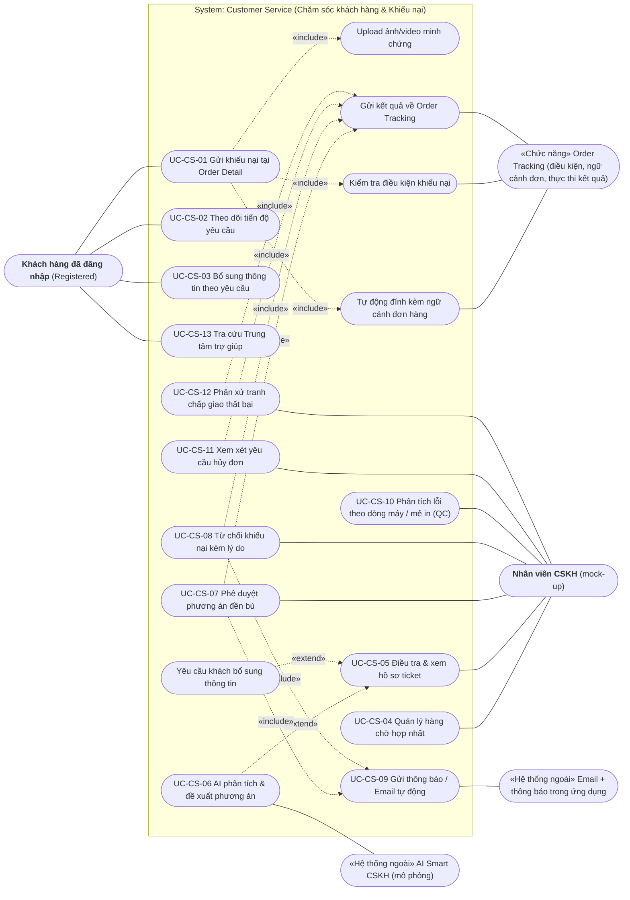

> Thay đổi: bỏ actor "Production (In ấn)", "Promotion / Voucher", "Payment & Refund" và các UC "Tạo lệnh in lại", "Phát voucher đền bù", "Hoàn tiền" – thay bằng "Gửi kết quả về Order Tracking"; thêm UC-CS-11, 12, 13.

#### 8.6.2. Đặc tả Use Case

| UC | Thay đổi so với bản gốc (các bước không nêu: [GIỮ]) |
|---|---|
| UC-CS-01 | PRE 2: "Đơn thỏa `OT.canReportIssue` (Delivered/Completed ≤ 7 ngày, hoặc Delivery_Failed trong hạn lưu kho)"; PRE 3: "Đơn chưa có yêu cầu mở". MAIN bước 4: loại sự cố theo `IssueType`, chọn dòng sản phẩm; bước 8: tạo ticket `support_tickets` + OT chuyển Return_Requested (nguyên tử) |
| UC-CS-02 | [SỬA] Tên "Theo dõi tiến độ yêu cầu"; MAIN bước 1: mục "Yêu cầu hỗ trợ của tôi" (gồm khiếu nại và yêu cầu hủy) |
| UC-CS-03 | [GIỮ]; ALT Flow 2 quá hạn → FR-CS-07 |
| UC-CS-04 | [SỬA] Tên "Quản lý hàng chờ hợp nhất"; danh sách gồm 3 loại việc kèm SLA |
| UC-CS-05 | MAIN bước 2: hiển thị phiên bản thiết kế, nhật ký trạng thái/giao hàng, PolicyConsent (tham chiếu OT/DES) |
| UC-CS-06 | Actor phụ: «Hệ thống ngoài» AI (mô phỏng); thêm nhánh tóm tắt cục bộ khi dịch vụ lỗi |
| UC-CS-07 | [SỬA] Actor phụ: **«Chức năng» Order Tracking** (thay Production, Promotion, Payment). MAIN bước 8: "Hệ thống gọi OT `apply_ticket_result(order, resolution, note)`; OT thực thi in lại / voucher đền bù / RefundRequest S4". ALT Flow 2: "OT lỗi" thay "Module ngoài lỗi" |
| UC-CS-08 | MAIN bước 6: gọi OT `apply_ticket_result(order, 'Rejected', reason)` |
| UC-CS-09 | Actor phụ: «Hệ thống ngoài» Email; thông báo trong ứng dụng lưu bảng `notifications` |
| UC-CS-10 | MAIN bước 3: thêm nhóm theo mẻ in, mẫu thiết kế |
| UC-CS-11 | [MỚI] **Xem xét yêu cầu hủy đơn.** Actor: Nhân viên CSKH. Trigger: yêu cầu hủy mới trong hàng chờ. PRE: đơn có CancelRequest Pending. MAIN: 1 Mở yêu cầu (đơn, lý do, hạn phản hồi). 2 Chọn Chấp nhận → OT `decide_cancel_request(accept)`: đơn Cancelled, hoàn kho, RefundRequest S1. ALT 2.1 Từ chối (lý do bắt buộc) → đơn tiếp tục xử lý. EXC: quá hạn → FR-CS-EX-20; khách đã rút yêu cầu → thông báo, đóng mục |
| UC-CS-12 | [MỚI] **Phân xử tranh chấp nguyên nhân giao thất bại.** Actor: Nhân viên CSKH; «Hệ thống ngoài» 3PL. Trigger: ticket loại `Dispute_Failure_Cause`. MAIN: 1 Xem nguyên nhân, bằng chứng khách, nhật ký giao hàng. 2 Đối soát với 3PL (mô phỏng). 3 Chọn giữ nguyên / đổi bên chịu lỗi → OT cập nhật nguyên nhân và cộng bù hạn lưu kho. EXC: 3PL không phản hồi → giữ tạm dừng, nhắc lại sau 1 ngày |
| UC-CS-13 | [MỚI] **Tra cứu Trung tâm trợ giúp.** Actor: Khách (kể cả vãng lai). MAIN: xem FAQ, chính sách; ALT: tạo yêu cầu "Hỏi đáp" (cần đăng nhập) |

#### 8.6.3. BPMN-CS [SỬA]

```mermaid
flowchart LR
subgraph Lane_KH ["Khách hàng (Customer)"]
n7(("Nhận hàng, phát hiện lỗi"))
n9["Mở Order Detail → Báo sự cố (UC-CS-01)"]
n10(("Không đủ điều kiện: hiển thị lý do"))
n12["Chọn loại sự cố, dòng sản phẩm, mô tả, upload ảnh/video, phương án mong muốn"]
n13["Bổ sung thông tin (UC-CS-03)"]
n14["Xem Timeline, đánh giá CSAT (UC-CS-02)"]
n15(("Yêu cầu được giải quyết"))
end
subgraph Lane_SYS ["Hệ thống CS (Ticket Engine)"]
n17["Gọi OT.canReportIssue (FR-CS-01)"]
n18{"Hợp lệ?"}
n20["Đính kèm ngữ cảnh: mã đơn, dòng máy, phiên bản thiết kế, nhật ký giao hàng (FR-CS-02)"]
n21["Tạo ticket (New) + OT chuyển Return_Requested – nguyên tử (FR-CS-04)"]
n22["Gọi AI: tóm tắt, sentiment, đề xuất (FR-CS-08)"]
n23["Gửi xác nhận đã nhận yêu cầu (FR-CS-09)"]
n24["Ghi resolution & audit log; gọi OT apply_ticket_result (FR-CS-10)"]
n25["Cập nhật Timeline & gửi thông báo (FR-CS-09)"]
end
subgraph Lane_AD ["Nhân viên CSKH (mock-up)"]
n26["Nhận ticket từ hàng chờ hợp nhất, điều tra hồ sơ + gợi ý AI → Investigating (UC-CS-04/05/06)"]
n27{"Đủ thông tin?"}
n29["Yêu cầu bổ sung (Waiting_Customer, hạn 3 ngày) (FR-CS-07)"]
n30{"Quyết định?"}
n32["Từ chối kèm lý do (UC-CS-08)"]
n33["Phê duyệt: Reprint / Voucher / Refund (UC-CS-07)"]
end
subgraph Lane_EXT ["Chức năng & dịch vụ liên quan"]
n35["Order Tracking: điều kiện khiếu nại"]
n36["Order Tracking / Design Studio: đơn, phiên bản thiết kế, nhật ký giao hàng"]
n37["«Ngoài» AI Smart CSKH (mô phỏng)"]
n38["«Ngoài» Email + thông báo trong ứng dụng"]
n39["Order Tracking: thực thi in lại / voucher đền bù / RefundRequest; cập nhật trạng thái đơn"]
end
n7 --> n9 --> n17 --> n18
n18 -- "Không" --> n10
n18 -- "Có" --> n20 --> n12 --> n21 --> n22 --> n23 --> n26 --> n27
n27 -- "Chưa" --> n29 --> n13 --> n26
n27 -- "Đủ" --> n30
n30 -- "Rejected" --> n32 --> n24
n30 -- "Approved" --> n33 --> n24
n24 --> n25 --> n14 --> n15
n17 -.-> n35
n20 -.-> n36
n22 -.-> n37
n23 -.-> n38
n24 -.-> n39
n25 -.-> n38
```

> Thay đổi: mã FR trong các nút được sửa đúng với bảng FR (bản gốc ghi lệch: "Gọi AI (FR-CS-06)", "Tạo Ticket (FR-CS-03)"…); bỏ pool Production/Payment; thêm bước nguyên tử tạo ticket + cập nhật đơn.

#### 8.6.4. Class Diagram – CD-CS [SỬA]

```mermaid
classDiagram
direction TB
class SupportTicket { -ticketId: UUID -ticketCode: String -kind: COMPLAINT | DISPUTE | INQUIRY -orderId: UUID [0..1] -orderItemIds: UUID[] -customerId: UUID -assignedStaffId: UUID [0..1] -issueType: IssueType -description: String -preferredResolution: Resolution [0..1] -status: TicketStatus -priority: int -slaDueAt: DateTime -firstResponseAt: DateTime [0..1] -resolvedAt: DateTime [0..1] -createdAt: DateTime +submit() void +changeStatus(next, by) void +isOpen() boolean }
class Evidence { -evidenceId: UUID -ticketId: UUID -mediaType: image | video -storagePath: String -fileHash: String -uploadedAt: DateTime }
class TicketStatusHistory { -historyId: UUID -ticketId: UUID -changedBy: UUID -fromStatus: TicketStatus -toStatus: TicketStatus -changedAt: DateTime -note: String }
class AdditionalInfoRequest { -requestId: UUID -ticketId: UUID -question: String -dueAt: DateTime -respondedAt: DateTime [0..1] +isOverdue() boolean }
class AIAnalysis { -analysisId: UUID -ticketId: UUID -summary: String -sentiment: String -urgencyScore: float -suggestedAction: Resolution -confidence: float -source: external | local_rules -version: int }
class Resolution { <<enumeration>> REPRINT VOUCHER REFUND REJECTED }
class TicketDecision { -ticketId: UUID -resolution: Resolution -approvedBy: UUID -note: String -compensationCost: Money -appliedToOrderAt: DateTime [0..1] }
class CsatSurvey { -surveyId: UUID -ticketId: UUID -score: int -comment: String -submittedAt: DateTime }
class HelpArticle { -id: String -title: String -body: String -keywords: String[] -link: String }
class OrderTrackingPort { <<interface – chức năng OT>> +canReportIssue(orderId) Eligibility +context(orderId) OrderContext +applyTicketResult(orderId, resolution, note) void +decideCancelRequest(requestId, decision, reason) void +resolveDispute(orderId, newCause) void }
class TicketStatus { <<enumeration>> NEW INVESTIGATING WAITING_CUSTOMER APPROVED REJECTED RESOLVED }
class IssueType { <<enumeration>> PRINT_DEFECT WRONG_DESIGN_OR_MODEL TRANSIT_DAMAGE NOT_RECEIVED DISPUTE_FAILURE_CAUSE INQUIRY }
SupportTicket "1" *-- "0..*" Evidence : has
SupportTicket "1" *-- "1..*" TicketStatusHistory : logged_in
SupportTicket "1" *-- "0..*" AdditionalInfoRequest : requests
SupportTicket "1" -- "0..*" AIAnalysis : analyzed_by
SupportTicket "1" -- "0..1" TicketDecision : resolved_by
SupportTicket "1" -- "0..1" CsatSurvey : rated_in
SupportTicket ..> OrderTrackingPort : điều kiện & thực thi
SupportTicket ..> TicketStatus
SupportTicket ..> IssueType
TicketDecision ..> Resolution
```

> Thay đổi: khóa chính `int` → `UUID`; bỏ lớp `User`, `OrderItem`, `Notification` tự định nghĩa (dùng `profiles`, `order_items`, `notifications` dùng chung); `ComplaintTicket` → `SupportTicket` (thêm loại DISPUTE, INQUIRY); `canvasJson`, `deliveryLogJson` sao chép → tham chiếu qua `OrderTrackingPort.context`; `ResolutionType` hợp nhất với `Resolution` chung; `APPROVED_REPRINT` → `APPROVED` (phương án ghi ở `TicketDecision`); thêm `HelpArticle`.

---

## 9. Quy trình tổng thể liên chức năng

### 9.1. BPMN cấp 0 – Hành trình mua hàng end-to-end [MỚI]

```mermaid
flowchart LR
subgraph KH["Khách hàng (vãng lai / thành viên)"]
s((Có nhu cầu ốp)) --> entry{Lối vào}
end
subgraph DISC["Khám phá"]
SRCH["SRCH: từ khóa / mô tả / ảnh"]
SH1["SH: duyệt, lọc, PDP, 3D"]
DES["DES: kho mẫu → Canvas → kiểm tra sẵn sàng in"]
end
subgraph ACC["Định danh"]
AUTH["AUTH: đăng nhập / đăng ký + Guest Session Contract"]
PM["PM: Onboarding, sổ địa chỉ"]
end
subgraph BUY["Mua hàng"]
CART["SH: giỏ hàng (vãng lai được), tồn kho"]
PAY["P: Checkout, EDD (OT), voucher, PolicyConsent, kiểm tra tồn kho → cổng thanh toán (ngoài) → place_order"]
end
subgraph FUL["Thực hiện đơn (OT)"]
INT["Order intake"] --> CUS{Có hàng CUSTOM?}
CUS -- có --> MOD["Operator duyệt thiết kế (Pending_Review)"]
MOD -- từ chối --> AR["Action_Required → sửa trên DES (≤2) / hủy → RefundRequest S2"]
AR -- gửi lại --> MOD
CUS -- không --> PACK
MOD -- duyệt --> PROD["Chốt mẻ 16:00 (batch_id) → in, QC"] --> PACK["Đóng gói"]
PACK --> SHIP["Giao vận (3PL ngoài – mô phỏng)"]
SHIP -- thất bại --> FAIL["Lưu kho 14 ngày → giao lại 1 lần / hủy"]
SHIP -- giao --> DLV["Delivered → xác nhận / tự hoàn thành 72h"]
end
subgraph AFTER["Hậu mãi"]
CS["CS: ticket, hàng chờ hợp nhất → apply_ticket_result"]
REF["OT: RefundRequest → Admin chuyển khoản (ngân hàng ngoài)"]
LOY["Loyalty (ngoài): earn / revoke"]
end
entry --> SRCH & SH1 & DES
SRCH -- "?template / ?y=" --> DES
SRCH --> SH1
SH1 -- "Tự thiết kế" --> DES
DES -- "lưu / thêm giỏ (vãng lai → đăng nhập)" --> AUTH
SH1 --> CART
DES -- "Line item CUSTOM 250.000đ" --> CART
CART --> PAY
PAY -- "chưa đăng nhập" --> AUTH --> PM
PAY --> INT
DLV --> LOY
DLV -- "Báo sự cố ≤ 7 ngày" --> CS
FAIL -- "Tranh chấp nguyên nhân" --> CS
CS -. "kết quả" .-> PROD & REF & DLV
AR & FAIL -.-> REF
DLV --> e1((Completed))
REF --> e2((Cancelled / Refunded))
```

### 9.2. Use Case tổng quát hệ thống [MỚI]

```mermaid
flowchart LR
G(["Khách vãng lai"])
M(["Khách thành viên"])
OP(["Operator (mock-up)"])
CSK(["Nhân viên CSKH (mock-up)"])
AD(["Admin (mock-up)"])
SYS(["Scheduler (pg_cron)"])
subgraph CaseEYE["casEYES – Thương mại điện tử ốp lưng cá nhân hóa"]
U1([Tìm kiếm & gợi ý])
U2([Duyệt sản phẩm / PDP 3D])
U3([Thiết kế ốp trên Canvas])
U4([Đăng ký / Đăng nhập / Khôi phục MK])
U5([Quản lý hồ sơ, sổ địa chỉ, My Designs])
U6([Quản lý giỏ hàng])
U7([Thanh toán & đặt hàng])
U8([Theo dõi / hủy / nhận đơn / giao lại])
U9([Khiếu nại & theo dõi yêu cầu])
U10([Duyệt thiết kế, sản xuất, đóng gói, mô phỏng giao vận])
U11([Hàng chờ CSKH: khiếu nại, yêu cầu hủy, tranh chấp])
U12([Duyệt & xác nhận hoàn tiền, khách rủi ro cao, thống kê])
U13([Chốt mẻ, tự hoàn thành, tự hủy quá hạn, nhắc nhở])
end
G --- U1 & U2 & U3 & U4 & U6
M --- U1 & U2 & U3 & U5 & U6 & U7 & U8 & U9
OP --- U10
CSK --- U11
AD --- U12
SYS --- U13
U7 -.- PG[["«Ngoài» Cổng thanh toán"]]
U7 -.- INV[["«Ngoài» Inventory"]]
U4 -.- GO[["«Ngoài» Google OAuth / Email"]]
U10 -.- TPL[["«Ngoài» 3PL"]]
U11 -.- AI[["«Ngoài» AI CSKH"]]
U13 -.- LOY[["«Ngoài» Loyalty"]]
U12 -.- BANK[["«Ngoài» Ngân hàng"]]
```

### 9.3. Điểm chuyển giao giữa các chức năng

| Từ → Đến | Cơ chế | Dữ liệu | Chủ sở hữu dữ liệu | Khi bên nhận lỗi |
|---|---|---|---|---|
| SRCH → DES | Điều hướng `?template=`, `?y=` | id mẫu, ý tưởng (≤ 200 ký tự) | DES | DES mở Kho mẫu mặc định |
| SH/DES → AUTH | Modal đăng nhập + `GuestDataMerge` | khóa localStorage Bảng 1.1 | AUTH (hợp đồng) | Giữ dữ liệu vãng lai, thử lại lần đăng nhập sau |
| DES → SH | `CartState.add` | Custom line item (designId, version, preview) | SH | Toast lỗi, giữ Canvas |
| SH → P | Điều hướng `/checkout` | CartItem[] + priceAtAdd | P (phiên) | Quay lại giỏ |
| P → OT | RPC `place_order` (`checkout_ref`) | OrderHandoff | OT | FR-P-35 (thử lại / void) |
| OT → DES | Liên kết `?order=&action=edit-design`; RPC `resubmit_design` | phiên bản bản vẽ | DES (bản vẽ), OT (đơn) | Giữ Action_Required |
| OT ↔ CS | `createTicket` / `apply_ticket_result` / `decide_cancel_request` | ticket, resolution | CS (ticket), OT (đơn) | Không đổi trạng thái đơn; thử lại |
| OT → SH | Sự kiện `OrderCancelled`, `DeliveryFailed` (outbox) | cause, customerFault | SH (RiskProfile) | Hàng đợi gửi lại |
| OT → Loyalty/Email/3PL/Ngân hàng | Interface ngoài (outbox) | Mục 0.3 | Hệ thống ngoài | Hàng đợi gửi lại |
| PM → OT/CS | `list_open_orders`, refund/cancel/ticket mở | BlockReason[] | OT, CS | Chặn xóa, cho thử lại |

---

## Phụ lục A. Ma trận truy vết sửa lỗi silo

| Mã silo | Mức | Chức năng | Đã khắc phục tại |
|---|---|---|---|
| A1 | 🔴 | AUTH | BR-AUTH-06, FR-AUTH-08/09, UC-AUTH-04, CD-AUTH |
| A2 | 🟠 | AUTH/PM | BR-PM-04/07, FR-PM-17/18, UC-AUTH-01 bước 9 |
| A3 | 🟠 | AUTH | FR-AUTH-03, Bảng 1.1 |
| P1 | 🔴 | PM | BR-PM-10/14, mục 0.3 |
| P2 | 🟠 | PM | FR-PM-05 → VoucherRegistry (P) |
| P3 | 🟠 | PM | FR-PM-10, CD-PM `DeletionEligibility` |
| P4 | 🟠 | PM | BPMN-PM-01…03 (đổi lane) |
| P5 | 🟠 | PM | BR-PM-15, FR-PM-26, UC-PM-04 |
| S1 | 🔴 | SH | Mục 3.3 (bộ FR-SH mới) |
| S2 | 🔴 | SH/SRCH | BR-SH-02 [CHUYỂN], UC-SH-02 [CHUYỂN], R1 |
| S3 | 🔴 | SH/OT | UC-SH-09 [CHUYỂN], FR-SH-17 |
| S4 | 🟠 | SH/P | FR-SH-14, FR-P-18 |
| S5 | 🟠 | SH/P | BR-SH-04, FR-SH-18, BR-P-05, FR-P-12 |
| S6 | 🟠 | SH | Mục 0.3, FR-SH-13 |
| S7 | 🟠 | SH/DES | BR-SH-07, FR-SH-06 |
| Y1 | 🔴 | P/OT | Mục 6.1, FR-P-35, FR-OT-13 |
| Y2 | 🔴 | P/OT | BR-P-01, FR-P-25 [BỎ], CD-P `CheckoutSession` |
| Y3 | 🟠 | P/OT | BR-P-13, FR-P-30 |
| Y4 | 🟠 | P | BR-P-12, FR-P-34, `VoucherRegistry` |
| Y5 | 🟠 | P | BR-P-09, FR-P-14 |
| D1 | 🔴 | DES/OT | BR-DES-13, FR-DES-27, FR-OT-15 |
| D2 | 🔴 | DES/OT | BR-DES-15, UC-DES-05 |
| D3 | 🟠 | DES | CD-DES (thu hẹp) |
| D4 | 🟠 | DES/SRCH | FR-DES-05/06, FR-SRCH-07 |
| D5 | 🟠 | DES/SRCH/CS | Bảng 0.6 |
| O1 | 🔴 | OT | Mục 0.3, FR-OT-22, CD-OT |
| O2 | 🟠 | OT/CS | Mục 0.5, Bảng 8.1 |
| O3 | 🟠 | OT/P | BR-P-01 |
| O4 | 🟠 | OT | FR-OT-09/10, `InventoryGateway` |
| C1 | 🔴 | CS | UC-CS-01 PRE, FR-CS-01 |
| C2 | 🔴 | CS/OT | FR-CS-10, FR-OT-16, BPMN-CS |
| C3 | 🔴 | CS | UCD-CS, UC-CS-07 |
| C4 | 🟠 | CS | Mục 0.5, CD-CS |
| C5 | 🟠 | CS | CD-CS |
| C6 | 🟠 | CS | BR-CS-07, UC-CS-11/12 |
| R1 | 🔴 | SRCH | BR-SRCH-06, FR-SRCH-08 |
| R2 | 🟠 | SRCH/DES | FR-SRCH-07, FR-DES-06 |
| R3 | 🟠 | SRCH | FR-SRCH-12 |
| R4 | 🟠 | SRCH/CS | FR-SRCH-13, BR-CS-08, FR-CS-14 |

**Độ bao phủ edge case:** mỗi chức năng được đối chiếu với danh sách ngoại lệ hợp nhất từ (1) bảng EX/EXC của tài liệu gốc, (2) mục "Edge case" của tài liệu góp ý silo, (3) các ngoại lệ phát hiện khi đối chiếu mã nguồn. Toàn bộ ngoại lệ đã xác định đều có mã EX tương ứng:

| Chức năng | Số ngoại lệ đã xác định | Có mã EX trong v3 |
|---|---|---|
| AUTH | 14 | 14 |
| PM | 15 | 15 |
| SH | 16 | 16 |
| SRCH | 16 | 16 |
| DES | 20 | 20 |
| P | 20 | 20 |
| OT | 26 | 26 |
| CS | 22 | 22 |

---

## Phụ lục B. Danh sách lỗi mã nguồn phát hiện khi đối chiếu

> Các lỗi dưới đây làm hành vi thực tế lệch đặc tả v3; ưu tiên P0 nên sửa trước khi trình diễn.

| # | Ưu tiên | Chức năng | Lỗi | Vị trí | Yêu cầu liên quan |
|---|---|---|---|---|---|
| B1 | P0 | AUTH/PM | `profiles.onboarding_status` NOT NULL, CHECK chỉ cho `completed/skipped`, không có giá trị mặc định – trigger tạo hồ sơ không đặt cột này → đăng ký mới có thể lỗi trên CSDL dựng từ migration; ứng dụng lại dựa vào `pending` | `20261029130000_update_profiles_for_onboarding.sql`, `handle_new_user()` | FR-AUTH-EX-13, BR-PM-07 |
| B2 | P0 | AUTH | Sau khi đặt lại mật khẩu điều hướng về `/login` (không tồn tại → 404) | `features/auth/auth.ts` | FR-AUTH-06 |
| B3 | P0 | AUTH | Người đã đăng nhập mở `/auth/reset-password` đổi được mật khẩu không cần mật khẩu cũ | `auth.routes.ts`, `auth.ts` | FR-AUTH-EX-07 |
| B4 | P0 | SH/P | Phụ kiện thêm giỏ với `custom: true` → Checkout coi là CUSTOM, khóa COD và `place_order` lỗi "Chưa có dòng máy Phụ kiện" | `shop-cart.ts` (addAccessory) | FR-SH-08, FR-P-EX-17 |
| B5 | P0 | SH/P | Dữ liệu catalog phía giao diện (33 mẫu, 5 dòng máy) lệch seed CSDL (thiếu biến thể `iphone-15-pro-max`) → đặt hàng thật lỗi "chưa có trong kho" với đa số sản phẩm | `features/shop/catalog.ts`, `20261114100600_seed_catalog.sql` | FR-SH-13, FR-P-15 |
| B6 | P0 | P | `placedOrderCode` không được reset giữa hai lần checkout → lần thứ hai có thể bỏ qua tạo đơn và trỏ về mã đơn cũ | `checkout.ts` | FR-P-09, FR-P-EX-15 |
| B7 | P0 | P | `/checkout` không có guard → khách vãng lai tạo đơn trong kho mock | `app.routes.ts` | FR-P-01, FR-P-EX-16 |
| B8 | P0 | P | Thanh toán mô phỏng thành công nhưng `place_order` lỗi → khách "đã trả tiền" mà không có đơn | `checkout.ts` | FR-P-35 |
| B9 | P1 | P | Máy chủ tin phí giao và giảm giá do trình duyệt gửi | `place_order` RPC | FR-P-EX-14 |
| B10 | P1 | P | Mã đơn hiển thị ở trang thành công là mã mẫu `CE-89421`; nội dung chuyển khoản cố định; mã giao dịch đầu cố định; CASEFIRST tự áp sẵn | `checkout.service.ts`, `checkout-success.html` | FR-P-11, 23, 27, 34 |
| B11 | P1 | DES | Modal cảnh báo đổi dòng máy không bao giờ hiện (gọi `selectModel` trước `requestModelChange`) | `design-studio.ts`, `studio-workspace.ts`, `template-browser.ts` | FR-DES-02 |
| B12 | P1 | DES/PM | My Designs lưu localStorage dùng chung mọi tài khoản trên trình duyệt, khớp theo tên | `studio-state.ts` | FR-DES-18, FR-PM-EX-15 |
| B13 | P1 | DES/P | Checkout tạo bản ghi `designs` với `canvas_json = {}` → xưởng không có file in | `order-tracking.service.ts` (placeRemoteOrder) | FR-P-16 |
| B14 | P1 | DES | Dòng máy không có 3D không tạo ảnh preview cho dòng giỏ | `studio-workspace.ts` (sync3dTexture) | FR-DES-21 |
| B15 | P1 | OT/CS | Khi đăng nhập, `report_issue` bỏ loại sự cố, mô tả, bằng chứng; không có bảng ticket | `20261114100400_order_rpcs.sql` | FR-OT-11, FR-CS-04 |
| B16 | P1 | OT | Giao lại lần 2 thất bại mở hạn lưu kho mới (bỏ qua `redelivery_used`); hàng có sẵn không được hoàn kho khi hủy sau giao thất bại | `apply_carrier_event`, `run_order_jobs` | FR-OT-09, FR-OT-EX-23 |
| B17 | P1 | OT | In lại (Reprint) hàng có sẵn vẫn về `In_Production` trong SQL | `apply_ticket_result` | FR-OT-16 |
| B18 | P1 | OT | Đơn COD không bao giờ chuyển `paid` → khiếu nại hoàn tiền không tạo được RefundRequest | `orders.payment_status` | FR-OT-21 |
| B19 | P2 | PM | Biểu mẫu hồ sơ bắt buộc nhập SĐT nhưng không lưu; email sửa được nhưng không lưu | `profile-tab.ts` | FR-PM-EX-13 |
| B20 | P2 | SH | Liên kết tên mặt hàng thiết kế trong giỏ dẫn tới `/shop/design` (không tồn tại) | `cart.html` | FR-SH-EX-14 |
| B21 | P2 | SRCH | Văn bản tìm kiếm mọi sản phẩm chứa tất cả tên dòng máy; nguồn mẫu thiết kế không thử lại khi lỗi; chế độ ảnh không được ghi nhật ký | `features/shop/search-source.ts`, `features/design-studio/search-source.ts`, `search.service.ts` | FR-SRCH-EX-08, EX-12, FR-SRCH-12 |
| B22 | P2 | OT | Sự kiện webhook bị từ chối không được ghi khi đã đăng nhập (bị hoàn tác cùng giao dịch) | `apply_carrier_event` | FR-OT-EX-02 |
| B23 | P2 | OT | Công cụ mô phỏng (tạo đơn mẫu, tua giờ, chạy job) chỉ tác động kho mock cục bộ, không tác động Supabase | `demo-console.ts` | FR-OT-07 |
| B24 | P2 | AUTH | Cấu hình Supabase cục bộ khai báo redirect `/auth/callback`, `/onboarding` không tồn tại trong ứng dụng | `supabase/config.toml` | FR-AUTH-05/06 |
