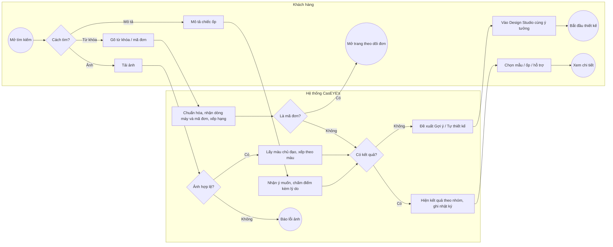

# BRD + SRD: Function Tìm kiếm và Gợi ý ốp theo mô tả

Phiên bản 1.0 · 15/11/2026 · Nhánh `integration/local` · Sơ đồ quy trình: [`tim-kiem.bpmn`](tim-kiem.bpmn) (mở bằng Camunda Modeler hoặc demo.bpmn.io)

---

## Phần A. BRD (yêu cầu nghiệp vụ)

### A1. Bối cảnh và vấn đề

Trước khi làm function này, web có ba ô tìm kiếm rời nhau:

- ô ở header chỉ tìm hàng có sẵn của Shop;
- Shop có ô lọc riêng;
- Design Studio có bộ lọc riêng.

Khách gõ "mèo" ở header sẽ không thấy mẫu thiết kế mèo. Khách chưa biết gọi tên mẫu thì không có cách nào được gợi ý.

### A2. Mục tiêu

| # | Mục tiêu | Cách đo |
|---|---|---|
| M1 | Một ô tìm kiếm duy nhất cho cả site: ốp có sẵn, mẫu thiết kế, trang hỗ trợ | Không còn ô tìm thứ hai trong Shop, Design Studio |
| M2 | Khách mô tả bằng lời vẫn ra mẫu hợp ý | Tỷ lệ tìm "không có kết quả" (nhật ký từ khóa) giảm |
| M3 | Không có kết quả thì vẫn có đường đi tiếp | Nút "Tự thiết kế với ý tưởng này" luôn có mặt khi rỗng |
| M4 | Tra đơn nhanh bằng mã | Dán `CC-…` là mở thẳng đơn |

### A3. Phạm vi

**Trong phạm vi**
- Tìm theo từ khóa.
- Gợi ý theo mô tả (✨).
- Tìm bằng ảnh (theo màu chủ đạo).
- Lối tắt mã đơn.
- Trang kết quả `/tim-kiem`.
- Nhật ký từ khóa không chứa dữ liệu cá nhân.

**Ngoài phạm vi**
- Danh sách đơn hàng trong ô tìm. Danh sách đơn vẫn nằm ở Tài khoản; trang admin giữ ô lọc tại chỗ của nó.
- Máy chủ tìm kiếm riêng.
- Gọi mô hình AI bên ngoài.

### A4. Các bên liên quan

| Bên | Quan tâm |
|---|---|
| Khách hàng | Tìm đúng mẫu nhanh, được gợi ý khi chưa biết gọi tên |
| Shop (Mai Anh), Design Studio | Sản phẩm / mẫu của mình được tìm thấy; không phải giữ ô tìm riêng |
| Quản lý đơn hàng (Thy) | Lối tắt mã đơn, trang chính sách được tìm thấy |
| Vận hành | Biết khách hay tìm gì, tìm gì mà không ra |

### A5. Quy tắc nghiệp vụ

- **BR1.** Ô tìm không liệt kê đơn hàng. Chỉ khi chuỗi gõ đúng dạng mã `CC-xxxxxx-xxxx` mới hiện lối tắt "Mở đơn". Trang đơn tự kiểm tra quyền xem.
- **BR2.** Trang hỗ trợ chỉ hiện khi chính chữ của trang khớp rõ (tối đa 2 mục), để không lấn kết quả sản phẩm.
- **BR3.** Hàng tạm hết vẫn hiện nhưng xếp sau và có nhãn "Tạm hết".
- **BR4.** Gợi ý theo mô tả phải ghi lý do ("Vì hợp với: tím · pastel"). Nếu mô tả không chứa ý muốn nào nhận ra được thì không đưa gợi ý ngẫu nhiên.
- **BR5.** Ảnh tải lên chỉ xử lý trong trình duyệt, không gửi đi đâu.
  - Định dạng: JPG, PNG hoặc WebP.
  - Dung lượng: tối đa 5 MB.
- **BR6.** Nhật ký tìm kiếm chỉ lưu: từ khóa, số kết quả, cách tìm, thời điểm. Không lưu ai tìm.

---

## Phần B. SRD (yêu cầu hệ thống)

### B1. Yêu cầu chức năng

| Mã | Yêu cầu | Tiêu chí chấp nhận |
|---|---|---|
| FR1 | Mở tìm kiếm | Có ba cách mở: bấm ô ở header, phím Ctrl K, hoặc nút ✨ ở header / Design Studio. Lớp phủ mở với con trỏ sẵn trong ô. Esc đóng |
| FR2 | Trước khi gõ | Hiện: Tìm gần đây (8, có nút Xóa), Từ khóa phổ biến, Dòng máy, 4 mẫu đang hot |
| FR3 | Khi gõ (sau 150 ms) | Kết quả chia nhóm: Mẫu thiết kế (3), Ốp có sẵn (3), Hỗ trợ (≤ 2). Cuối có nút "Xem tất cả N kết quả". ↑↓ di chuyển giữa các kết quả |
| FR4 | Hiểu tiếng Việt | Gõ không dấu vẫn ra ("hoa la" ra Hoa lá). Gõ sai 1 chữ với từ từ 4 ký tự vẫn ra. Từ đồng nghĩa có tác dụng ("dẻo" ra ốp TPU). Từ ngắn dưới 4 ký tự không bị khớp như tiền tố ("hoa" không ra "hoàn") |
| FR5 | Nhận dòng máy | "ốp mèo ip15 pro max" hiện "dòng máy iPhone 15 Pro Max" và tìm "ốp mèo" |
| FR6 | Lối tắt mã đơn | Gõ `cc-261115-0001` hiện "📦 Mở đơn CC-261115-0001". Enter mở `/order-tracking/CC-261115-0001` |
| FR7 | Gợi ý theo mô tả | Ô nhập nhiều dòng, có câu mẫu. Hiện "Mình hiểu bạn muốn: …" và tối đa 12 thẻ kèm lý do. Có nút "Tự thiết kế với ý tưởng này" |
| FR8 | Tìm bằng ảnh | Ảnh sai định dạng hoặc quá 5 MB thì báo lỗi. Ảnh hợp lệ hiện ảnh thu nhỏ, màu chủ đạo và 12 mẫu gần màu nhất |
| FR9 | Trang kết quả `/tim-kiem?q=` | Có tab Tất cả / Mẫu thiết kế / Ốp có sẵn (kèm số lượng), lọc phong cách (≤ 6 chip phổ biến nhất), sắp xếp theo phù hợp hoặc giá. Không có ô tìm thứ hai: nút "Sửa tìm kiếm" mở lại lớp phủ |
| FR10 | Không có kết quả | Có hai nút: "✨ Gợi ý theo mô tả" và "Tự thiết kế với ý tưởng này". Nút thứ hai mở `/design-studio/templates?y=<ý tưởng>`, ở đó hiện băng "Ý tưởng của bạn" với nút "Bắt đầu từ phôi trắng" |
| FR11 | Mở mẫu từ kết quả | Thẻ mẫu dẫn tới `/design-studio/templates?template=<id>`, trang tự mở cửa sổ chi tiết mẫu đó |
| FR12 | Gỡ ô trùng | Shop không còn tìm bằng ảnh hay ô tìm riêng. Shop vẫn nhận `?q=` từ link cũ, hiện "Đang lọc: … ✕" để bỏ lọc |

### B2. Yêu cầu phi chức năng

| Mã | Yêu cầu |
|---|---|
| NFR1 | Tính trên trình duyệt (kho dưới vài trăm mục). Kết quả hiện dưới 50 ms sau khoảng chờ gõ |
| NFR2 | Kho mẫu Design Studio nạp lười (dynamic import) để không làm nặng trang đầu |
| NFR3 | Truy cập: role dialog/tab, `aria-live` cho kết quả, dùng được hoàn toàn bằng bàn phím, nút cao tối thiểu 40–44 px |
| NFR4 | Quy ước kiến trúc: `core` không import `features`. Mỗi function tự khai báo nguồn tìm kiếm qua token `SEARCH_SOURCES` trong `app.config.ts` |
| NFR5 | Riêng tư: ảnh không rời máy; nhật ký không có dữ liệu cá nhân (BR5, BR6) |

### B3. Thiết kế kỹ thuật (tóm tắt)

| Lớp | Tệp | Vai trò |
|---|---|---|
| Lõi thuần (không Angular) | `shared/search/normalize-vi.ts`, `lexicon.ts`, `rank.ts`, `search.types.ts` | Bỏ dấu, khái niệm (màu, phong cách, chủ đề, dịp, chất liệu), dòng máy, mã đơn; xếp hạng chữ, gợi ý theo mô tả, xếp theo màu |
| Dịch vụ | `core/search/search.service.ts` | Gom nguồn, trạng thái lớp phủ, tìm gần đây, nhật ký, thống kê |
| Giao diện | `core/search/search-overlay/*`, `core/search/search-card/*`, `features/search/search-page.*` | Lớp phủ, thẻ kết quả, trang `/tim-kiem` |
| Nguồn dữ liệu | `features/shop/search-source.ts`, `features/design-studio/search-source.ts`, `features/order-tracking/search-source.ts` | Ốp + phụ kiện; mẫu thiết kế; mục chính sách + CSKH |

**Điểm xếp hạng mỗi từ** (lấy mức cao nhất đạt được):

| Khớp ở đâu | Điểm |
|---|---|
| Trùng nguyên một từ trong tên | 6 |
| Đầu một từ trong tên | 5 |
| Phụ đề | 3 |
| Mô tả, tag | 2 |
| Sai 1 chữ | 1,5 |

Cộng thêm vào tổng điểm:

- khớp khái niệm: +3;
- khớp cả cụm trong tên: +6;
- độ phổ biến (boost): +0,5 × boost;
- tạm hết hàng: −2.

Cần khớp ít nhất 60% số từ, hoặc khớp một khái niệm.

**Gợi ý theo mô tả:** điểm theo nhóm khái niệm.

| Nhóm | Trọng số |
|---|---|
| Chủ đề | 4 |
| Phong cách | 3 |
| Màu | 2,5 |
| Chất liệu | 1,5 |
| Dịp | 1 |

Lý do hiển thị chính là các khái niệm khớp.

### B4. Kiểm thử

- Unit: `shared/search/rank.spec.ts` có 9 ca (bỏ dấu, sai chữ, từ đồng nghĩa, dòng máy, mã đơn, gợi ý có lý do, mô tả vô nghĩa thì không gợi ý, tiền tố ngắn, màu). Kết quả: 9/9 đạt.
- Thử trên trình duyệt:
  - Ctrl K mở lớp phủ;
  - "mèo ip15 pro max" ra mẫu mèo và nhận đúng dòng máy;
  - mô tả "ốp tím pastel dễ thương tặng bạn gái" ra 12 gợi ý có lý do;
  - `/tim-kiem?q=hoa` ra 10 kết quả, không lẫn trang "hoàn tiền";
  - `/tim-kiem?q=hủy đơn` ra 2 trang hỗ trợ;
  - `?template=` mở đúng mẫu; `?y=` hiện băng ý tưởng.

### B5. Hướng phát triển

- Khi bảng `products` trên Supabase đủ dữ liệu, `ShopSearchSource` đọc từ đó thay cho `catalog.ts`.
- Đưa nhật ký từ khóa lên một bảng Supabase để admin xem thống kê thật. Hiện thống kê có sẵn trong `SearchService.stats`, chưa gắn màn admin.
- "Gợi ý theo mô tả" có thể thay lõi luật bằng mô hình ngôn ngữ, giữ nguyên giao diện và cách hiện lý do.

---

## Phụ lục. Quy trình (BPMN, một tiến trình, không subprocess)

Bản chuẩn là [`tim-kiem.bpmn`](tim-kiem.bpmn) (BPMN 2.0, có tọa độ vẽ). Bản xem nhanh:

